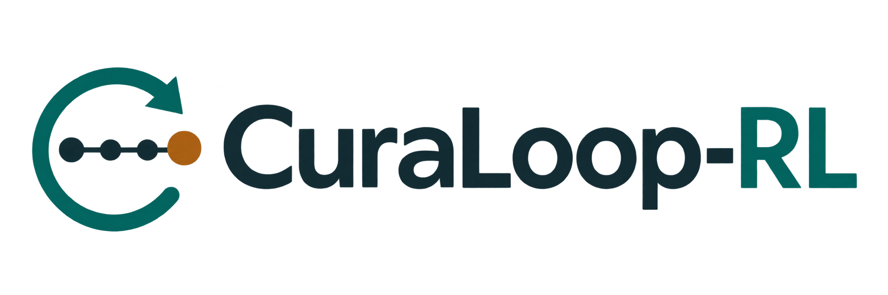
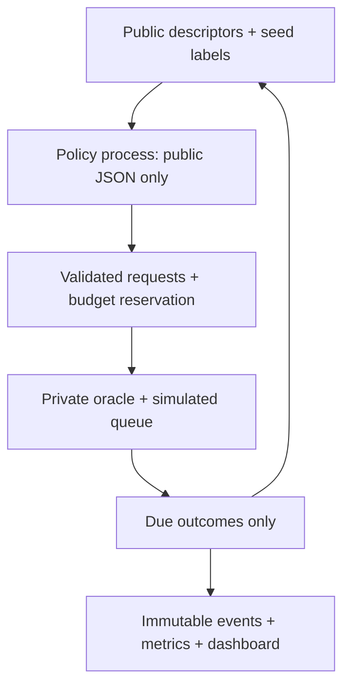

# Pharmaceutical Screening Decision Lab

**โครงการส่วนบุคคล · ไม่ใช่โครงการทางการของ GPO · Research demonstration only**

เลือกสารที่จะทดสอบภายใต้งบและความจุจำกัด เรียนรู้จากผลที่ส่งคืน แล้วเปรียบเทียบวิธีเลือกอย่างตรวจสอบซ้ำได้ แอปทำงานบน CPU ในเครื่อง ไม่มี API key, GPU หรือ cloud service ข้อมูลหลักเป็น **ผล assay จริงย้อนหลังจาก MoleculeNet HIV** พร้อม synthetic fixtures สำหรับทดสอบระบบ

## สิ่งที่รันได้จริง

- เว็บหลัก React + TypeScript + FastAPI 7 หน้า พร้อม Thai/English, explorer โครงสร้าง RDKit, simulation lab, comparison และ guided presentation
- Streamlit 4 หน้าเดิมเก็บไว้เป็น fallback ที่ `app/streamlit_app.py`
- Historical HIV replay 1,200 real molecules พร้อม Morgan fingerprints, scaffold IDs, provenance และ source hash
- Random, Greedy และ Uncertainty + **Q-learning / contextual bandit ที่ฝึกจริงบนโจทย์สังเคราะห์** พร้อม checkpoint และผลประเมินแยกต่างหาก
- Private label oracle, delayed feedback, pending queue, capacity, reserved/spent/remaining budget และ immutable public events
- Single-class fallback ที่บอกสถานะตามจริง; missing-outcome และ jitter scenarios; matched independent comparisons
- JSON / UTF-8 CSV export, paired-seed benchmark และ scaffold-disjoint predictor audit
- Pytest + Streamlit AppTest และคำสั่ง Windows ที่ไม่จำเป็นต้อง activate virtual environment

ไม่ใช่ระบบค้นพบยาที่มีประสิทธิผล ไม่ใช่เครื่องมือ GMP/clinical และไม่มีการเชื่อมแล็บหรือ operational Digital Twin

## เริ่มบน Windows

ติดตั้ง Python 3.11/3.12 แบบ 64 bit แล้วแตก ZIP ดับเบิลคลิก **`Start-CuraLoop-Web.cmd`** ครั้งแรกจะติดตั้ง dependencies ใน `.venv` ครั้งถัดไปเปิดเว็บจากข้อมูล/โมเดล/font ที่รวมไว้ได้โดยไม่ใช้อินเทอร์เน็ต เว็บเปิดที่ **http://127.0.0.1:8000** เท่านั้น ไม่ต้องมี Node สำหรับ release ที่รวม `frontend/dist` แล้ว ไม่ต้องใช้สิทธิ์ admin หรือเปลี่ยน execution policy

อ่าน [คู่มือ Windows ภาษาไทย](START_WINDOWS_TH.md) สำหรับ prerequisites, troubleshooting และโหมดนักพัฒนา การทดสอบจริงครั้งนี้ใช้ Linux/Python 3.12; Windows launcher ยังเป็น **NOT_RUN**

ทางเลือก PowerShell (พาธด้านล่างเป็นตัวอย่าง):

```powershell
cd C:\Projects\curaloop-rl
py -3.12 -m venv .venv
.\.venv\Scripts\python.exe -m pip install -r requirements-web-lock.txt
.\.venv\Scripts\python.exe -m pip install -e ".[web,dev]" --no-deps
.\.venv\Scripts\python.exe scripts\start_web.py
```

Streamlit fallback: `.\.venv\Scripts\python.exe -m streamlit run app\streamlit_app.py` (port 8501)

Linux/macOS:

```bash
python3.12 -m venv .venv
.venv/bin/python -m pip install -r requirements-web-lock.txt
.venv/bin/python -m pip install -e '.[web,dev]' --no-deps
.venv/bin/python scripts/start_web.py --no-browser
```

## สาธิต 5–7 นาที

1. Overview: ผล assay จริงย้อนหลัง กับ cost/time ที่จำลอง และคำถามการเลือกทดสอบ
2. Scenario: HIV / seed 42 / budget 30 / capacity 5 / delay 2 หรือปรับเงื่อนไขเอง
3. Lab: Select → pending (ยังไม่เห็นผล) → Advance สองครั้ง → delivered; ตรวจงบและเหตุผล
4. Explorer: ค้นหา/กรอง/เรียงสาร ดูโครงสร้างจริงและเฉพาะผลที่เปิดเผยแล้ว
5. Benchmark: เลือก 3–5 policies → Run comparison → ดูผลจริง/fallback → ดาวน์โหลด JSON/CSV
6. Evidence: ตรวจ source/hash, ข้อจำกัด, checkpoint, ส่งออก run JSON และ validate/resume
7. Guided presentation: ลำดับอธิบาย 5 ขั้นที่ใช้แคมเปญจริง ไม่มีผลสำเร็จที่เขียนเตรียมไว้

ไม่มีการเลือก seed เพื่อทำคะแนนให้ดูดี Default อาจได้ศูนย์ hits กราฟ recorded v0.1 แยกจากการรันใหม่ชัดเจน

## ตรวจและพัฒนา

```bash
.venv/bin/python -m pytest -q
.venv/bin/python scripts/start_web.py --check
cd frontend
npm ci
npm run typecheck
npm run lint
npm test
npm run build
npm run dev
```

Development: API `python -m uvicorn api.main:app --host 127.0.0.1 --port 8000`; Vite 5173 proxy ไป API. Release: FastAPI ให้บริการ built frontend ที่ address เดียว ต้องใช้ Node >=22.12 เฉพาะตอนแก้/rebuild UI

Browser QA: ติดตั้ง `playwright==1.49.1`, `python -m playwright install chromium`, ทำ `npm ci` สำหรับ axe แล้ว `python scripts/web_browser_smoke.py` โดยต้องว่าง port 8000. หลักฐานที่รันจริงอยู่ `docs/evidence/web-v2/` ไม่ใช้ screenshot จำลอง

API เก็บ sessions ใน memory ของ process เดียว รีสตาร์ตแล้วต้องนำ single-run JSON กลับมา validate/resume ไม่มีฐานข้อมูล/บัญชีผู้ใช้ และไม่รองรับ Uvicorn หลาย workers

## โครงสร้างข้อมูล



นโยบาย built-in รับเพียง PolicyObservation ผ่าน subprocess แยก memory; ไม่มี full label table อยู่ใน process ของ policy การแยกนี้ **ไม่ใช่ OS sandbox สำหรับโค้ดอันตราย** เจ้าของเครื่องอ่าน source/ไฟล์ข้อมูล benchmark ได้ตามธรรมชาติของงาน reproducible open source

Seed labels ของ HIV สุ่มแบบไม่ดูคำตอบ ส่วน synthetic seeds stratified โดยใช้ oracle knowledge ที่เปิดเผยไว้ ถือเป็น preexisting sunk cost เท่ากันทุกวิธี ไม่นับ seed hits เป็นการค้นพบใหม่; ผล missing ใช้ต้นทุนแต่ไม่ใช่ inactive หรือ hit

## วิจัยและหลักฐาน

- [Benchmark evidence และขอบเขตคะแนน](docs/RESEARCH_BENCHMARKS_TH.md)
- [สถาปัตยกรรมและการตัดสินใจ](docs/ARCHITECTURE.md)
- [ผลตรวจ rebuild](docs/WEB_REBUILD_AUDIT.md) และ [ผลตรวจ v0.1 เดิม](docs/AUDIT_REPORT.md)
- [Codex handoff](HANDOFF_TO_CODEX.md)
- [สิทธิ์ข้อมูลและ attribution](THIRD_PARTY_NOTICES.md)
- `docs/evidence/`: ผลทดสอบ, training evidence, historical benchmark และ screenshot ที่จับจริงเมื่อทำได้
- `requirements_v3/`: ข้อกำหนดเดิมที่ตรวจแล้ว เก็บไว้เป็น reference **ไม่ใช่สถานะปัจจุบันของ implementation**

MoleculeNet: Wu et al., Chemical Science (2018), DOI [10.1039/C7SC02664A](https://doi.org/10.1039/C7SC02664A). ข้อมูลจาก NCI DTP / DeepChem; สิทธิ์ HIV ระบุ CC BY 4.0 โดย [TDC](https://tdcommons.ai/single_pred_tasks/hts/#hiv). ชุดย่อยและ split ของเราไม่ใช่ reproduction ของคะแนนใน paper

## พัฒนาและฝึกซ้ำ

```powershell
# ติดตั้งเครื่องมือสำหรับ rebuild fingerprints เท่านั้น (Streamlit demo ไม่ต้องใช้ RDKit; เว็บติดตั้งไว้สำหรับภาพโมเลกุล)
.\.venv\Scripts\python.exe -m pip install -e ".[chemistry]"
.\.venv\Scripts\python.exe scripts\prepare_hiv.py --download
# ฝึก checkpoint ใหม่จริงบน synthetic tasks และประเมินซ้ำหลังเปลี่ยน model
.\.venv\Scripts\python.exe -m curaloop.learning
.\.venv\Scripts\python.exe -m curaloop.benchmark --output outputs\retrained-benchmark
```

Code: MIT. Dataset: separate CC BY 4.0 attribution. Logo: AI-assisted original project asset; no claim of trademark registration. ไม่สร้าง remote repository, ไม่ push, ไม่ deploy และไม่ใช้ข้อมูลบริษัท
