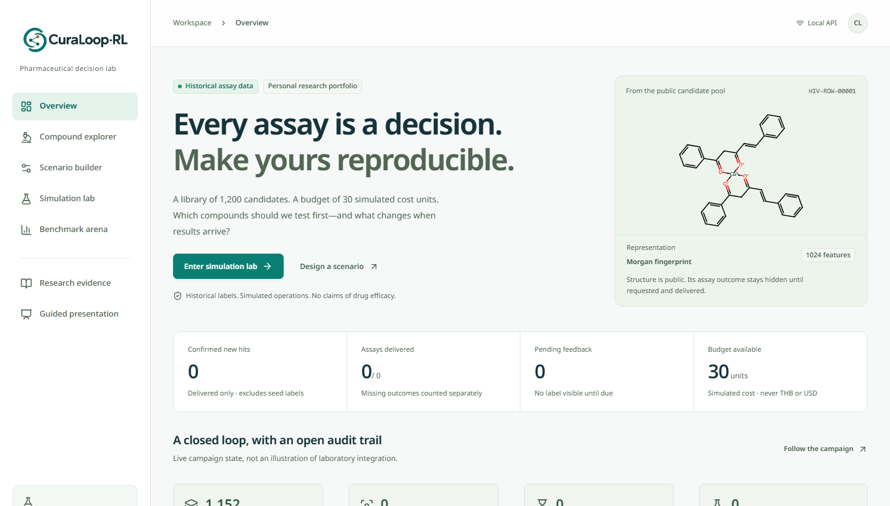
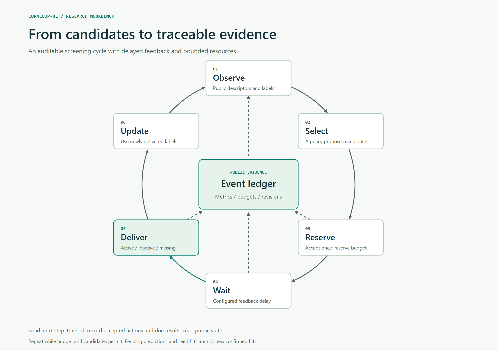
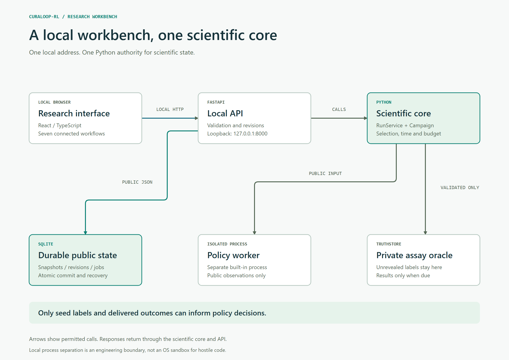

<p align="center">
  
</p>

<h1 align="center">Screening decisions you can audit.</h1>

<p align="center">
  A local research workbench for sequential pharmaceutical screening.<br>
  Choose candidates. Wait for feedback. Compare policies. Preserve the evidence.
</p>

<p align="center">
  <a href="docs/manual/CuraLoop-RL-User-Manual-EN.pdf"><strong>English user manual (PDF)</strong></a> &nbsp;·&nbsp;
  <a href="#quick-start">Quick start</a> &nbsp;·&nbsp;
  <a href="#architecture">Architecture</a> &nbsp;·&nbsp;
  <a href="START_HERE.md">Research programme</a> &nbsp;·&nbsp;
  <a href="docs/EVALUATION.md">Scientific evaluation</a>
</p>

<p align="center"><strong>Research POC</strong> &nbsp; / &nbsp; Local CPU &nbsp; / &nbsp; Windows first &nbsp; / &nbsp; Offline after installation &nbsp; / &nbsp; MIT code</p>

---

CuraLoop-RL explores a practical research question: **with a budget for 30 assays
in a library of 1,200 historical compounds, which candidates should be tested
first?** The workbench connects selection policies to delayed feedback, explicit
resource accounting and an inspectable public event ledger.

It includes a frozen MoleculeNet HIV replay dataset, clearly labelled synthetic
fixtures, five selection policies and independent matched comparisons. The
scientific engine runs in Python; the interface presents its actual state.



*Captured from the running English application. This is a retrospective research
simulator; historical assay labels are distinct from simulated cost and timing.*

## The screening loop



Accepted requests reserve budget once. Outcomes become visible only when their
configured simulated delay has elapsed. Only newly delivered active outcomes
count as hits; seed labels, pending predictions and missing outcomes are excluded.

The ledger makes decisions inspectable. SQLite preserves public snapshots and
revisions, while portable single-run JSON supports validated recovery elsewhere.

[Editable diagram](docs/diagrams/screening-loop.html) · [SVG](docs/diagrams/screening-loop.svg) · [Persistence and recovery](docs/PERSISTENCE.md)

## Inside the workbench

| Workspace | What you can do |
| --- | --- |
| **Overview** | Understand the active scenario, data origin and live campaign counts. |
| **Compound explorer** | Search, filter, sort and inspect public descriptors and genuine historical molecular structures. |
| **Scenario builder** | Configure dataset, seed, policy, budget, capacity, delay, jitter and missingness. |
| **Simulation lab** | Select batches, advance time, finish, replay or reset; inspect outcomes, explanations and the budget ledger. |
| **Benchmark arena** | Execute matched independent policies, inspect actual fallback usage and reopen saved comparisons. |
| **Research evidence** | Inspect provenance and limitations; export, resume and recover saved campaigns or revisions. |
| **Guided presentation** | Tell the project's story in 5-7 minutes using the same live campaign. |

## Research and R&D pilot programme

Latest: [Goal 2 real-data planning challenge](docs/03_research/GOAL_02_RESULTS_V1.md)
completed **180 Tox21 development runs on dr-train**. The new bound preserved
rollout decisions but increased policy computation; nearest-hit found more
assay actives on this panel. This is an implemented prototype with a retained
negative result, not an established new method. See the
[paper-backed dataset and FS-Mol download record](docs/03_research/GOAL_02_DATASET_ACQUISITION_V1.md).

Reviewed v2 adds a [master plan](ACADEMIC_BUSINESS_MASTERPLAN.md),
[literature review](docs/02_literature/CRITICAL_REVIEW.md),
[proposed study protocol](docs/03_research/PROTOCOL.md) and
[R&D pilot offer](docs/04_business/PILOT_OFFER.md).
The research asks when pending work, capacity and a simulated deadline change
delivered-hit discovery. Multi-target performance, controller transfer and
customer value require new evidence; the current HIV pilot remains historical.

Read [START_HERE](START_HERE.md) for the document order and
[the documentation map](docs/README.md) for the complete programme.
The versioned research reference remains separate from the application engine;
new research configuration files are not inputs to the existing UI or CLI.

The local [NCATS development pilot](docs/03_research/NCATS_DEVELOPMENT_RESULTS_V1.md)
now records **108 completed runs** across AhR, PPAR-gamma and p53, with six fixed
controls and three seeds. Pending-penalty selection added no deadline hits in
this bounded pilot and lost two hits in one paired run. These are correlated
development endpoints, not untouched final tests or therapeutic-efficacy evidence.

A [fresh-environment reproduction](docs/03_research/NCATS_REPRODUCTION_V1.md)
matched all 108 scientific traces. A separate frozen
[54-run Gaussian comparator](docs/03_research/NCATS_GAUSSIAN_RESULTS_V1.md)
also found no extra deadline hits from pending conditioning in this allocation.

The latest [candidate audit](docs/03_research/CANDIDATE_ASSAY_AUDIT_V1.md) and
[design sensitivity report](docs/03_research/DESIGN_SENSITIVITY_V1.md) prepare a
broader 12+ family estimation study. They retain metadata/feature audits,
failures and hypothetical uncertainty/resource scenarios. Final task rights,
endpoint mappings and roles remain open; no final compound outcomes were read.

The English [working manuscript](docs/01_paper/MANUSCRIPT.md) now includes the
measured development evidence. A source-checked
[journal shortlist](docs/01_paper/JOURNAL_TARGETS_20261104.md) and
[submission review package](docs/01_paper/submission/README.md) respect the
owner's US$300 publication-fee limit. The manuscript is awaiting author,
scientific and venue review; no journal submission or acceptance is claimed.

## Quick start

**Windows:** install 64-bit Python 3.12, open the project folder and double-click
**`Start-CuraLoop-Web.cmd`**. First use creates `.venv` and installs the locked
dependencies; subsequent use runs from local assets. The bundled frontend needs
no Node.js installation.

Open **http://127.0.0.1:8000** and keep the launcher terminal open. Stop with Ctrl+C.
No administrator access, execution-policy change, API key or cloud account is
required. Python 3.11 is also supported by configuration; the executed Windows
verification used Python 3.12.10.

```powershell
# From the source folder:
.\Setup-CuraLoop-Web.cmd
.\Start-CuraLoop-Web.cmd
```

**Start with the illustrated guide:** [Download the English user manual](docs/manual/CuraLoop-RL-User-Manual-EN.pdf).
Its 20 pages include real program screenshots, linked contents, a worked campaign,
policy comparison, export/import, saved revisions and recovery instructions.

For platform commands and troubleshooting, see the [Windows operator guide](START_WINDOWS.md).
Linux/macOS can use the same locked Python dependencies and
`python scripts/start_web.py --no-browser` inside a virtual environment.
The English Streamlit fallback is available through `Start-CuraLoop.cmd` on port 8501.

## Architecture



The React/TypeScript frontend calls a loopback FastAPI adapter. `RunService` and
the existing Python engine own selection, simulated time, accounting and export.
Built-in policies receive public observations in a separate process. Unrevealed
assay labels stay in the private backend.

SQLite stores public snapshots, revisions and comparison records. Restart
reconstructs accepted state through the existing reconciliation logic; unfinished
comparison jobs are marked interrupted and never silently repeated. Run one
active server with one Uvicorn worker.

[Architecture reference](docs/ARCHITECTURE.md) · [Editable diagram](docs/diagrams/architecture.html) · [SVG](docs/diagrams/architecture.svg)

## Scientific scope

| Evidence | Interpretation |
| --- | --- |
| Historical HIV replay | Genuine retrospective assay labels and structures; a custom 1,200-molecule derivative, not an official leaderboard reproduction. |
| Budget, delay, capacity and missingness | Explicit simulated operational assumptions, not measured laboratory costs or turnaround times. |
| Random, Greedy and Uncertainty | Implemented selection baselines; model probabilities are uncalibrated and uncertainty is a margin heuristic. |
| Q-learning and contextual bandit | Frozen controllers trained on synthetic tasks. Actual learned-request and fallback counts are exposed. |
| Recorded historical benchmark | Both learned controllers used **Greedy fallback for 300/300 requests each**. Matching Greedy does not establish learned RL transfer. |

The default seed may produce zero new hits. That result is retained. Recorded
benchmarks are labelled separately from newly executed comparisons. No dataset,
label semantics, trained checkpoint, reward or evaluation protocol was changed
for the interface, persistence or documentation work.

This independent personal project does not establish clinical efficacy, GMP
suitability, real laboratory savings or an operational Digital Twin. It is not
an official GPO system. See [evaluation and limitations](docs/EVALUATION.md) and
[dataset provenance](docs/RESEARCH_BENCHMARKS.md) for the full research boundary.

## Verification

Executed Windows verification includes **136 Python tests and 18 frontend
tests**, a production build, real desktop/mobile browser workflows, delayed
visibility, budget accounting, restart recovery, exports and validated resume.
The detailed reports distinguish current execution from preserved historical
evidence and list all unrun checks.

- [POC release verification](docs/RELEASE_VERIFICATION.md)
- [README, branding and manual verification](docs/README_MANUAL_VERIFICATION.md)
- [Current screenshots and capture records](docs/evidence/readme-manual-v1/)

## Development

```powershell
.\.venv\Scripts\python.exe -m pytest -q
.\.venv\Scripts\python.exe -m ruff check src app api scripts tests
.\.venv\Scripts\python.exe scripts\start_web.py --check
cd frontend
npm ci
npm run typecheck
npm run lint
npm test
npm run build
```

Use a Node version compatible with `frontend/package.json` for frontend work.
Vite development uses port 5173; production serves the committed build at port
8000. Rebuild `frontend/dist` after UI changes and restart to refresh build
identity. Documentation tooling is optional and separate from application runtime.

## Documentation and attribution

| Resource | Purpose |
| --- | --- |
| [English user manual (PDF)](docs/manual/CuraLoop-RL-User-Manual-EN.pdf) | Illustrated operation, evidence and recovery. |
| [Windows operator guide](START_WINDOWS.md) | Installation, launchers, backup and troubleshooting. |
| [Persistence reference](docs/PERSISTENCE.md) | Storage schema, atomic actions, interruption and corruption recovery. |
| [Research benchmarks](docs/RESEARCH_BENCHMARKS.md) | Data preparation, source records and evaluation context. |
| [Change log](CHANGELOG.md) | Release changes. |
| [Engineering handoff](HANDOFF_TO_CODEX.md) | Verified checkpoints and continuation boundaries. |

Code is [MIT licensed](LICENSE). The HIV derivative has separate CC BY 4.0
attribution to NCI DTP, MoleculeNet, DeepChem and TDC. Fonts and software retain
their upstream notices. New brand artwork is AI-assisted; the original logo and
historical screenshots remain preserved. See [third-party notices](THIRD_PARTY_NOTICES.md)
and [brand provenance](docs/BRAND.md).
