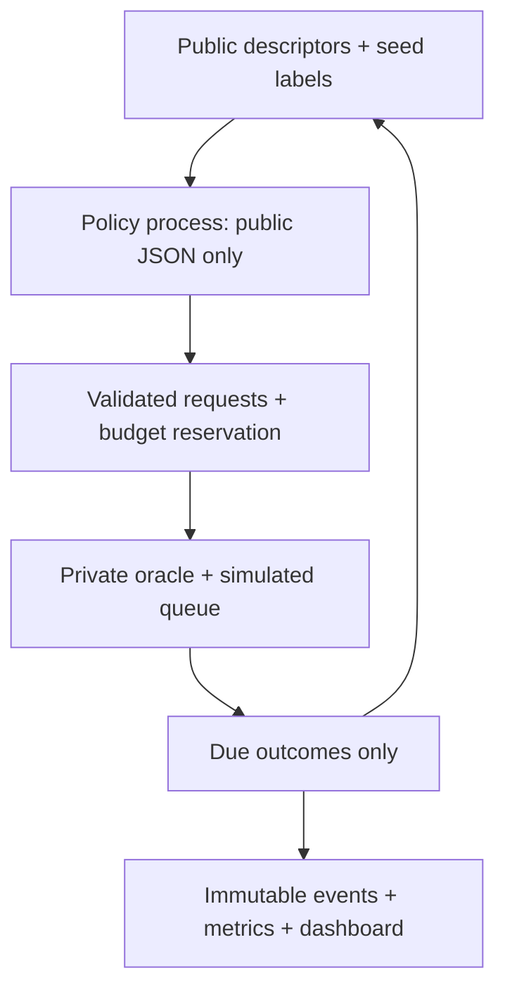

# Pharmaceutical Screening Decision Lab

**โครงการส่วนบุคคล · ไม่ใช่โครงการทางการของ GPO · Research demonstration only**

เลือกสารที่จะทดสอบภายใต้งบและความจุจำกัด เรียนรู้จากผลที่ส่งคืน แล้วเปรียบเทียบวิธีเลือกอย่างตรวจสอบซ้ำได้ แอปทำงานบน CPU ในเครื่อง ไม่มี API key, GPU หรือ cloud service ข้อมูลหลักเป็น **ผล assay จริงย้อนหลังจาก MoleculeNet HIV** พร้อม synthetic fixtures สำหรับทดสอบระบบ

## สิ่งที่รันได้จริง

- Dashboard Streamlit 4 หน้า: Overview, Scenario Setup, Screening Run, Compare & Export
- Historical HIV replay 1,200 real molecules พร้อม Morgan fingerprints, scaffold IDs, provenance และ source hash
- Random, Greedy และ Uncertainty + **Q-learning / contextual bandit ที่ฝึกจริงบนโจทย์สังเคราะห์** พร้อม checkpoint และผลประเมินแยกต่างหาก
- Private label oracle, delayed feedback, pending queue, capacity, reserved/spent/remaining budget และ immutable public events
- Single-class fallback ที่บอกสถานะตามจริง; missing-outcome และ jitter scenarios; matched independent comparisons
- JSON / UTF-8 CSV export, paired-seed benchmark และ scaffold-disjoint predictor audit
- Pytest + Streamlit AppTest และคำสั่ง Windows ที่ไม่จำเป็นต้อง activate virtual environment

ไม่ใช่ระบบค้นพบยาที่มีประสิทธิผล ไม่ใช่เครื่องมือ GMP/clinical และไม่มีการเชื่อมแล็บหรือ operational Digital Twin

## เริ่มบน Windows PowerShell

ติดตั้ง Python 3.11 ขึ้นไป (แนะนำ 3.11 หรือ 3.12, 64 bit) แล้วแตก ZIP ไปยังโฟลเดอร์ที่เลือก เช่น `C:\Projects\curaloop-rl` ตำแหน่งนี้เป็นตัวอย่าง ไม่ใช่ตำแหน่งที่ระบบได้เขียนลงเครื่องคุณแล้ว

```powershell
cd C:\Projects\curaloop-rl
py -3.11 -m venv .venv
.\.venv\Scripts\python.exe -m pip install -r requirements-lock.txt
.\.venv\Scripts\python.exe -m pip install -e . --no-deps
.\.venv\Scripts\python.exe -m streamlit run app\streamlit_app.py
```

ถ้ามีเฉพาะ Python 3.12 ใช้ `py -3.12` ในคำสั่งแรก เปิด `http://127.0.0.1:8501` ใน browser หลังติดตั้งครั้งแรกแล้ว demo ใช้ข้อมูลที่รวมอยู่ใน package และไม่ต้องต่อ internet ไม่ต้องเปลี่ยน PowerShell execution policy เพราะเรียก python.exe ตรง

```powershell
.\.venv\Scripts\python.exe -m pytest -q
.\.venv\Scripts\python.exe -m curaloop.cli compare --config configs\hiv-demo.json --output outputs\comparison
.\.venv\Scripts\python.exe -m curaloop.cli replay --input outputs\comparison\report.json
.\.venv\Scripts\python.exe -m curaloop.benchmark --output outputs\benchmark
```

คำสั่งสำหรับ Linux/macOS ใช้ `.venv/bin/python` แทน `.\.venv\Scripts\python.exe` หลัง `python3 -m venv .venv` การทดสอบ Windows จริงระบุแยกใน handoff และ audit

## สาธิต 5–7 นาที

1. Overview: อธิบาย historical assay labels กับ synthetic cost/time และข้อจำกัด
2. Scenario: ใช้ HIV / seed 42 / budget 30 / capacity 5 / delay 2 หรือเปลี่ยนเงื่อนไข
3. Screening: Select → เห็น pending → Advance สองครั้ง → เห็น delivered; อ่านเหตุผลและงบที่จอง/ชำระ
4. Complete run → Compare policies → ดู actual event-derived curves → ดาวน์โหลด JSON/CSV
5. Learning Lab: ดู checkpoint, training returns และข้อจำกัดการฝึกบน synthetic tasks

## โครงสร้างข้อมูล



นโยบาย built-in รับเพียง PolicyObservation ผ่าน subprocess แยก memory; ไม่มี full label table อยู่ใน process ของ policy การแยกนี้ **ไม่ใช่ OS sandbox สำหรับโค้ดอันตราย** เจ้าของเครื่องอ่าน source/ไฟล์ข้อมูล benchmark ได้ตามธรรมชาติของงาน reproducible open source

Seed labels ของ HIV สุ่มแบบไม่ดูคำตอบ ส่วน synthetic seeds stratified โดยใช้ oracle knowledge ที่เปิดเผยไว้ ถือเป็น preexisting sunk cost เท่ากันทุกวิธี ไม่นับ seed hits เป็นการค้นพบใหม่; ผล missing ใช้ต้นทุนแต่ไม่ใช่ inactive หรือ hit

## วิจัยและหลักฐาน

- [Benchmark evidence และขอบเขตคะแนน](docs/RESEARCH_BENCHMARKS_TH.md)
- [สถาปัตยกรรมและการตัดสินใจ](docs/ARCHITECTURE.md)
- [ผลตรวจและข้อจำกัด](docs/AUDIT_REPORT.md)
- [Codex handoff](HANDOFF_TO_CODEX.md)
- [สิทธิ์ข้อมูลและ attribution](THIRD_PARTY_NOTICES.md)
- `docs/evidence/`: ผลทดสอบ, training evidence, historical benchmark และ screenshot ที่จับจริงเมื่อทำได้
- `requirements_v3/`: ข้อกำหนดเดิมที่ตรวจแล้ว เก็บไว้เป็น reference **ไม่ใช่สถานะปัจจุบันของ implementation**

MoleculeNet: Wu et al., Chemical Science (2018), DOI [10.1039/C7SC02664A](https://doi.org/10.1039/C7SC02664A). ข้อมูลจาก NCI DTP / DeepChem; สิทธิ์ HIV ระบุ CC BY 4.0 โดย [TDC](https://tdcommons.ai/single_pred_tasks/hts/#hiv). ชุดย่อยและ split ของเราไม่ใช่ reproduction ของคะแนนใน paper

## พัฒนาและฝึกซ้ำ

```powershell
# ติดตั้งเครื่องมือสำหรับ rebuild fingerprints เท่านั้น (demo ไม่ต้องใช้ RDKit)
.\.venv\Scripts\python.exe -m pip install -e ".[chemistry]"
.\.venv\Scripts\python.exe scripts\prepare_hiv.py --download
# ฝึก checkpoint ใหม่จริงบน synthetic tasks และประเมินซ้ำหลังเปลี่ยน model
.\.venv\Scripts\python.exe -m curaloop.learning
.\.venv\Scripts\python.exe -m curaloop.benchmark --output outputs\retrained-benchmark
```

Code: MIT. Dataset: separate CC BY 4.0 attribution. Logo: AI-assisted original project asset; no claim of trademark registration. ไม่สร้าง remote repository, ไม่ push, ไม่ deploy และไม่ใช้ข้อมูลบริษัท
