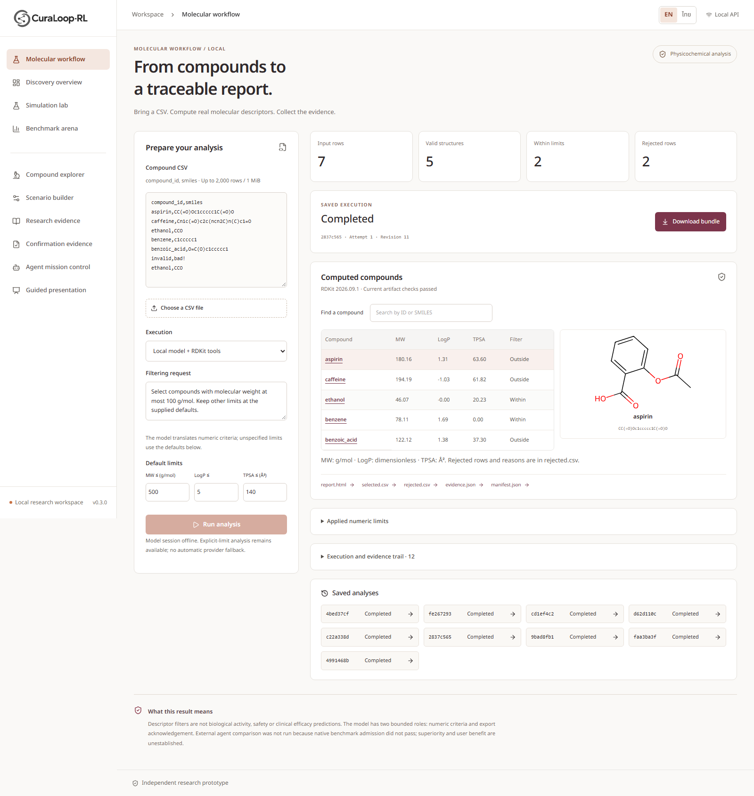
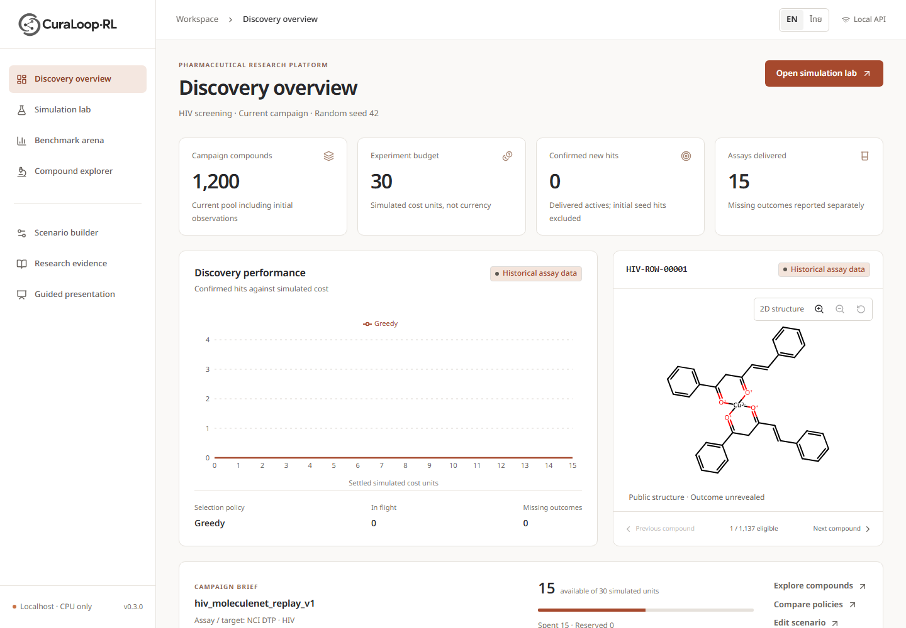

<h1 align="center">Pharmaceutical evidence you can trace.</h1>

<p align="center">
  A local molecular workflow and retrospective pharmaceutical evidence workbench.<br>
  Import compounds. Compute with RDKit. Inspect real model decisions and collect the evidence.
</p>

<p align="center">
  <a href="docs/manual/CuraLoop-Local-Molecular-Workflow-Guide-EN-v3.pdf"><strong>Local molecular workflow guide (PDF)</strong></a> &nbsp;·&nbsp;
  <a href="docs/07_publication/CuraLoop-Local-Workflow-Feasibility-EN-v2.pdf"><strong>Local workflow feasibility report (PDF)</strong></a> &nbsp;·&nbsp;
  <a href="docs/manual/CuraLoop-RL-Dashboard-Guide-EN-v3.pdf"><strong>English user manual (PDF)</strong></a> &nbsp;·&nbsp;
  <a href="docs/manual/CuraLoop-RL-Confirmation-Evidence-Guide-EN-v4.pdf"><strong>Confirmation evidence guide (PDF)</strong></a> &nbsp;·&nbsp;
  <a href="docs/manual/CuraLoop-AgentRD-Guide-EN-v2.pdf"><strong>Agent RD guide (PDF)</strong></a> &nbsp;·&nbsp;
  <a href="docs/07_publication/CuraLoop-AgentRD-Computational-Report-EN-v2.pdf"><strong>Computational report (PDF)</strong></a> &nbsp;·&nbsp;
  <a href="docs/evidence/agent-rd-20261110-v1/README.md">Actual agent evidence</a> &nbsp;·&nbsp;
  <a href="docs/evidence/lr-cf2p-20261110-v1/README.md">CF1 integration gallery</a> &nbsp;·&nbsp;
  <a href="docs/evidence/four-screen-dashboard-20261108-v1/README.md">EN/TH screen gallery</a> &nbsp;·&nbsp;
  <a href="#quick-start">Quick start</a> &nbsp;·&nbsp;
  <a href="#architecture">Architecture</a> &nbsp;·&nbsp;
  <a href="START_HERE.md">Research programme</a> &nbsp;·&nbsp;
  <a href="docs/EVALUATION.md">Scientific evaluation</a>
</p>

<p align="center"><strong>Research POC</strong> &nbsp; / &nbsp; Windows first &nbsp; / &nbsp; EN/TH workspace &nbsp; / &nbsp; Optional authorized local model &nbsp; / &nbsp; MIT code</p>

---

**Latest delivery, 13 November 2026:** open **`/workflow`** for an actual
CSV → RDKit → verified report/ZIP workflow in English or Thai. It includes a
searchable descriptor table, real 2D structures, saved jobs, cancellation and
explicit recovery. Component/API checks passed **58 tests**. The fixed local
Typhoon model passed **6/6 author-selected EN/TH software cases** using **12 real
responses**, without repeated cases or mock results. These checks establish
bounded software behavior, not independent scientific validation.

The intended external method comparison is **NOT_RUN**: native readiness reached
one development reference and six evaluation candidates, but only **3/4 required
repository lineages**. The comparative effect is **NOT_ESTIMABLE**, not zero.
The delivered manuscript is an honest feasibility/software report; it does not
claim agent superiority or journal readiness. [Actual results](docs/07_publication/LOCAL_WORKFLOW_ACTUAL_RESULTS_20261113.md)
· [Evidence and reproduction](docs/evidence/lr-dc2-local-20261113-v1/README.md).



*Captured from the running application after reopening a genuine model job.
The model session is correctly offline in this capture; reopening makes no new
inference. Explicit-limit RDKit execution works without a model or SSH.*

CuraLoop-RL connects retrospective screening with bounded pharmaceutical evidence
missions. The new Agent RD workspace records actual model proposals, read-only
aggregate calculations, source checks and explicit fallback. Its frozen
computational evaluation is **complete: 408/408 units**. The guarded agent and
matched LLM + tools each completed 67/96 tasks; deterministic code completed
96/96. The study does not establish incremental agent superiority.

The historical screening track asks: **with a budget for 30 assays
in a library of 1,200 historical compounds, which candidates should be tested
first?** The workbench connects selection policies to delayed feedback, explicit
resource accounting and an inspectable public event ledger.

It includes a frozen MoleculeNet HIV replay dataset, clearly labelled synthetic
fixtures, five selection policies and independent matched comparisons. The
scientific engine runs in Python; the interface presents its actual state.



*Captured from the running English application. This is a retrospective research
simulator; historical assay labels are distinct from simulated cost and timing.*

## The screening loop


Accepted requests reserve budget once. Outcomes become visible only when their
configured simulated delay has elapsed. Only newly delivered active outcomes
count as hits; seed labels, pending predictions and missing outcomes are excluded.

The ledger makes decisions inspectable. SQLite preserves public snapshots and
revisions, while portable single-run JSON supports validated recovery elsewhere.

[Editable diagram](docs/diagrams/screening-loop.html) · [SVG](docs/diagrams/screening-loop.svg) · [Persistence and recovery](docs/PERSISTENCE.md)

## Inside the workbench

| Workspace | What you can do |
| --- | --- |
| **Molecular workflow** | Import a bounded CSV, run actual RDKit descriptors and numeric filtering, inspect structures and current evidence, then collect a verified report/ZIP. Optional model execution requires an active operator session; no paid or deterministic fallback is hidden. |
| **Discovery Overview** | Read actual compound, budget, delivered-assay and hit counts; inspect public chemistry and discovery curves. |
| **Digital Twin Simulation Lab** | Use the explicitly labeled Retrospective Simulator; inspect selection, queue, delivery and model-data stages. |
| **Benchmark Arena** | Compare Random, Greedy, active-learning and RL implementations; distinguish single-seed efficiency from recorded ten-seed variation and fallback. |
| **Compound Explorer** | Search a structure table or grid; inspect public descriptors, outcome visibility and selection history. |
| **Scenario builder** | Configure dataset, seed, policy, budget, capacity, delay, jitter and missingness. |
| **Research evidence** | Inspect provenance and limitations; export, resume and recover saved campaigns or revisions. |
| **Confirmation evidence** | Compare recorded CF1 H/coverage tradeoffs across six development campaigns, five budgets and 18 arms; inspect source hashes and download an EN/TH comparison brief. |
| **Agent RD** | Inspect the genuine recorded model example, run deterministic aggregate comparisons or a five-budget sweep, and export an EN/TH dossier. Designated unsupported requests produce explicit controller abstentions. New model execution needs a freshly authorized operator session and transport setup; the research worker is retired. |
| **Guided presentation** | Explain the screening loop in 5-7 minutes using the same live campaign. |
| **C Workspace** | Trace cached declared fields to their original sources, review readiness and export local files in EN/TH. |

## Research and R&D pilot programme

**Local-workflow release, 13 November 2026:** the owner resumed and adopted a
fresh resource release. Native external admission did not pass its unchanged
diversity rule; the approved real-workflow/software-report fallback was used.
Old ledgers, negative results and protected hidden outcomes remain preserved.
[Execution record](docs/08_agent_rd/LOCAL_AGENT_EXECUTION_20261113.md)
· [Current evidence](docs/evidence/lr-dc2-local-20261113-v1/README.md).
The [11 November pause handoff](docs/08_agent_rd/LR_DC2_DATASET_PAUSE_HANDOFF_20261111.md)
is retained historical context, not the current state.

**Completed computational work, 11 November 2026:** the
[AgentRD owner report](docs/08_agent_rd/FINAL_OWNER_REPORT_20261111.md) delivers the
localhost workbench, all 408 frozen unit results, actual analysis and a full
[English manuscript](docs/07_publication/CURALOOP_AGENTRD_COMPUTATIONAL_REPORT_EN_V2.md).
The primary guarded-agent minus LLM + tools effect was **0.00 percentage points**.
Both produced identical recorded outputs on all 96 paired seed/task units; no
invalid terminal proposal naturally exercised their numerical/source repair
branch. This result is conditional on one model and authored aggregate tasks,
and does not establish external equivalence or general verifier efficacy.

The [eight-page Agent RD guide](docs/manual/CuraLoop-AgentRD-Guide-EN-v2.pdf)
uses actual served-app screenshots. The
[11-page computational report](docs/07_publication/CuraLoop-AgentRD-Computational-Report-EN-v2.pdf)
includes seven tables, three figures, costs and failure analysis. Final pages
and figures passed author visual checks; this is not independent review.
The latest current-service real-model mission passed its technical lifecycle
but **failed the comparison task by abstaining after three calls**. It remains
evidence alongside the earlier successful
[recorded model dossier](docs/evidence/agent-rd-20261110-v1/example-dossier-v1/report-en.html).

Use **Open recorded model example** explicitly or select deterministic mode for
offline operation. The owned dr-train worker/root was removed after all 477
files were returned and hash-reread; new inference needs a fresh authorized
session and transport setup. [Reproduction and operating limits](docs/08_agent_rd/REPRODUCIBILITY_V1.md)
explain the distinction. Final16, private CF1 rows and hidden outcomes stay
closed. No paid API, live team/lab write, public deployment or submission was
performed. A competitive JCAMD method paper is **not established**. Prior
negative studies below remain unchanged.

**Historical checkpoint, 10 November 2026:** [LR-CF2P is complete](docs/06_execution/LR_CF2P_OWNER_CHECKPOINT_20261110.md).
CF2-Design ends with **NO_GO_THIS_MECHANISM**: two generic coverage/feedback
formulations do not yet supply a distinct identifiable new method. P-CF1 is
**PASS_INTERNAL_INTEGRATION**: the main app and additive local C Workspace now
read the same authenticated CF1 aggregates, with all 70 EN/TH comparison views,
filtered exports, real screenshots and a six-page English PDF addendum.
No selector was trained and final16 remains sealed. This closes a design
decision and internal product integration; user/business validation and a
publishable method remain open. [Integration guide](docs/05_product/CF1_INTEGRATION_GUIDE_20261110.md)
· [Evidence](docs/evidence/lr-cf2p-20261110-v1/README.md)
· [Full phase status](docs/06_execution/PROJECT_PHASE_STATUS_20261110.md).

**Prior research checkpoint:** [LR-CF1 is complete](docs/03_research/LR_CF1_RESULTS_20261109.md).
Six published-source development campaigns, 60 molecular fits and2,700 fixed
portfolio cells passed, including independent H/D recalculation and complete
private return/exact remote cleanup. Classical group diversification increases
coverage while losing hits; a quota alone does not establish a new method.
Final16 remains sealed and journal readiness is not established. Open the
[EN/TH offline evidence report](research/product_handoffs/lr_cf1_v1/README.md),
[English paper insert](docs/07_publication/LR_CF1_METHODS_RESULTS_INSERT_20261109.md)
and [owner checkpoint](docs/06_execution/LR_CF1_OWNER_CHECKPOINT_20261109.md).
The subsequent P-CF1 integration above uses these recorded aggregates; any
further method, workflow pilot or live connector needs a new owner decision.

**9 November 2026:** [LR-D23 is complete](docs/03_research/LR_D23_DEVELOPMENT_RESULTS_20261109.md).
The residual candidate did not meet its frozen D2 criteria; Gk2 achieved more
mean hits with less CPU. Conditional D3 was not run, and final outcomes remain
sealed. All 2,052 biological units and the complete remote return/cleanup were
audited. The [EN/TH evidence handoff](research/product_handoffs/lr_d23_v1/README.md)
and [English paper insert](docs/07_publication/LR_D23_METHODS_RESULTS_INSERT_20261109.md)
preserve that result. See the [owner checkpoint](docs/06_execution/LR_D23_OWNER_CHECKPOINT_20261109.md)
and [evidence index](docs/evidence/lr-d23-20261109-v1/README.md).

**Contribution direction evaluated:** the owner-approved
[confirmation-portfolio question](docs/03_research/CONFIRMATION_PORTFOLIO_CONTRIBUTION_PROPOSAL_20261109.md)
now has real baseline evidence. LR-CF1 closes data/endpoint feasibility and
baseline opportunity; **NO_GO for a quota-only method claim**. A distinct
mechanism and independent evaluation remain unresolved. The original proposal's
disabled configuration records its creation time, not the later released study.

**M2 complete / INCONCLUSIVE, 9 November 2026.** CuraLoop's method-first study
evaluated learned REUSE/UPDATE/PLAN allocation on six exposed FS-Mol assays,
four annotation components, two predictors and eight matched arms. All 4,164
biological units and the full technical return/cleanup/audit completed.

In the primary RF/Ccheap setting, L-G1=-0.225, L-T=-0.425 and L-E=+1.1625
new binary positives. History attribution is positive, but the learned method
does not establish an advantage over strong simple controls. Read the
[complete results and figures](docs/03_research/M2_COSTED_RESULTS_20261108.md),
[aggregate evidence](docs/evidence/m2-costed-20261108-v2/README.md) and
[reviewer assessment](docs/01_paper/M2_EVIDENCE_POSITION_20261109.md).

The predeclared promising-signal rule was not met. The owner's conditional
96 CPU-hour / 120-hour M3 -> P1 -> J1 grant was **not activated**; final 16 outcomes
remain closed. The study closed at 31.729 / 48 conservatively charged CPU-hours.
All 27,454 remote task files were returned/hash-reread before exact cleanup.
Next step is the [owner evidence review](docs/06_execution/M2_OWNER_CHECKPOINT_20261108.md).

The existing EN/TH app and C Workspace remain research prototypes with their
earlier evidence limits. The new learned controller is not a production policy;
new-method integration and a new results manuscript were not run. Earlier M1
NO-GO, slower-planning findings and all prior source roles/results are preserved.
There is no clinical, operational Digital Twin, lab-savings or publication claim.

Read [GOAL](GOAL.md), [PLAN](PLAN.md), [START_HERE](START_HERE.md) and
[constructed evidence](docs/evidence/method-first-20261108-v1/README.md).
The [data inventory](docs/03_research/LOCAL_DATA_INVENTORY_20261107.md) remains
available. QP32/QC500 and benchmark-publication fallbacks are deferred. The LR-M12
release is closed after verified full return and exact remote cleanup; final
outcomes remain closed. See the [owner checkpoint](docs/06_execution/LR_M12_OWNER_CHECKPOINT_20261108.md)
before a new mechanism or phase.

The four-screen dashboard uses the [shadcn Dashboard](https://ui.shadcn.com/blocks/dashboard)
as a design reference, reusing the existing app and real Python engine. It supports
EN/TH, Graphite x Copper styling, public 2D chemistry and reduced motion. Read the
[frontend checkpoint](docs/05_product/FOUR_SCREEN_DASHBOARD_CHECKPOINT_20261108.md)
for actual checks and limits. The C Workspace exposes
cached declared metadata and local reports; live autonomous R&D efficacy,
external-team delivery and customer value are unvalidated.

[English manual](docs/manual/CuraLoop-RL-Dashboard-Guide-EN-v3.pdf) ·
[Previous Molecular Studio walkthrough](docs/media/molecular-studio-walkthrough.mp4) ·
[C Workspace HTML](docs/05_product/metadata-workspace-v2/workspace.html) ·
[Core guide](docs/05_product/METADATA_PORTFOLIO_GUIDE_V1.md)

The [literature positioning review](docs/02_literature/POSITIONING_REVIEW_20261108.md)
and [current download status](docs/02_literature/LITERATURE_DOWNLOAD_STATUS_20261108.md)
separate papers actually inspected from 25 newly verified private reading copies.

Historical negative results remain visible: [Goal4](docs/03_research/GOAL4_RESULTS_V1.md)
found slower screening in its matched check, and [4R1](docs/03_research/GOAL4R1_RESULTS_V1.md)
did not establish incremental planner value beyond the stronger predictor.
Old final outcomes and all closed ledgers/source STOPs remain preserved.
The [working manuscript](docs/01_paper/MANUSCRIPT.md) is a design draft with
separately retained historical studies; no submission or acceptance is claimed.

## Quick start

**Windows:** install 64-bit Python 3.12, open the project folder and double-click
**`Start-CuraLoop-Web.cmd`**. First use creates `.venv` and installs the locked
dependencies; subsequent use runs from local assets. The bundled frontend needs
no Node.js installation.

Open **http://127.0.0.1:8000** and keep the launcher terminal open. Stop with Ctrl+C.
No administrator access, execution-policy change, API key or cloud account is
required. Python 3.11 is also supported by configuration; the executed Windows
verification used Python 3.12.10.

```powershell
# From the source folder:
.\Setup-CuraLoop-Web.cmd
.\Start-CuraLoop-Web.cmd
```

**Start with the illustrated guide:** [Download the English user manual](docs/manual/CuraLoop-RL-User-Manual-EN.pdf).
Its 20 pages include real program screenshots, linked contents, a worked campaign,
policy comparison, export/import, saved revisions and recovery instructions.

For platform commands and troubleshooting, see the [Windows operator guide](START_WINDOWS.md).
Linux/macOS can use the same locked Python dependencies and
`python scripts/start_web.py --no-browser` inside a virtual environment.
The English Streamlit fallback is available through `Start-CuraLoop.cmd` on port 8501.

## Architecture


The React/TypeScript frontend calls a loopback FastAPI adapter. `RunService` and
the existing Python engine own selection, simulated time, accounting and export.
Built-in policies receive public observations in a separate process. Unrevealed
assay labels stay in the private backend.

SQLite stores public snapshots, revisions and comparison records. Restart
reconstructs accepted state through the existing reconciliation logic; unfinished
comparison jobs are marked interrupted and never silently repeated. Run one
active server with one Uvicorn worker.

[Architecture reference](docs/ARCHITECTURE.md) · [Editable diagram](docs/diagrams/architecture.html) · [SVG](docs/diagrams/architecture.svg)

## Scientific scope

| Evidence | Interpretation |
| --- | --- |
| Historical HIV replay | Genuine retrospective assay labels and structures; a custom 1,200-molecule derivative, not an official leaderboard reproduction. |
| Budget, delay, capacity and missingness | Explicit simulated operational assumptions, not measured laboratory costs or turnaround times. |
| Random, Greedy and Uncertainty | Implemented selection baselines; model probabilities are uncalibrated and uncertainty is a margin heuristic. |
| Q-learning and contextual bandit | Frozen controllers trained on synthetic tasks. Actual learned-request and fallback counts are exposed. |
| Recorded historical benchmark | Both learned controllers used **Greedy fallback for 300/300 requests each**. Matching Greedy does not establish learned RL transfer. |

The default seed may produce zero new hits. That result is retained. Recorded
benchmarks are labelled separately from newly executed comparisons. No dataset,
label semantics, trained checkpoint, reward or evaluation protocol was changed
for the interface, persistence or documentation work.

This independent personal project does not establish clinical efficacy, GMP
suitability, real laboratory savings or an operational Digital Twin. It is not
an official GPO system. See [evaluation and limitations](docs/EVALUATION.md) and
[dataset provenance](docs/RESEARCH_BENCHMARKS.md) for the full research boundary.

## Verification

Executed Windows verification includes **136 Python tests and 18 frontend
tests**, a production build, real desktop/mobile browser workflows, delayed
visibility, budget accounting, restart recovery, exports and validated resume.
The detailed reports distinguish current execution from preserved historical
evidence and list all unrun checks.

- [POC release verification](docs/RELEASE_VERIFICATION.md)
- [README, branding and manual verification](docs/README_MANUAL_VERIFICATION.md)
- [Current screenshots and capture records](docs/evidence/readme-manual-v1/)

## Development

```powershell
.\.venv\Scripts\python.exe -m pytest -q
.\.venv\Scripts\python.exe -m ruff check src app api scripts tests
.\.venv\Scripts\python.exe scripts\start_web.py --check
cd frontend
npm ci
npm run typecheck
npm run lint
npm test
npm run build
```

Use a Node version compatible with `frontend/package.json` for frontend work.
Vite development uses port 5173; production serves the committed build at port
8000. Rebuild `frontend/dist` after UI changes and restart to refresh build
identity. Documentation tooling is optional and separate from application runtime.

## Documentation and attribution

| Resource | Purpose |
| --- | --- |
| [English user manual (PDF)](docs/manual/CuraLoop-RL-User-Manual-EN.pdf) | Illustrated operation, evidence and recovery. |
| [Windows operator guide](START_WINDOWS.md) | Installation, launchers, backup and troubleshooting. |
| [Persistence reference](docs/PERSISTENCE.md) | Storage schema, atomic actions, interruption and corruption recovery. |
| [Research benchmarks](docs/RESEARCH_BENCHMARKS.md) | Data preparation, source records and evaluation context. |
| [Change log](CHANGELOG.md) | Release changes. |
| [Engineering handoff](HANDOFF_TO_CODEX.md) | Verified checkpoints and continuation boundaries. |

Code is [MIT licensed](LICENSE). The HIV derivative has separate CC BY 4.0
attribution to NCI DTP, MoleculeNet, DeepChem and TDC. Fonts and software retain
their upstream notices. New brand artwork is AI-assisted; the original logo and
historical screenshots remain preserved. See [third-party notices](THIRD_PARTY_NOTICES.md)
and [brand provenance](docs/BRAND.md).
