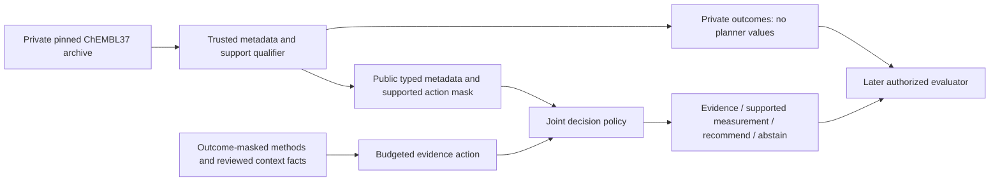

# ChEMBL task-first dataset and benchmark plan

Date: 7 November 2026. Base: `5199760dab0c98fe597d840ae67181dc1aba856e`.
Status: **DESIGN_READY_FOR_OWNER_REVIEW; DATA_INTAKE_AND_EXECUTION_NOT_AUTHORIZED**.
The owner selected direction A: prepare a new ChEMBL-centered plan for the
existing joint evidence/molecular-decision question. This is planning authority,
not permission to download an archive, qualify outcomes or start a next phase.

## Question, intended contribution and evidence boundary

When assay context is uncertain, should a molecular decision system clarify a
shared context fact, acquire a supported measurement, recommend compounds, or
abstain? Test whether selective evidence use improves reference-endpoint
discovery under declared resource limits, beyond complete metadata and competent
upfront evidence resolution using the same predictor.

The candidate contribution remains a joint decision method, supported by a
source-linked benchmark and a reproducible R&D tool contract. Annotation,
retrieval, a dependency graph or another name for value of information does not
establish method novelty. The existing [reduction/closest-work concerns](R0_METHOD_FORMALIZATION_20261107.md)
remain open. A benchmark-only or product-only pivot still needs an owner decision.

The [R0-A1 failure](R0A1_FEASIBILITY_RESULTS_20261107.md) is preserved: the admitted
same-target group has one molecule, and useful context was already in metadata.
The new design therefore selects **decision tasks with supported molecular
alternatives**, rather than the first assays or twenty activity IDs. Existing
exposed cases are diagnostics, not a fresh final population.

## Proposed task unit

A task bundle contains one explicitly specified reference assay context, one
reference endpoint type, **128 distinct canonical reference compounds**, and
one to three auxiliary assay contexts with actual historical measurement support.
All assays refer to the same verified protein target/organism; variants and
constructs are explicit context attributes, never silently merged.
The primary target gate is SINGLE_PROTEIN, direct relationship and confidence9
with accession/organism reconciliation. Homologue-only assignments, complexes
and nonmolecular targets are outside this primary proposal. The reference must
be wild-type or an explicitly identified construct; a null variant field does
not establish wild-type. All queryable compounds lie inside the fixed128-member
panel; auxiliary-only molecules outside it are not extra free actions.

| Element | Proposed minimum / rule | Why it is required |
| --- | --- | --- |
| Reference panel | 128 unique canonical compounds with admissible exact numerical reference records, after all exclusions | Prevent a one-molecule or nominal-record-count task |
| Auxiliary contexts | 1-3 context-distinct assays; at least 32 shared compounds per admitted auxiliary context | Permit a real supported alternative observation |
| Shared support | At least 64 of the 128 reference compounds observed in one or more auxiliary contexts | A nontrivial shared decision problem; not an imputed dense matrix |
| Context fact | A source-linked fact with an explicit path to pooling, surrogate-use or action eligibility | Descriptive completeness alone is insufficient |
| Clear controls | Context already resolved by full permitted metadata is retained as a control | Do not manufacture uncertainty by hiding useful fields |
| Reference truth | A unique source/assay/procedure interpretation, later independently reviewed | A database flag or parent interpretation is not gold |

These are proposed **structural feasibility floors**, not a power calculation,
meaningful-effect threshold or evidence that 128 compounds will be sufficient.
The owner reviews them before intake; they are not lowered after observing yield.

An illustrative template uses fictional compounds M001-M128, one reference
context and two partially measured auxiliary contexts. A verified context fact
could change which auxiliary observations are admissible for a declared action.
This is a schema example only; no such task has been qualified in this project.

## Source and acquisition choice

Use the **fixed ChEMBL 37 SQLite release**, with release identity
`10.6019/CHEMBL.database.37`; never use a mutable `latest` path as the manifest
identity. Official downloads list release 37 and SQLite availability.
[Official downloads](https://chembl.gitbook.io/chembl-interface-documentation/downloads).

The already authenticated 7 November official directory snapshot lists
`chembl_37_sqlite.tar.gz` as **5.4G, rounded**. Exact compressed bytes, archive
member layout, unpacked size and checksum are not verified. Proposed caps are
8 GiB compressed and 32 GiB for the unpacked database. Check the provider's
published checksum with its actual declared algorithm, then record an additional
local SHA-256. Do not invent an expected SHA-256 if only another digest is supplied.

The full archive contains numerical outcomes, including irrelevant/protected
records, in plaintext at rest. Receiving those bytes is different from querying
or exposing them. The proposed next-phase permission explicitly covers a private
archive and restricted qualification reader; it does not release numerical
outcomes to the planner, conversation, reports or model-training code. Old
protected final assays/identities must be excluded before any value-validation
query. This bulk acquisition is not authorized by the present planning request.

Rationale for offline qualification: compute complete support intersections for
the selected frame, use one reproducible release, and avoid truncated API samples.
There is no automatic API-only, other-release or mirror fallback. Archive access
failure requires a report and lawful owner assistance, not a silent population
change. The three purchase-only papers remain deferred without purchase.

Source papers support the database rationale, not a claim that this new benchmark
already exists: Papadatos et al., [ChEMBL curation](https://doi.org/10.1007/s10822-015-9860-5)
documents activity/assay/target curation; Zdrazil et al.,
[The ChEMBL Database in 2023](https://doi.org/10.1093/nar/gkad1004) is a database
paper identity, not qualification of release37 rows. The new derived benchmark
would be a CuraLoop research artifact, not an official ChEMBL benchmark.

## Qualification frame and three freezes

Proposed bounded frame: at most **100 target entities, 2,000 selected assay
metadata records, 120 candidate bundles, 1,000,000 support rows and 100,000
canonicalized molecules**. These are ceilings, not known available counts.
The trusted process may scan the release catalog to construct the frame, but
exports only admitted frame metadata; arbitrary descriptions/values are not
shown to the agent.

1. Verify the archive/schema, rights, existing protection manifests and a
   predeclared family/source taxonomy. Construct a deterministic target/assay
   frame, stratified by that taxonomy and publication lineage, using a recorded
   hash salt. Freeze this frame and all eligibility rules before inspecting
   numerical outcomes or source-reference interpretations.
2. Build the complete **outcome-free identity topology** for that assay frame:
   record/compound IDs, endpoint type, units and relations, with no values or
   value-derived quality flags. Use observed ID overlap to propose at most120
   candidate bundles and freeze their IDs before numeric-validity checks or
   methods interpretation. This is selection on support, not potency. A record
   ID alone still does not prove a nonmissing value.
3. The restricted validator checks actual finite/nonmissing support for those
   frozen candidates. Apply preset quality/protection rules, record source
   feasibility, then freeze the eligible cohort before any policy/outcome utility.
   Retain every candidate and exclusion reason. If a cap truncates an assay's
   graph, mark it INCOMPLETE_SUPPORT; never treat a prefix as complete or refill
   outside the frozen120-bundle candidate frame after validation failures.

Support admission depends on measurement availability, not favorable potency.
Historical selective measurement can still bias this population. The estimand
is conditional on the qualified finite panels, not an entire chemical library.

## Endpoints, duplicates and missingness

Proposed primary tracks are **Ki and Kd, kept separate**. Each task has one
reference type; no raw pooling or relabeling between Ki, Kd, IC50, EC50 and
percentage inhibition. IC50 may be a source-supported auxiliary readout or a
separately approved later track. EC50/percentage are outside the primary tracks.
If Ki/Kd scope cannot supply the intended cohort, report that and request an
endpoint decision rather than adding another phenotype silently.

For the primary panel, a restricted validator admits finite positive values,
exact `=` relations and dimensionally valid concentration units, with fixed
conversion to molar units. It returns only eligibility/support facts and counts.
It neither computes top-k rankings nor exposes values. Censored/qualitative,
unmapped and absent values remain distinct and are outside the exact-value
primary panel; their original rows and attrition stay recorded for later work.

Duplicate downloads reuse source release + activity ID. Canonical molecule
identity follows the existing pinned RDKit/protection policy. Multiple records
for one compound/assay become one primary edge chosen by lowest admissible
activity ID, never by best potency. Keep all replicates privately; a later
replicate-aggregation sensitivity needs a frozen protocol. Potential-duplicate
and validity flags support audit, not independent measurement or reference gold.
Do not infer inactivity or zero from missingness. ChEMBL describes these
standardization/duplicate flags in its [data FAQ](https://chembl.gitbook.io/chembl-interface-documentation/frequently-asked-questions/chembl-data-questions).

## Biological grouping and target benchmark scale

Target **36 task bundles in 18 conservative family/source split units**:

| Role | Target groups | Bundles per group | Target bundles |
| --- | ---: | ---: | ---: |
| Development | 4 | 2 | 8 |
| Validation | 2 | 2 | 4 |
| Reserved final | 12 | 2 | 24 |
| Total | 18 | 2 | 36 |

This preserves the ambition of at least twelve final biological family groups.
It is a proposed design, not a claim that eighteen groups qualify or that this
sample gives adequate precision. Two bundles per group do not create two
independent families. Report Ki/Kd composition and true grouping counts.

Fix biological family granularity before frame selection. Reconcile target
accessions, variant relationships, classification ancestry, `ASSAY_GROUP`,
document/deposition lineage and repeated protocols. ChEMBL classification labels
alone do not certify evolutionary independence. Family certification and final
reference labels require qualified review; unresolved lineage blocks final
admission. If source links connect groups, merge them and report the reduced
independent-unit count rather than retaining convenient labels.

Assign these connected units to roles by a recorded outcome-blind rule. Remove
exact canonical molecules shared across roles with fixed priority final >
validation > development; apply all structural floors **after** pruning. Also
exclude all protected identities and known exposed lineage from final use.
Retain the existing 4,723-identity/registry protections and the new exposure
register, including the R0/R0-R/R0-A1 slices. Any incomplete protection mapping
is UNKNOWN and blocks final admission. Report residual scaffold/Tanimoto
similarity; no chemical-OOD or absence-of-pretraining-contamination claim.
Planning discovery also returned an unrelated public search snippet associating
CHEMBL8809 with numerical bioactivity discussion. No values are imported into
this benchmark. Record that ID as exposed, with entity type unresolved, and
exclude it from a future final population until its identity/provenance is
reconciled. Do not quietly call incidental published examples untouched cases.

## Natural uncertainty and reference design

Every arm receives all available permitted metadata, including descriptions
projected without outcomes, cell/organism/tissue, variant/construct identity,
`ASSAY_GROUP`, BAO format, assay parameters and relevant provenance. Those fields
exist in the cached release37 schema; their exact SQLite mappings are still to
be checked against the acquired database. The official [assay deposition guide](https://chembl.gitbook.io/chembl-data-deposition-guide/file-structure/field-names-and-data-types-minimal-data-submission/assay.tsv)
also distinguishes an assay instance from a reusable protocol.

Natural uncertainty must remain after that complete metadata, involve plausible
interpretations grounded in source evidence, and affect a declared admissibility
or surrogate-use decision. A unit omission, hidden known mutation or different
target label alone is insufficient. One shared fact should potentially affect
at least32 supported compound/action edges; this is a proposed structural
minimum, not an observed gain. Retain clear, unresolved and contradictory cases.

The next phase examines **eight development bundles across four development
groups**, using at most24 primary documents. It seeks at least two traceable
candidate decision-sensitive context factors in two groups, plus at least two
clear-context controls. These counts are feasibility gates, not confirmation of
effect size or a benchmark composed only of favorable cases. Record the entire
intent-to-qualify frame and access/missingness bias.

Proposed evidence permission expands beyond A1: retain entity identifiers and
**numerical procedural conditions** only when verified as methods inputs, such
as temperature, incubation time or buffer concentration. Continue excluding
potency/effect values, dose-response outputs, compound rankings and result tables
or figures before model view. Ambiguous spans are quarantined. This new access
requires owner approval; no numeric protocol unmasking occurs during planning.

The next-phase interpretations remain author drafts. Before a reference is called
independently adjudicated, two qualified reviewers independently inspect the
outcome-masked source locations while blind to activity values and policy results;
resolve disagreements with recorded adjudication. Unknown truth remains UNKNOWN.
No reference is inferred from a typical protocol, metadata flag or LLM vote.
Newer derived annotation packages are not reference gold; reconcile any applicable
erratum/version before using their fields as inputs.

Planning allowance for later independent review: **8-16 reviewer-hours for eight
pilot bundles**, assuming two reviewers and0.5-1hour per bundle/reviewer. The
full36-bundle reference set could require36-72reviewer-hours before adjudication.
These are workload assumptions, not bookings or payment authorization. Reviewer
availability, compensation and full-reference scope are a later owner decision.

## Proposed benchmark observation/action contract

This is a proposed trust boundary, not implemented isolation. Private/sealed means
values are withheld from the planner and exports; the source archive itself is
plaintext, not cryptographically inaccessible to the host account. Later tests
must enforce column/tool access and prove no value/pending/schedule leakage.

Evidence actions reveal only the requested admissible fact or UNRESOLVED.
Measurement actions reveal an actually supported assay/compound cell, once,
through the trusted evaluator. All arms share the same support mask and data
availability; an absent cell never becomes a predicted oracle response.
Only delivered reference measurements count toward reference discovery.

## Proposed primary endpoint and fair comparisons

Proposed primary utility: recovery of the **ten strongest reference-panel
compounds** among delivered reference measurements, at fixed measurement budget.
For task t, the later evaluator defines R10(t) by that task's own reference Ki
or Kd, sorting ascending molar concentration (equivalently descending negative
log-molar affinity), with source IDs as deterministic tie breaks. Utility is
`|delivered_reference_compounds intersect R10(t)| / 10`. This is retrospective
within-panel top-rank recovery, not validated therapeutic hits or a clinical
potency threshold. The qualifier does not compute R10, including for reserved
final tasks. This metric is proposed for owner review, not a final experiment
protocol or permission to release any outcomes.

Proposed measurement budgets are16/32/64 supported cell reveals, with32primary;
evidence budgets are0/1/2/4 fact-review actions. Report the two resource axes,
actual CPU and evidence latency separately. One reveal is a benchmark action,
not a claimed laboratory price. No CPU-to-assay-cost or analyst-to-lab exchange
rate is invented. Both cached and uncached technical burden must be measured.
If evidence is effectively free, retain that regime and its unfavorable result.

All arms start with zero delivered reference outcomes. Any bootstrap choices
are outcome-blind, matched across arms and counted in budget; no known-hit seed.
Freeze the same assay-aware predictor/updates/hyperparameters and fallback
contract before later comparisons; current GP experience is a starting candidate,
not transferred evidence. Separate any predictor-repair factor from policy value.

| Required control | What it isolates |
| --- | --- |
| Complete metadata + strong acquisition | Useful fields must not be withheld from the baseline |
| Full upfront admissible evidence + same acquisition | Whether selective review adds anything after fair technical cost/caching |
| Fixed/random evidence allocation + same predictor | Whether adaptivity matters beyond a simple schedule |
| Adapted decision-region and multifidelity search controls | Existing decision-resolution/cheap-oracle ideas; label adaptations honestly |
| Random, retrained Greedy and appropriate low-data structural control | Acquisition strength and fallback behavior |
| Zero-cost full-context ceiling | A diagnostic information bound, not a cost-matched deployed competitor |

An upfront baseline that exceeds a declared evidence budget is reported at its
actual resource point, not secretly removed or forced to waste work. Candidate
performance must be assessed on the common feasible frontier. Any advantage that
exists only because the baseline is denied metadata/caching defeats the claim.

Later report family-level paired effects and uncertainty, Ki/Kd strata, task and
group counts, abstention/coverage, unsupported recommendations, actions/fallbacks,
source failures and actual compute. Repetitions are not biological samples.
No minimum meaningful effect or significance threshold is selected from old
pilots; no significance is assumed from the proposed cohort size. Final protocol,
power/precision planning and final evaluation require another owner checkpoint.

## What the proposed next phase can pass

The next phase is **R0-DQ: data/support and development-context qualification**.
It ends before model fitting, numerical outcome release to the research agent,
full independent reference construction or final evaluation. Detailed resource
and permission bounds are in the [execution proposal](../06_execution/CHEMBL_TASKFIRST_DQ_PROPOSAL_20261107.md).

| Gate | Required evidence | Failure/unknown handling |
| --- | --- | --- |
| G1 source/rights | Exact release/member/checksums/schema, attribution and intended-use map; source access established | STOP_SOURCE or RIGHTS_REVIEW; no mirror/release switch |
| G2 protection | All old protections authenticated; family/document roles and exact-molecule exclusions audited | Unknown mapping blocks final reservation |
| G3 structural scope | Candidate36bundles/18conservative split units with4/2/12role targets; every counted bundle meets128/64/32floors after pruning | PILOT_ONLY_REVISE if smaller; do not call candidate groups certified families |
| G4 development relevance | Eight dev bundles reviewed; at least2source-linked candidate decision-sensitive factors across2groups and2clear controls, using complete metadata | STOP_CURRENT_ADAPTIVE_EVIDENCE_ROUTE if evidence only fills descriptions or uncertainty was manufactured; PENDING_DOMAIN_REVIEW for unadjudicated truth |
| G5 integrity/return | No model-visible numerical values; full failure/attrition ledger, reproducible manifests and complete remote return/reread before exact cleanup | FAIL_INTEGRITY; no advancement |

All gates supported -> **PASS_FOR_REFERENCE_REVIEW**, not scientific GO or a
publication-ready benchmark. Formal biological-family certification and independent
reference truth are still required. If only data counts pass, report that
limited state. A partial source/access problem is not proof against the entire
research question. Owner review follows every verdict; no R1 or automatic
second qualification round is released.

## Product and journal relevance

The same task/source/decision records can later back a plugin's evidence lookup,
reviewable plan and local report export. Product testing would separately compare
the same model with ordinary tools, correctness, abstention and workflow burden
on source-disjoint cases. No live team writes, deployment, customers or ROI are
established by this dataset plan.

[JCAMD's scope](https://link.springer.com/journal/10822/aims-and-scope) allows
appropriate retrospective validation for novel computational strategies while
prioritizing experimental validation. This motivates a rigorous molecular
decision endpoint and credible baselines; it is not acceptance evidence.
Subscription choice and the owner'sUSD300publication ceiling do not lower the
scientific bar or authorize payment. Method novelty, independently reviewed
references, held-out evidence and reproduction remain journal gates.

## Delivery and current state

Plan/schema/source review only. New archive acquisition, support validation,
reference adjudication, model fitting and final evaluation are **NOT_RUN**.
This plan was prepared serially by the parent, not independently scientifically
reviewed. Source limitations and failed publisher-body retrievals are retained in
the [planning evidence](../evidence/chembl-taskfirst-plan-20261107-v1/README.md).
The [machine-readable proposal](../../research/manifests/chembl_taskfirst_plan_20261107_v1.json)
has execution disabled and no start/deadline. Approving its preparation does not
approve R0-DQ execution.
