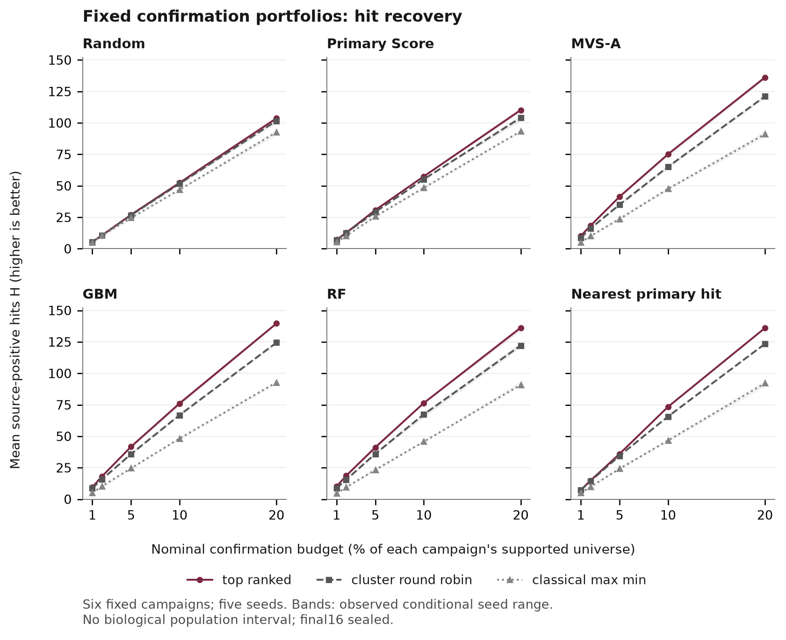
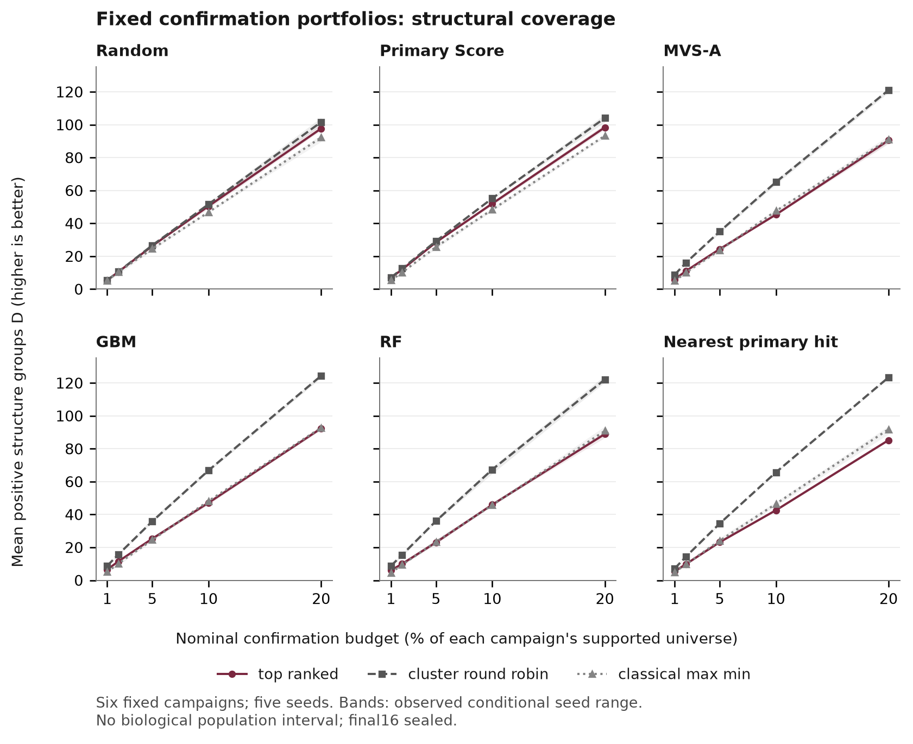

# LR-CF1: real-source confirmation portfolios

**Data/endpoint feasibility and baseline opportunity are complete.** All 60
molecular fits and 2,700 fixed comparison cells passed. Independent local
recalculation matches every H/D cell. The result confirms a hit/coverage tradeoff
already attainable with classical controls. **NO_GO for a quota-only new-method
claim; novel-selector potential remains unproven.** This is not an independent
final study or a submission-ready paper.

## What was actually run

Six whole AIC_Finder campaigns were selected by numeric AID before outcomes from
snapshot `04c58e85188e724ec5ff44cbed2e7b960f6f3df3`. Source intake was 77,576,150
bytes and 1,341,881 assay-specific primary rows. After protected exact-structure,
invalid/duplicate exclusions, 1,333,191 primary rows and 6,896 observed primary-hit
confirmations remained. These are observations, not unique cross-assay molecules.
All six campaigns are now exposed development data.

| Primary/confirmation AID | Retained primary rows | Supported U | Source positives in U | Positive groups in U | Actual B at 1/2/5/10/20% |
| :--- | ---: | ---: | ---: | ---: | :--- |
| 628/677 | 63,058 | 1,640 | 717 | 599 | 17, 33, 82, 164, 328 |
| 1040/1254 | 194,681 | 1,181 | 246 | 210 | 12, 24, 60, 119, 237 |
| 2661/2821 | 319,652 | 219 | 171 | 127 | 3, 5, 11, 22, 44 |
| 449739/489005 | 103,716 | 881 | 693 | 567 | 9, 18, 45, 89, 177 |
| 485270/492964 | 323,814 | 1,780 | 872 | 701 | 18, 36, 89, 178, 356 |
| 485273/493155 | 328,270 | 1,195 | 351 | 232 | 12, 24, 60, 120, 239 |

There are four provider blocks and one historical annotation-connected component,
not six certified independent biological families. Source 0 combines inactive
and inconclusive; missing confirmation is excluded, never imputed. The source
totals are 3,050 positive assay-specific observations and 2,436 within-campaign
positive groups. Their sums do not identify globally unique molecules/groups.

Thirty MVS-A and thirty RF models use primary labels only. GBM probabilities
reuse MVS-A's model. Random, Primary Score and nearest-primary controls add no
fit. All six rankers receive top-ranked, group round-robin and classical max-min
at five fixed budgets and five seeds. All 18 nominal arms, redundant controls
and unfavorable cells remain in the [complete CSV](../evidence/lr-cf1-20261109-v1/portfolio-cells-v1.csv).
Original author score/checkpoint/leaf-loop conventions and core package versions
are retained; all 30 real MVS-A score recalculations pass the declared tolerance.

## Descriptive result at the predeclared 10% reading example

Every campaign has equal weight. H is source-positive hits; D is positive Murcko/
acyclic-fallback groups. Brackets are the observed range across five conditional
seeds, **not biological-population confidence intervals**. D(FP) uses the frozen
fingerprint grouping. Actual confirmation counts are 164/119/22/89/178/120.

| Ranker | Operator | Mean H [seed range] | Mean D [seed range] | Mean D(FP) |
| :--- | :--- | ---: | ---: | ---: |
| Random | Top-ranked | 52.40 [51.00, 53.67] | 50.50 [49.00, 51.67] | 50.60 |
| Random | Group round-robin | 51.67 [50.83, 52.67] | 51.67 [50.83, 52.67] | 51.00 |
| Random | Classical max-min | 46.93 [46.33, 47.67] | 46.83 [46.33, 47.50] | 46.93 |
| Primary Score | Top-ranked | 57.50 [56.83, 58.33] | 52.03 [50.83, 53.00] | 52.27 |
| Primary Score | Group round-robin | 55.23 [54.67, 55.83] | 55.23 [54.67, 55.83] | 53.37 |
| Primary Score | Classical max-min | 48.43 [47.33, 49.50] | 48.40 [47.33, 49.50] | 48.43 |
| MVS-A | Top-ranked | 75.13 [73.00, 76.33] | 45.37 [44.83, 46.00] | 44.30 |
| MVS-A | Group round-robin | 65.13 [63.67, 66.50] | 65.13 [63.67, 66.50] | 56.57 |
| MVS-A | Classical max-min | 47.57 [46.33, 48.50] | 47.57 [46.33, 48.50] | 47.57 |
| GBM | Top-ranked | 76.07 [73.83, 78.00] | 47.17 [46.00, 48.50] | 45.70 |
| GBM | Group round-robin | 66.83 [65.83, 67.67] | 66.83 [65.83, 67.67] | 58.60 |
| GBM | Classical max-min | 48.23 [47.33, 48.83] | 48.23 [47.33, 48.83] | 48.23 |
| RF | Top-ranked | 76.40 [76.00, 77.33] | 46.00 [45.67, 46.50] | 43.53 |
| RF | Group round-robin | 67.37 [64.83, 68.83] | 67.37 [64.83, 68.83] | 58.17 |
| RF | Classical max-min | 45.73 [45.00, 46.50] | 45.73 [45.00, 46.50] | 45.73 |
| Nearest primary hit | Top-ranked | 73.40 [73.17, 73.67] | 42.63 [42.50, 42.83] | 40.30 |
| Nearest primary hit | Group round-robin | 65.70 [65.17, 66.17] | 65.70 [65.17, 66.17] | 55.67 |
| Nearest primary hit | Classical max-min | 46.67 [45.50, 47.67] | 46.53 [45.17, 47.67] | 46.67 |

For the predeclared MVS-A anchor, round-robin changes mean H from
75.13 to 65.13
(-10.00; -13.31%)
and mean D from 45.37 to
65.13 (+19.77;
+43.57%).
The fingerprint sensitivity also increases, from
44.30 to 56.57,
but the magnitude depends on the group definition. These are descriptive
development effects, without a post-result meaningful-effect threshold.

## All five budgets, same MVS-A anchor

| Nominal budget | Top H | Top D | Round-robin H | Round-robin D | H difference | D difference |
| :--- | ---: | ---: | ---: | ---: | ---: | ---: |
| 1% | 10.13 | 5.93 | 8.73 | 8.73 | -1.40 | +2.80 |
| 2% | 18.30 | 11.03 | 16.03 | 16.03 | -2.27 | +5.00 |
| 5% | 41.37 | 24.37 | 35.07 | 35.07 | -6.30 | +10.70 |
| 10% | 75.13 | 45.37 | 65.13 | 65.13 | -10.00 | +19.77 |
| 20% | 136.13 | 90.50 | 121.07 | 121.07 | -15.07 | +30.57 |

The direction is consistent here: more confirmed groups, fewer confirmed
compounds. Ranker ordering varies with budget and metric; there is no universal
best-model claim. Paired campaign/seed contrasts and all provider summaries are
available in the evidence index, including unfavorable effects.

## Why this is not a new method result

Every assigned B is smaller than the available number of structure groups.
Consequently, round-robin takes only its first pass: one candidate per group.
All 900 round-robin cells therefore have D=H by construction. This is a property
of the operator and budget range, not two independent empirical successes.
Learned primary rankers combined with that classical quota account for the
observed tradeoff. Max-min alone often loses relevance; beating it alone would
not establish novelty. MVS-A's paper already discusses diversity and hybrid
selection, so the next claim cannot be merely ranking plus a scaffold quota.

**Recommendation:** do not fund a new selector on this quota-only contribution.
The problem is measurable; a distinct mechanism that improves on the strongest
shared diversified controls has not been established. A different mechanism
would require its own literature/identifiability review, frozen design and owner
approval. No novel selector or RL controller was trained in LR-CF1.

## Resource and return evidence

The retained upper allocation is 93,088/172,800 CPU seconds
(25.858/48 hours), including the full 43,200-second utility bucket
and every failed attempt. This is not measured total CPU. Measured whole-cgroup
CPU at result for the 60 molecular fits is 16,408.400 seconds
(4.558 hours); setup, features, selection and utilities are
separate. The closure audit gives handler-level measurements and their scope.
The original deadline was never reset.

All 10,655 task files (5,130,006,634 bytes) and
seven export files returned locally, were SHA-256 checked and independently
reread before exact task/export cleanup. The archive is 1,080,043,143
bytes. Combined owned regular files plus archive are 6,210,049,777 bytes, below
8 GiB. Fresh exact remote absence passed. Raw data, environments, models and
private traces remain in `.local/lr-cf1-20261109-v1/remote-return/`, outside Git.

## Resolved technical issues and remaining scientific limits

- SI/repository codenames conflict in 13/17 pairs. The owner approved numeric AID
  plus repository provenance; aliases remain recorded. This is qualified
  processed-repository reproduction, not raw-assay/all-paper-table equivalence.
- Four stored CSV indices contain legitimate gaps. The initial dense-index
  assumption failed; append-only repairs retained every eligible original row.
- A conservative storage forecast stopped before remaining fits. Measured opaque
  gzip sizing showed the unchanged matrix and complete return fit the8 GiB cap.
- Concurrent worker rendering leaked a bootstrap type flag into a metadata-only
  stage. A terminal/target-absence check and fresh serial stage repaired it,
  without refits, changed cells or premature confirmation analysis.
- Visual QA caught first-render shared-axis clipping at 20%; v2 restores all
  endpoints with unchanged data. The first render/source remain private history.
- The six development campaigns are exposed, dependence remains, and the
  historical observation process limits whole-library interpretation. Final16
  remains sealed and is not automatically a matching confirmation test panel.
- Raw records and the protected exclusion index remain private. The public code
  and aggregates are not a complete external row-level reproduction bundle.

## Product and journal position

The [EN/TH offline evidence report](../../research/product_handoffs/lr_cf1_v1/report.html)
and strict card are complete; 70 language/campaign/budget views were browser
checked. This is separate from the live engine and contains no individual assay
rows. It provides a useful internal evidence/decision artifact, without a
customer workflow, commercial-data clearance or ROI evaluation.

The [English paper insert](../07_publication/LR_CF1_METHODS_RESULTS_INSERT_20261109.md)
is a methods/results draft. As a reviewer, I would request a distinct method,
stronger independent evaluation and a cleared reproduction plan before a
method-first journal submission. The current package does not establish novel
algorithmic contribution, independent biological generalization or publication
readiness. No benchmark-paper pivot or journal submission is initiated.

Read the [owner checkpoint](../06_execution/LR_CF1_OWNER_CHECKPOINT_20261109.md)
and [next-method disposition](LR_CF1_NEXT_METHOD_DISPOSITION_20261109.md) before
any new training, source intake or evaluation phase.
