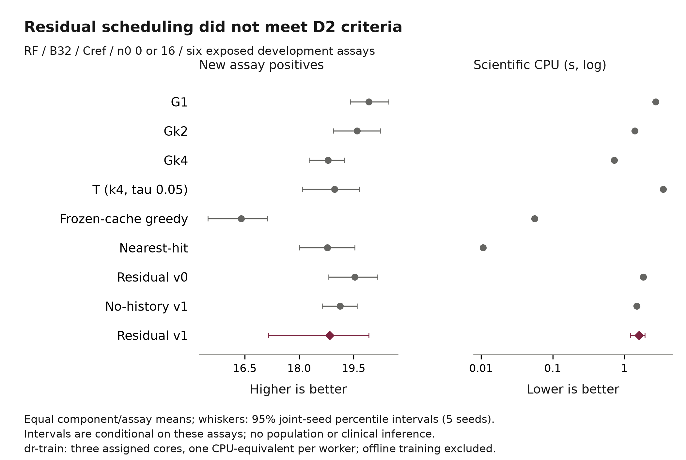

# LR-D23 development results

**Scientific disposition: INCONCLUSIVE_D2.** The residual candidate failed the
frozen usefulness and attribution gate. D3 is **NOT_RUN_D2_GATE_NOT_MET**. All
authorized primary/attribution work and the independent offline handoff are
complete. M3 and final16 remain closed.

The decisive comparison is Gk2: it achieved more mean new positives with less
scientific CPU than v1. Additional complexity is not supported by these results.
The study is a method evaluation on published FS-Mol data, not a new benchmark
publication or an RL superiority claim.

[Vector figure](../assets/research/lr-d23-v1/primary-comparison.svg) ·
[Full-precision aggregate](../evidence/lr-d23-20261109-v1/D2-aggregate-v1.json) ·
[CSV](../evidence/lr-d23-20261109-v1/primary-results-v1.csv)

## What was executed

The owner-approved [plan](../06_execution/LONG_RUN_D2_D3_PROPOSAL_20261109.md)
started from main `36f3812`. The fresh release was 9 November 2026 at
11:47:12.999016 UTC, with an original deadline of 12 November at the same UTC
time. The ceiling was 24 CPU-hours / 72 elapsed hours, local one plus up to
three dr-train workers. The inactive conditional 96-hour grant was not activated.

One candidate uses Gk2 plus a fixed-alpha Ridge terminal-gain gate choosing only
UPDATE/REUSE. Round0 uses Gk2-generated states/common Gk2 tails; round1 uses each
outer fold's v0-generated states/common frozen v0 tails. Final v1 uses only
round1 targets. Four held-out annotation-component folds exclude the held-out
component from state generation, targets, scaling and fitting. No third round,
replacement candidate or post-result threshold change was made.

Data remain the six already exposed development assays, with 1,285 assay-specific
records / 1,107 unique canonical structures in four annotation components.
There is no new biological independence from using new seeds. Components are
not certified families, and no chemical/scaffold OOD claim is made.

| Executed allocation | Count | Status |
| :--- | ---: | :--- |
| Synthetic admission | 48 complete G1 campaigns + 24 constructed checks | PASS |
| Training prefixes | 216 | PASS |
| Paired continuation branches | 1,296 | PASS |
| Fitted models | 4 v0 + 4 v1 + 4 no-history | PASS |
| D2 primary campaigns | 420 | PASS_EXECUTION |
| Attribution campaigns | 120 | PASS_EXECUTION |
| D3 additional cells | 0 of 7 conditional cells | NOT_RUN: D2 gate not met |
| Final16 / M3 | 0 | NOT_RUN: not released |

All 324 paired states per training round have executed support, with outer-fold
totals 72/90/90/72, above the frozen minimum. All 2,052 biological units were
retained. No scientific retry or outcome-based replacement was used.

## Discovery and compute

Primary: RF / B32 / Cref, uniform n0=0/16, five matched evaluation seeds.
Initial labels do not enter new-hit counts. Means give equal component weight,
equal assay weight within component and matched n0/seed contexts.

| Arm | Mean new positives, higher better | Mean scientific CPU (s), lower better | Mean deliveries |
| :--- | ---: | ---: | ---: |
| G1 | 19.9250 | 2.7443 | 32.000 |
| Gk2 | 19.6000 | 1.3914 | 32.000 |
| Gk4 | 18.8000 | 0.7179 | 32.000 |
| T(k4,tau0.05) | 18.9750 | 3.4900 | 31.925 |
| Frozen-cache greedy | 16.4000 | 0.0558 | 32.000 |
| Nearest-hit | 18.7750 | 0.0107 | 32.000 |
| v0 attribution | 19.5375 | 1.8322 | 32.000 |
| No-history v1 attribution | 19.1250 | 1.4846 | 32.000 |
| Residual v1 | 18.8375 | 1.5945 | 32.000 |

Random was not assigned in this protocol. Historical app demonstrations and
their selection policies are separate evidence.

| Frozen requirement | Observed | Decision |
| :--- | :--- | :--- |
| G1: hit loss <=0.25 and CPU saving >=20% | Loss 1.0875; saving 41.90% | FAIL: loss |
| Gk2: >=1 extra hit with CPU<=1.1x, or saving>=20% with loss<=0.25 | 0.7625 fewer hits; 14.59% more CPU | FAIL |
| At least 3/4 components within 0.25 loss of G1 | 1/4 | FAIL |
| No control mean-point dominates v1 | Gk2 has more hits and lower CPU | FAIL |
| Complete matched support | All assigned comparisons; same-core contexts | PASS |
| Useful attribution beyond no-history and complete incumbent fallback | Real overrides, but no-history has more hits/lower CPU | INCONCLUSIVE |

The candidate made 1,268 actual delivered overrides across its 60 campaigns,
with no interruption or feasibility fallback. Its failure is not explained by
an unused gate. All candidate campaigns deliver B32. T's interruptions and
lower delivery mean remain visible.

The v1-minus-G1 hit contrast is -1.0875, conditional 95% interval
[-2.7500, 0.2375]. Against Gk2 it is -0.7625 [-2.5125, 0.7250]; against
no-history it is -0.2875 [-1.6375, 0.7625]. These enumerate all 5^5 joint-seed
resamples conditional on the same assays. They are not biological population
CIs. Gk2's mean-point dominance is descriptive, without a significance claim.

In frozen component order, v1-minus-G1 hit differences are +0.20, -2.40, -0.40
and -1.75. See the aggregate JSON for full component IDs and every effect.
Compared with v0, round1 v1 has 0.7000 fewer hits while using less CPU. Neither
v0 nor no-history is selected post hoc as a replacement candidate.

## Cost, integrity and return

The retained account is **29,040 seconds = 8.0667 CPU-hours** under 86,400.
This includes the full 6,000-second utility/handoff bucket and complete booked
scientific envelopes, including preserved utility failures. Unused allowance
does not authorize another study.

Measured remote scientific-worker process CPU is 2,629.321 seconds; this is a
different quantity from the retained account and excludes some utilities.
Experimental training prefixes/branches/fits consume 1,704.194 measured seconds.
Dividing this experimental training workload by the observed 1.14982-second
per-campaign CPU saving against G1 gives a hypothetical 1,483-campaign recovery
point. This excludes utilities, uses fold-training workload and does not model
a deployable training investment or laboratory economics. The hit-loss gate
already fails, so this arithmetic does not justify adopting v1.

All 100 remote scientific batches have actual one-CPU-equivalent / 4GiB / zero
swap kernel proof. At most three batches overlap, with no same-core overlap.
The largest incremental unit CPU, including first-unit startup, is 6.357 seconds,
inside the 10-second envelope. All returned traces were checked against their
development input labels and initial-label exclusion; aggregate reproduction is
exact. All 58 old file pins and 11 old ledgers remain unchanged.

Complete private return covers **11,188 task files / 248,687,151 bytes**, plus
seven export files. Archive: 90,943,907 bytes, SHA-256
`ed2359cec1c73bc07007889a762e9538ee540a1961faf0a185cf2c42c2a1dcde`.
Every file was independently reread locally before exact task/export cleanup.
Fresh absence is verified. Private root:
`C:\Users\User\Desktop\myProject\curaloop-rl\.local\lr-d23-20261109-v1`.

See the [closure audit](../evidence/lr-d23-20261109-v1/closure-audit-v1.json),
[complete return](../evidence/lr-d23-20261109-v1/complete-return-verified-v1.json),
[fresh absence](../evidence/lr-d23-20261109-v1/fresh-absence-v1.json) and
[engineering notes](../evidence/lr-d23-20261109-v1/engineering-notes-v1.json).
The notes retain the Windows test-stub repair, early local utility overlap,
figure-only tick-bound repair and frozen import-order warning. None changes the
scientific candidate, gate or outcomes.

Final local checks pass 39 distinct constructed/regression cases: 28 primary
checks plus 11 historical analysis checks. An earlier subprocess collection
attempt failed with a native allocation/stack error under an aggregate 512MiB
wrapper; recovery ran in process under the approved 1GiB local bound. The original
failure and all test receipts are retained in the [recovery record](../evidence/lr-d23-20261109-v1/validation-recovery-v1.json).
The documented offline re-analysis CLI also reproduced all 540 evaluation rows
exactly. Full app runtime/browser/build checks were not rerun because no app
runtime was changed.

## Contribution, product and journal decision

This round supplies a reproducible negative method evaluation: a learned gate
was actually used, two behavior-conditioned rounds ran with outer-component
isolation, and strong cheap controls defeated the proposed advantage. It does
not establish a superior method or certify novelty. Existing active-search and
cost-aware retraining ideas remain the relevant prior art.

The [EN/TH aggregate-only card](../../research/product_handoffs/lr_d23_v1/README.md)
and [English paper insert](../07_publication/LR_D23_METHODS_RESULTS_INSERT_20261109.md)
are complete handoff artifacts. Running UI, live engine adapters, connectors,
customer workflow measurement and deployment were not changed or tested here.
The four-screen application can remain useful as a research workbench, without
advertising this candidate as its superior policy.

**Journal sufficiency: NO for a method-superiority submission from this evidence.**
There is no protected final result, broad transfer, independent biological
validation, certified novelty or customer/clinical benefit. This is useful
negative development evidence, not a submission-ready paper. No journal was
contacted and no submission or payment was made.

Recommended owner decision: close this candidate and review the research
question before any new training. Product workflow work can be scoped separately
around transparent baseline comparisons. Do not run D3/M3 for v1 or relax the
thresholds to manufacture a pass. See the [owner checkpoint](../06_execution/LR_D23_OWNER_CHECKPOINT_20261109.md).

## Historical wording correction

The old D1 report/proposal incorrectly described a masked/full-pool population
mismatch. The original M2 mask retained every compound in all six pools; an
identifier-only equality check confirms this. The [erratum](../evidence/lr-d23-20261109-v1/pool-frame-erratum-v1.json)
preserves the old mask/results and corrects interpretation. Different seeds,
interventions and estimands still prohibit arbitrary cross-study pairing.
