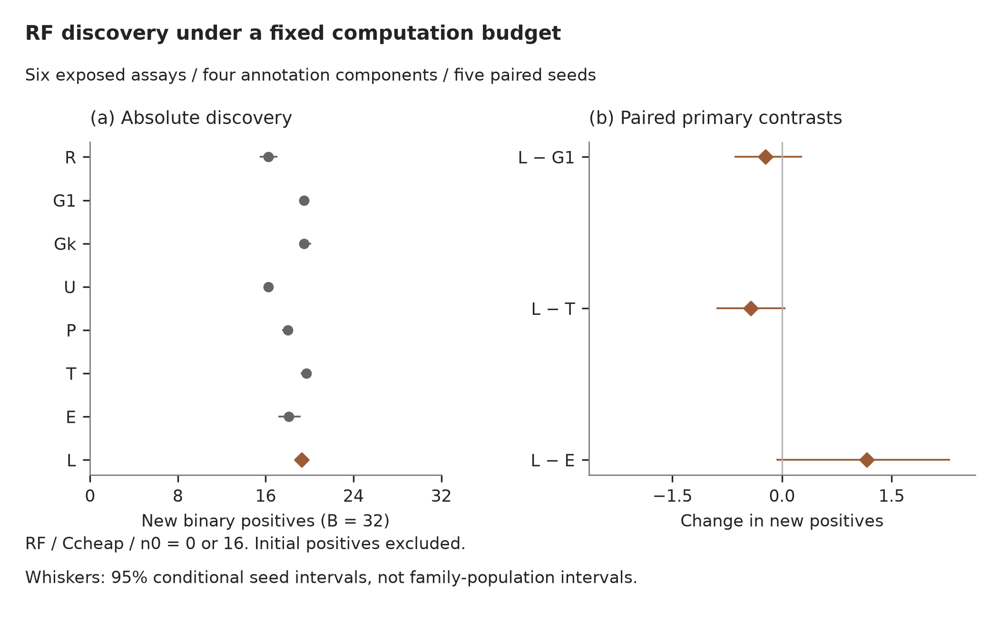
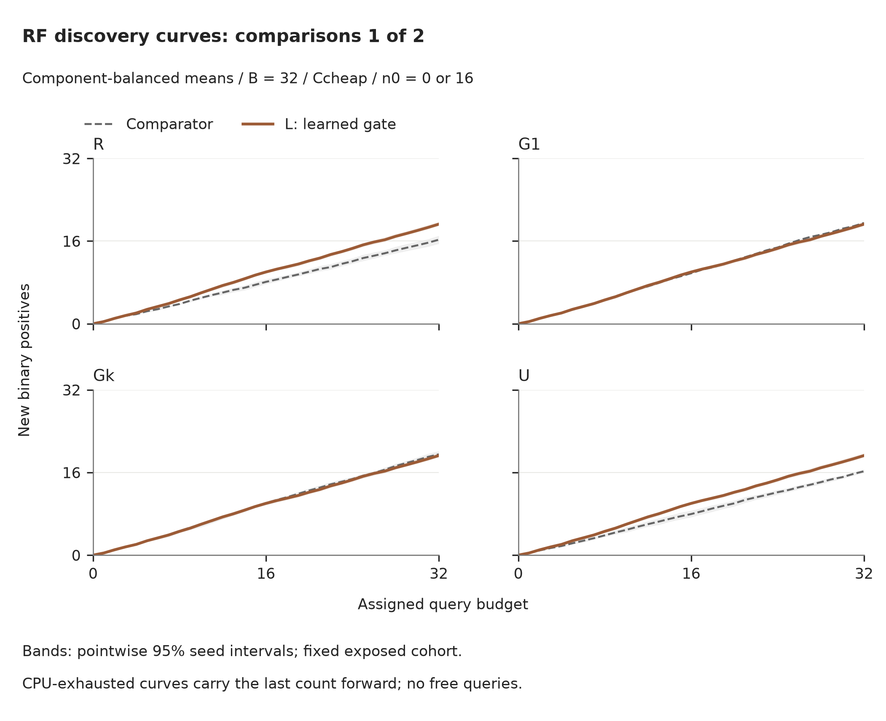
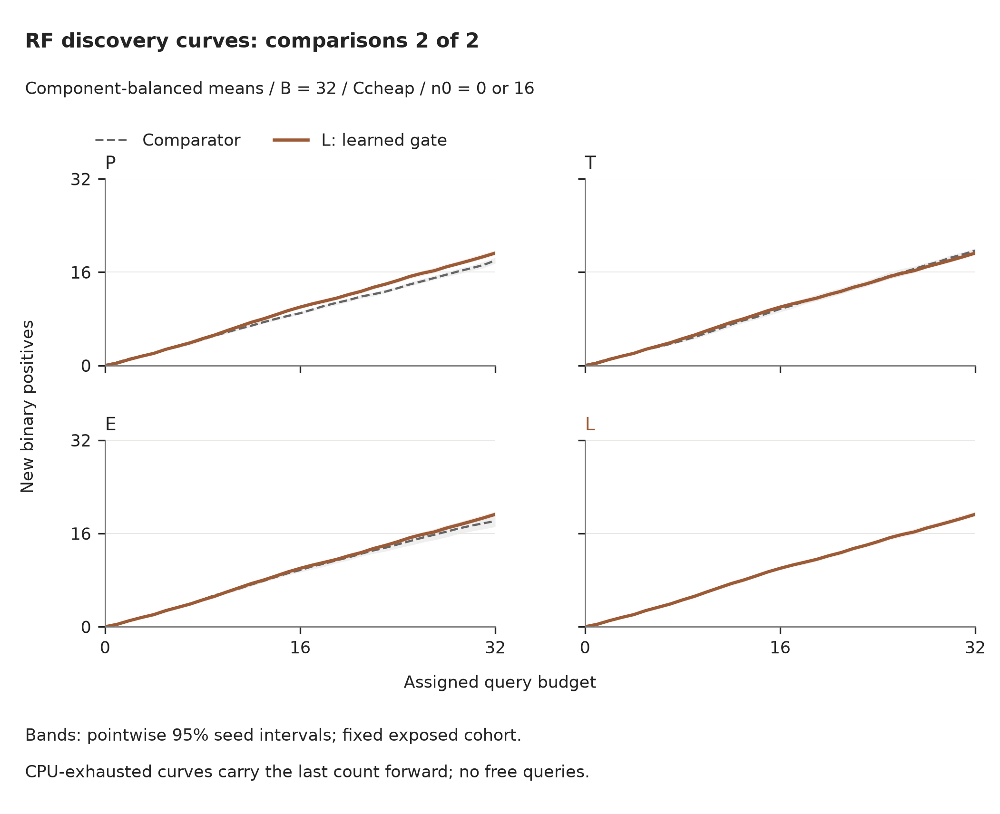

# Costed M2 development results

**COMPLETE_FOR_OWNER_REVIEW — INCONCLUSIVE.** Technical closeout: **PASS**.

The fixed development study is complete. Final outcomes remained closed throughout M2. Completion is a research result, including mixed or negative findings; it is not publication readiness or a production-policy release.

The owner's conditional M3 -> P1 -> J1 grant is not activated because M2 did not meet its predeclared promising-signal entry condition. Review the findings with the owner before another research release; final outcomes remain closed.

## Question and evidence scope

The method learns whether to REUSE cached scores, UPDATE the predictor, or PLAN with the same nonmyopic reference used by its controls. The incremental contribution under test is useful outcome-supervised computation allocation in molecular active search. General metareasoning, portfolios and learned acquisition remain established prior art.

Six previously exposed FS-Mol development assays provide 1,285 task rows and four annotation components. These are not four certified independent biological families. The freshly admitted training mask retained all rows, with no cross-component canonical overlap. No final feature, label or presence payload, old validation pool, new assay or download was used.

Labels are assay-relative potency-derived binary classifications. Newly delivered positives exclude initial observations. They are not validated therapeutic hits, realistic HTS prevalence, clinical outcomes or monetary savings.

### Frozen computation limits

Caps below were derived without molecular outcomes: 1.25 times the maximum complete matched synthetic reference across both pool sizes and three repeats. They differ by predictor/n0/B; comparisons are paired within each context. Machine-readable evidence retains full precision. No high regime collapsed.

| Predictor | Initial n0 | New-label B | Ccheap (CPU-s) | Cplan (CPU-s) |
| --- | --- | --- | --- | --- |
| rf | 0 | 16 | 1.60838 | 25.0079 |
| rf | 0 | 32 | 3.43279 | 56.2592 |
| rf | 16 | 16 | 2.00059 | 30.2752 |
| rf | 16 | 32 | 3.79663 | 64.9061 |
| neighbor | 0 | 16 | 0.0312536 | 2.31804 |
| neighbor | 0 | 32 | 0.0325011 | 4.8074 |
| neighbor | 16 | 16 | 0.0250013 | 2.29419 |
| neighbor | 16 | 32 | 0.0374977 | 4.73565 |

## Primary result

RF, assigned B=32 and Ccheap. Seeds and n0 are equally weighted within each assay, assays equally within component, and the four components equally. Intervals below are 95% conditional seed-variability intervals on this fixed cohort, from 10,000 jointly resampled seed vectors. They are not population-wide biological-family confidence intervals.

| Contrast | Mean change in new positives | Conditional 95% interval | Positive components |
| --- | --- | --- | --- |
| L-G1 | -0.225 | [-0.650, 0.275] | 1/4 |
| L-T | -0.425 | [-0.900, 0.050] | 1/4 |
| L-E | 1.163 | [-0.075, 2.300] | 4/4 |

| Annotation component | L-G1 | L-T | L-E | L minus no-history |
| --- | --- | --- | --- | --- |
| globin annotation component | -0.500 | -0.700 | 2.200 | 1.500 |
| MIT/TFE annotation component | 0.900 | 0.200 | 0.750 | 1.650 |
| TNF annotation component | -1.100 | -0.600 | 1.000 | 0.100 |
| quarantined broad annotation component | -0.200 | -0.600 | 0.700 | 1.900 |

The predeclared exploratory potential rule requires positive mean L−G1, L−T and L−E, positive L−G1 in at least three components, and positive L−no-history, with no accounting/information artifact. No practical-effect margin or p<0.05 gate was invented. With four dependence groups the minimum attainable two-sided sign-flip p-value is 0.125.

| Requirement | Observed |
| --- | --- |
| L-G1 mean > 0 | False |
| L-T mean > 0 | False |
| L-E mean > 0 | True |
| L−G1 positive in at least 3/4 components | False |
| L−no-history mean > 0 | True |
| Technical closeout | PASS |

## Full matched comparisons

R: uniform Random; G1: update each delivery; Gk: training-selected periodic update; U: p(1−p) uncertainty; P: plan while feasible with a charged cheap tail; T: training-selected threshold rule; E: Exp3 selected-operation feedback; L: learned gate. Both predictors, initial-label settings and all five evaluation seeds are retained. Every reported arm has 60 campaigns per CPU regime.

### RF / cheap

| Arm | Mean new positives | New delivered | Total observed | Science CPU (s) | Process CPU (s) | Process wall (s) | Full B / 60 | Interrupted / 60 |
| --- | --- | --- | --- | --- | --- | --- | --- | --- |
| R | 16.262 | 32.000 | 40.000 | 0.101 | 2.949 | 2.901 | 60 | 0 |
| G1 | 19.500 | 32.000 | 40.000 | 2.713 | 5.564 | 5.520 | 60 | 0 |
| Gk | 19.513 | 32.000 | 40.000 | 1.381 | 4.222 | 4.181 | 60 | 0 |
| U | 16.238 | 32.000 | 40.000 | 2.702 | 5.550 | 5.515 | 60 | 0 |
| P | 18.000 | 32.000 | 40.000 | 3.053 | 5.897 | 5.858 | 60 | 0 |
| T | 19.700 | 31.938 | 39.938 | 3.482 | 6.327 | 6.285 | 59 | 0 |
| E | 18.112 | 30.062 | 38.062 | 3.529 | 6.373 | 6.338 | 53 | 3 |
| L | 19.275 | 31.938 | 39.938 | 3.170 | 6.015 | 5.972 | 59 | 0 |

### RF / high

| Arm | Mean new positives | New delivered | Total observed | Science CPU (s) | Process CPU (s) | Process wall (s) | Full B / 60 | Interrupted / 60 |
| --- | --- | --- | --- | --- | --- | --- | --- | --- |
| R | 16.262 | 32.000 | 40.000 | 0.100 | 2.942 | 2.897 | 60 | 0 |
| G1 | 19.500 | 32.000 | 40.000 | 2.702 | 5.554 | 5.511 | 60 | 0 |
| Gk | 19.513 | 32.000 | 40.000 | 1.381 | 4.237 | 4.192 | 60 | 0 |
| U | 16.238 | 32.000 | 40.000 | 2.711 | 5.557 | 5.516 | 60 | 0 |
| P | 19.675 | 32.000 | 40.000 | 43.481 | 46.349 | 46.345 | 60 | 0 |
| T | 19.188 | 32.000 | 40.000 | 31.527 | 34.366 | 34.342 | 60 | 0 |
| E | 19.288 | 32.000 | 40.000 | 14.246 | 17.098 | 17.063 | 60 | 0 |
| L | 19.725 | 32.000 | 40.000 | 14.081 | 16.924 | 16.894 | 60 | 0 |

### NEIGHBOR / cheap

| Arm | Mean new positives | New delivered | Total observed | Science CPU (s) | Process CPU (s) | Process wall (s) | Full B / 60 | Interrupted / 60 |
| --- | --- | --- | --- | --- | --- | --- | --- | --- |
| R | 16.262 | 32.000 | 40.000 | 0.010 | 2.868 | 2.818 | 60 | 0 |
| G1 | 20.425 | 32.000 | 40.000 | 0.017 | 2.863 | 2.814 | 60 | 0 |
| Gk | 19.975 | 32.000 | 40.000 | 0.014 | 2.865 | 2.817 | 60 | 0 |
| U | 16.150 | 32.000 | 40.000 | 0.017 | 2.870 | 2.821 | 60 | 0 |
| P | 18.125 | 32.000 | 40.000 | 0.012 | 2.854 | 2.815 | 60 | 0 |
| T | 19.975 | 32.000 | 40.000 | 0.017 | 2.862 | 2.820 | 60 | 0 |
| E | 20.137 | 32.000 | 40.000 | 0.018 | 2.865 | 2.817 | 60 | 0 |
| L | 19.712 | 31.200 | 39.200 | 0.024 | 2.876 | 2.827 | 50 | 0 |

### NEIGHBOR / high

| Arm | Mean new positives | New delivered | Total observed | Science CPU (s) | Process CPU (s) | Process wall (s) | Full B / 60 | Interrupted / 60 |
| --- | --- | --- | --- | --- | --- | --- | --- | --- |
| R | 16.262 | 32.000 | 40.000 | 0.010 | 2.852 | 2.802 | 60 | 0 |
| G1 | 20.425 | 32.000 | 40.000 | 0.017 | 2.863 | 2.820 | 60 | 0 |
| Gk | 19.975 | 32.000 | 40.000 | 0.014 | 2.868 | 2.821 | 60 | 0 |
| U | 16.150 | 32.000 | 40.000 | 0.017 | 2.864 | 2.817 | 60 | 0 |
| P | 20.750 | 32.000 | 40.000 | 1.995 | 4.840 | 4.809 | 60 | 0 |
| T | 20.625 | 32.000 | 40.000 | 1.395 | 4.245 | 4.207 | 60 | 0 |
| E | 20.475 | 32.000 | 40.000 | 0.635 | 3.481 | 3.436 | 60 | 0 |
| L | 20.488 | 32.000 | 40.000 | 1.760 | 4.605 | 4.562 | 60 | 0 |

### Paired effects across all regimes

| Predictor | C regime | Contrast | Mean change | Conditional 95% interval |
| --- | --- | --- | --- | --- |
| rf | cheap | L-G1 | -0.225 | [-0.650, 0.275] |
| rf | cheap | L-T | -0.425 | [-0.900, 0.050] |
| rf | cheap | L-E | 1.163 | [-0.075, 2.300] |
| rf | high | L-G1 | 0.225 | [-0.113, 0.637] |
| rf | high | L-T | 0.537 | [-0.388, 1.538] |
| rf | high | L-E | 0.438 | [-0.450, 1.012] |
| neighbor | cheap | L-G1 | -0.713 | [-1.087, -0.287] |
| neighbor | cheap | L-T | -0.263 | [-0.600, 0.062] |
| neighbor | cheap | L-E | -0.425 | [-0.750, -0.100] |
| neighbor | high | L-G1 | 0.062 | [-0.463, 0.438] |
| neighbor | high | L-T | -0.138 | [-0.275, 0.000] |
| neighbor | high | L-E | 0.013 | [-0.487, 0.362] |

### Descriptive compute/discovery frontier

Nondominance below compares mean scientific CPU and mean discovery across the 16 cheap/high operating points within each predictor. This is a descriptive mean-point frontier, not statistical dominance; all dominated points remain in the full tables.

| Predictor | C regime | Arm | Science CPU (s) | New positives |
| --- | --- | --- | --- | --- |
| rf | cheap | T | 3.482 | 19.700 |
| rf | high | R | 0.100 | 16.262 |
| rf | high | Gk | 1.381 | 19.513 |
| rf | high | L | 14.081 | 19.725 |
| neighbor | cheap | G1 | 0.017 | 20.425 |
| neighbor | cheap | P | 0.012 | 18.125 |
| neighbor | high | R | 0.010 | 16.262 |
| neighbor | high | Gk | 0.014 | 19.975 |
| neighbor | high | P | 1.995 | 20.750 |
| neighbor | high | T | 1.395 | 20.625 |
| neighbor | high | E | 0.635 | 20.475 |

### Discovery curves

All curves use the assigned query budget. CPU-exhausted campaigns retain their last delivered count; no extra labels are acquired. Bands are pointwise 95% intervals from the same conditional seed-vector bootstrap, not simultaneous coverage across all budgets.

The [aggregate curve table](../evidence/m2-costed-20261108-v2/discovery-curves-v1.csv) includes all eight policies, both predictors and both CPU regimes. Vector SVG/PDF exports accompany the previews.

The [complete summary table](../evidence/m2-costed-20261108-v2/main-summary-v1.csv) also reports H/B, the discrete mean of H(k) across assigned budgets, and delivered-observation Brier/log loss. These errors are selection-biased diagnostics, not pool calibration. Process wall time includes startup/reporting but excludes queue waiting.

## Attribution and B=16 transfer

RF history/action ablations use the same cheap budgets and five seeds. Their jobs were interleaved with the main jobs on the same paired core before any outer evaluation. B=16 transfer uses the first three evaluation seeds, both n0/C regimes and frozen B=32 gates/controls; no retuning.

| RF cheap ablation contrast | Mean change | Conditional 95% interval |
| --- | --- | --- |
| L-no_history | 1.288 | [0.613, 1.962] |
| L-no_UPDATE | 1.075 | [0.325, 1.837] |
| L-no_PLAN | -0.312 | [-0.713, 0.062] |

| B=16 C regime | Contrast | Mean change | Conditional 95% interval |
| --- | --- | --- | --- |
| cheap | L-G1 | -1.167 | [-1.750, -0.500] |
| cheap | L-T | -0.458 | [-1.000, 0.312] |
| cheap | L-E | 0.375 | [-0.438, 1.062] |
| high | L-G1 | -0.708 | [-1.312, -0.188] |
| high | L-T | -0.792 | [-0.938, -0.562] |
| high | L-E | -0.625 | [-1.000, -0.062] |

## Operation and support diagnostics

| Predictor | C regime | Arm | REUSE | UPDATE | PLAN | Feasibility fallbacks |
| --- | --- | --- | --- | --- | --- | --- |
| rf | cheap | G1 | 0 | 1824 | 0 | 0 |
| rf | cheap | T | 1354 | 345 | 120 | 1117 |
| rf | cheap | E | 1208 | 399 | 118 | 0 |
| rf | cheap | L | 1057 | 672 | 90 | 0 |
| rf | high | G1 | 0 | 1824 | 0 | 0 |
| rf | high | T | 470 | 73 | 1281 | 0 |
| rf | high | E | 656 | 618 | 550 | 0 |
| rf | high | L | 435 | 869 | 520 | 0 |
| neighbor | cheap | G1 | 0 | 1920 | 0 | 0 |
| neighbor | cheap | T | 1180 | 740 | 0 | 813 |
| neighbor | cheap | E | 997 | 908 | 15 | 0 |
| neighbor | cheap | L | 751 | 1110 | 12 | 0 |
| neighbor | high | G1 | 0 | 1920 | 0 | 0 |
| neighbor | high | T | 381 | 236 | 1303 | 0 |
| neighbor | high | E | 685 | 665 | 570 | 0 |
| neighbor | high | L | 75 | 383 | 1462 | 0 |

Operation counts identify requested operations, not all internal forest fits. Common initial fits and cold-start uniform choices are additional charged work; PLAN at one remaining assay degenerates to cheap selection.

Gate supervision retained 384 eligible state/C combinations out of 384; 0 branches retained an already-exhausted prefix and invoked no continuation. Each training state has three forced-operation continuations followed by common G1. Targets are realized terminal-hit differences, not optimal values or independent biological observations. Gates/scalers and control selection exclude the entire held-out component.

| Predictor | C regime | Forced operation | Positive targets | Zero targets | Negative targets | Mean target |
| --- | --- | --- | --- | --- | --- | --- |
| neighbor | cheap | PLAN | 0 | 96 | 0 | 0.000 |
| neighbor | cheap | UPDATE | 8 | 83 | 5 | 0.021 |
| neighbor | high | PLAN | 36 | 45 | 15 | 0.656 |
| neighbor | high | UPDATE | 8 | 83 | 5 | 0.021 |
| rf | cheap | PLAN | 29 | 32 | 35 | -0.208 |
| rf | cheap | UPDATE | 13 | 67 | 16 | -0.062 |
| rf | high | PLAN | 28 | 47 | 21 | 0.198 |
| rf | high | UPDATE | 13 | 67 | 16 | -0.062 |

## Execution and cost

| Stage | Completed units |
| --- | --- |
| prefix | 48 |
| branch | 1152 |
| tuning | 576 |
| main | 1920 |
| ablation | 180 |
| transfer | 288 |

All 96 unique synthetic contexts passed, including 12 preceding RF profiles and 84 in this continuation. The fresh release completed 4,248 intended units and retained 6 additional not-dispatched technical failures, each retried with unchanged parameters. The first local calibration coordinator hit its CPU envelope; switching to in-process booking and batched transport resolved that overhead. A later SSH connect timeout stopped tuning after 174 completed units; fresh exact job/unit absence preceded three identical-context retries. All stopped attempts and local orchestration reservations remain retained. Controller restarts continue only unchanged frozen units after reconciling successful remote receipts. A Windows heartbeat replacement collision was repaired without changing the molecular engine; its two actual-reader-lock checks concern telemetry only. Eleven distinct constructed engine checks, three original analysis checks, three supplemental heterogeneous-pairing scenarios and five transport checks passed. The pairing supplement verifies nonconstant shared-seed effects against an exhaustive finite bootstrap distribution and rejects malformed pairs. It changes neither the estimator nor the predeclared scientific criterion. Repeated executions are not additional distinct checks.

| Local orchestration attempt | Final state | Retained reservation (CPU-s) |
| --- | --- | --- |
| orchestration-recovery-v2 | FAIL | 2000 |
| orchestration-recovery-v3 | FAIL | 2000 |
| orchestration-recovery-v4 | FAIL | 2000 |
| orchestration-recovery-v5 | PASS | 1500 |

| Budget stage | Charged reservation (CPU-s) | Stage ceiling (CPU-s) |
| --- | --- | --- |
| engineering_guards | 11640 | 12690 |
| synthetic_calibration_and_utilities | 2460 | 2700 |
| training_prefixes_branches_gate | 27288 | 39600 |
| control_tuning | 13224 | 18000 |
| main_comparison | 43680 | 57600 |
| ablation_transfer | 7524 | 16200 |
| analysis_return_cleanup_retry_delivery | 1487 | 17460 |

Cumulative conservative charge: **31.729 CPU-hours of 48**, including 6922 retained seconds from earlier M2 steps. Failed attempts and utility reservations remain charged in full. This is conservative reservation accounting, not measured total-host CPU consumption. Original deadline: 2026-11-12T08:17:29Z; closed: 2026-11-09T02:40:30.932710+00:00.

Verified training/tuning worker subtotal: 8848.816 CPU-seconds. Their charged stage reservations total 40589 CPU-seconds. Shared setup/orchestration/return overhead is additional and included in the project accounting. The following worker-only amortization values are lower bounds, not complete deployment cost estimates.

| Assumed future campaigns | Worker CPU-s per campaign |
| --- | --- |
| 1 | 8848.816 |
| 10 | 884.882 |
| 100 | 88.488 |

Every biological unit passed trace/label consistency, paired-core and budget audits. Startup/reporting CPU range: [2.6306132979999997, 3.698119141]; all within five seconds. Timed campaigns ran only on the admitted dr-train runtime. Feature/graph preparation, inference, fits, planning, interruptions and fallbacks consumed C. The exact calibrated caps were not enlarged or clipped to favor a method.

## Reviewer assessment and limits

**Publication readiness: no.** This is grouped exploratory development evidence on a small, previously exposed cohort. Repeated seeds and correlated continuations do not increase biological independence. Similar scaffolds remain, predictor probabilities are uncalibrated, the synchronous retrospective simulator has unit costs and immediate delivery, and CPU regimes are hardware-specific. Delivered-observation error diagnostics are selection-biased. There is no chemical-OOD, clinical, lab-savings or universal-policy claim.

The owner's conditional M3 -> P1 -> J1 grant is not activated because M2 did not meet its predeclared promising-signal entry condition. Review the findings with the owner before another research release; final outcomes remain closed. A mixed or negative finding is not permission for an automatic M1 loop, larger dataset, new mechanism or journal submission.

The research controller is not integrated into the product as a validated production policy. The existing EN/TH app and R&D plugin retain their earlier evidence limits. Workflow utility and business value require separate assessment.

## Reproduction, return and preservation

Scientific implementation: `research/m2_costed_v2/`; original predictor/planner: `research/m2_v1/models.py`, unchanged. The private execution root retains frozen matrices, code pins, permits, gates, controls, source projections, traces and complete remote returns. All original inputs, previous ledgers, source roles and frozen historical findings were rechecked. Raw compound rows, structures, fingerprints, labels, gate caches and individual histories remain private.

The complete task/export was returned, safely extracted and independently reread/hash-verified before exact deletion of `/home/chaw/curaloop-tasks/m2-costed-20261108-v2` and its exact export. Fresh absence passed. The ledger is closed; do not reuse its allowance or recreate old roots.

Read the [aggregate evidence](../evidence/m2-costed-20261108-v2/README.md), [execution notes](../06_execution/M2_COSTED_EXECUTION_NOTES_20261108.md), [original plan](../06_execution/M2_EXPERIMENT_PLAN_20261108.md) and [owner checkpoint](../06_execution/M2_OWNER_CHECKPOINT_20261108.md).
