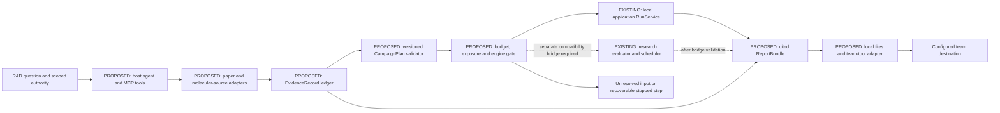

# CuraLoop agentic R&D plugin: first product proposal

5 November 2026. **PROPOSED; IMPLEMENTATION AND LIVE CONNECTIONS NOT_RUN.**

## Product promise to test

Turn an R&D question into an inspectable evidence package, a feasible study plan
and a report that a team can continue using in its existing workspace. The owner
selected **paper/molecular-database search followed by plan/report delivery to
team tools** as the first workflow. The commercial hypothesis is reduced analyst
effort and fewer unsupported or unreproducible decisions. Demand, willingness to
pay and laboratory savings remain untested.

Example future request: “Review the evidence for this target, distinguish
measured activity from predictions, propose a screening study under my budget,
and place the evidence-linked report in our project workspace.” The plugin
should return alternatives and unresolved evidence when a sound plan is not yet
possible. An empty search or a negative result is a valid workflow outcome.

## Current reusable system versus proposed work

| Current, statically inspected | New work required |
| --- | --- |
| [Application API](../../api/main.py) calls [RunService](../../src/curaloop/service.py) and the [application Campaign](../../src/curaloop/engine.py) | Typed connector/plugin layer, source intake, orchestrator and destination adapters |
| Three built-in datasets/five allowlisted policies, public observations, saved runs/revisions | A declared `CampaignPlan` schema; general external assay import is not implemented |
| [Public JSON/CSV reports](../../src/curaloop/export.py), validated JSON resume and SQLite recovery | Evidence/citation ledger plus a portable `ReportBundle`; CSV export is not CSV assay import |
| Local threaded comparison jobs; interrupted jobs are recorded after restart | Durable workflow steps, resumable retrieval, idempotent delivery and explicit interrupted-state handling |
| Separate [research PolicySession](../../research/planning_v3/policy.py) and [research scheduler](../../research/event_time.py) | A versioned research bridge and compatibility checks before that planner becomes an application option |
| Host/Origin checks for a local application | Destination credentials and scoped authority; no existing user authentication or tenant isolation can be assumed |

No MCP server, literature/database intake, team-tool connector or operational LLM
workflow was found in the scoped source review. The scientific planner and the
application engine must remain explicitly identified by schema/engine version.

## Proposed architecture

The [MCP standard](https://modelcontextprotocol.io/docs/2026-07-28/getting-started/intro)
is the recommended interface for AI clients to discover and call CuraLoop tools.
Use the client's configured model for orchestration initially; no new paid model
account or GPU service is included in this proposal. MCP support in a particular
client/provider still needs an integration check.

This editable diagram is a proposal, not a rendered/verified deployment diagram.
Solid arrows describe the intended first path, not already implemented edges;
dotted arrows require an additional research bridge. Existing node identities
come from the source links above. A reserved-outcome store is deliberately not
an agent-facing node. Architecture-diagrams skill checks were applied to these
state/edge labels; no visual export is claimed.

## Workflow and interface contracts

| Step | Proposed typed output | Automatic behavior within configured authority |
| --- | --- | --- |
| Search papers and source databases | `EvidenceRecord`: DOI/source ID, URL, exact version, retrieval time, supporting location, endpoint/unit, access/rights and exposure classification | Deduplicate records, follow relevant citations within a fixed retrieval budget, retain failures and conflicting evidence |
| Build a study proposal | `CampaignPlan`: question, population, source roles, engine version, controls, endpoint, simulated/actual operation assumptions, CPU/wall cap and unresolved gates | Validate completeness; distinguish source facts, inference and hypotheses; show alternatives when evidence is insufficient |
| Execute a permitted local workflow | `RunReference`: plan hash, backend/schema, public observation references, job/revision state and usage | Execute only the supported frozen replay or separately authorized study; stop at the declared resource boundary |
| Produce the report | `ReportBundle`: narrative, cited claims, public JSON/CSV, data/source/version ledger, failures, hashes and reproduction instructions | Reconcile reported hits/costs/pending work with the trusted engine; distinguish predictions from delivered labels |
| Return it to the team | `DeliveryReceipt`: destination/project/object ID, content hash, revision and duplicate key | Preview before the first destination grant; later delivery may be automatic within that standing scoped authority, with idempotent retry |

Proposed tool names are `search_evidence`, `inspect_source`, `draft_plan`,
`validate_plan`, `start_permitted_run`, `get_run_status`, `build_report`,
`preview_delivery` and `deliver_report`. These are design names, not callable
tools already present in the application.

Start with public paper metadata/open text and one molecular-record source,
then local Markdown/JSON/HTML output. Select one actual team destination during
the P1 implementation contract. Its provider capability, account permissions and
write scope must be checked rather than promising universal connectivity. PDF
is a presentation export around the same report identity, not the canonical
scientific record.

The LLM proposes actions and explanations. Typed code owns source identity,
budget/exposure checks, state transitions, label delivery and accounting. Retrieved
paper text is evidence, never executable workflow authority. Final-reserved assay
outcomes must be excluded by the source/exposure gateway, including database
lookups that would retrieve the same outcomes under another identifier. Any
accidental exposure is recorded and invalidates an untouched-role claim.

The first external-source workflow should retrieve metadata and supporting
literature, not bulk-load activity tables into the LLM. A later assay-data adapter
needs explicit missing/censored/untested semantics and access to a trusted loader.
Public reporting must not export raw licensed rows simply because the agent can
read them. Credentials stay in provider-managed storage, outside plan/report text.

## What would be impressive and testable

The demonstration should complete an actual evidence-to-report workflow with
source citations, a valid plan, resumable steps and reproducible numbers. It
should handle conflicting target names, an unavailable paper and an interrupted
delivery without silently inventing data or duplicating a report. This makes
automatic operation inspectable and useful to a team.

Chemical agents and literature agents already exist: [ChemCrow](https://www.nature.com/articles/s42256-024-00832-8),
[Coscientist](https://www.nature.com/articles/s41586-023-06792-0) and
[PaperQA2](https://arxiv.org/html/2409.13740v2). Interoperability is product work.
Scientific impact still depends on the [4R research question](../03_research/GOAL4R_METHOD_PREDICTOR_PROPOSAL_V1.md),
appropriate controls and independent evidence. The plugin can remain commercially
useful if cheap exploitation is the best scientific policy; it must report that
result honestly.

## P1 acceptance and business evidence

Before implementation, freeze twelve workflow cases: six representative
paper/database-to-plan/report cases and six failure cases covering unavailable
sources, conflicting endpoint definitions, reserved outcomes, stale revisions,
interruption and duplicate delivery. Use independently checked source expectations
and deterministic fixtures for contract checks. Keep a held-out subset for the
complete agent after prompts/tool definitions are fixed. Fixture replay alone
does not establish live-provider or scientific performance.

Measure citation support and endpoint/source correctness, plan completeness,
successful and correctly stopped workflows, recovery, artifact replay, agent/tool
usage and user correction count. Compare the same model with ordinary search
against the complete plugin so orchestration value is not confused with a model
upgrade. Report errors individually; LLM-only report scoring is insufficient.

Then propose an owner-authorized R&D-team pilot. Measure hands-on analyst time,
review effort, repeated use and willingness to continue/pay on comparable real
briefs. Customer access, external communication, hosting and payment are separate
steps. The existing [pilot offer](PILOT_OFFER.md) supplies the local auditable
workflow starting point; a new pricing or savings claim needs observed demand.

Proposed P1 prototype cap: **4 cumulative CPU-hours / 12 elapsed hours / at most
two CPU workers**, in a newly recorded approved window. The first prototype
would expose local typed tools, use paper/molecular-source metadata and fixed
fixtures, create local report bundles and preview a destination write. No new
paid model/API service, scientific campaign, bulk activity-table retrieval or
live team-tool write is included. A destination adapter remains in preview mode
until its exact destination and standing write authority are granted.

P1 requires its own approved engineering/execution contract and provider
capability check. It is not included in the proposed 4R1 scientific CPU allocation.
The proposed sequence is 4R1 review, then P1; product prototyping can be selected
first if the owner prioritizes workflow value. Neither manuscript submission
nor physical laboratory automation is part of this first plugin workflow.

## Current decision

**DIRECTION SELECTED; SCOPE IMPLEMENTATION.** The owner has selected the
first workflow; this document makes it concrete for review. All connector
implementation, live-provider evaluation, delivery and business-pilot results
remain **NOT_RUN**. No team system was contacted or written during this review.
