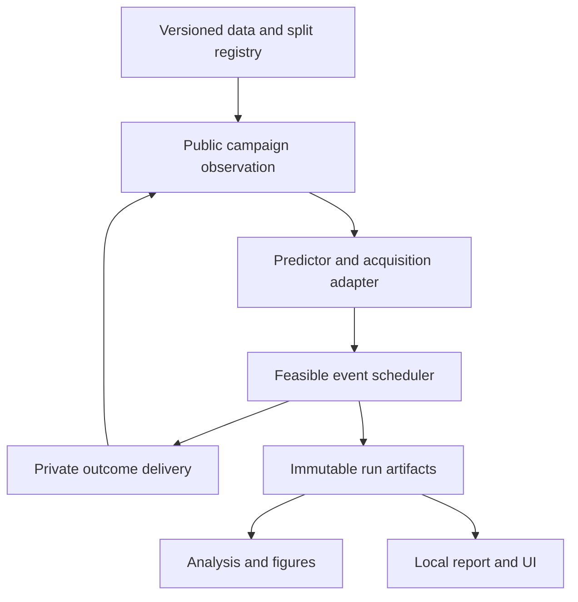

# Architecture: current system and planned extension

## Current boundaries

`src/curaloop/domain.py` defines immutable public data contracts. `_datasets.py` and `_oracle.py` load private outcomes and deliver them only for registered due requests. `engine.py` owns campaign transitions, reservation and settlement. `policy_worker.py` consumes serialized public information in a separate built-in process and fits the predictor or chooses a strategy. `service.py` coordinates reports, comparisons and validated restoration.

`api/main.py` is the loopback adapter; `api/storage.py` manages public SQLite snapshots, revisions and comparisons. The React frontend renders actual API state. The committed production build is served at port 8000. The Streamlit fallback remains separate. This package does not change those files or application behavior.

## Planned architecture

The registry and new event scheduler are specifications. Keep a compatibility adapter for the existing scenario and avoid altering old evidence. Shared numerical backends may provide acquisition, but must never receive future labels. An external acquisition backend is optional local code reuse, not an authorization to send data to a hosted API.

## API and state evolution

Version scientific manifests, observations and event schemas explicitly. Public operational quotes and pending summaries need typed fields with known visibility. A change to event ordering, cancellation, cost settlement or deadline counting creates a new scientific version. The existing restore path should reject incompatible imports with an actionable message instead of coercing them silently.

The study runner should reuse the same scientific engine and reporting logic as the UI. Do not implement separate accounting in JavaScript or an analysis notebook. Independent comparator campaigns may share immutable public inputs and feature caches; they cannot share acquired labels or trained state unless the protocol explicitly defines transfer.

## Deployment implications

Keep one local owner/server/worker until a separately tested multi-user design exists. A later enterprise service would need identity, access, data lifecycle, concurrency and security work. Adding a cloud database or binding the API publicly does not satisfy those requirements. The first R&D pilot can remain a controlled local evaluation.

## Backend feasibility contract

Evaluate a pinned BayBE/BoTorch or other local backend through an adapter rather than replacing the oracle/scheduler boundary. The adapter receives feasible public candidate features, delivered labels and declared pending information. CuraLoop remains responsible for cost/capacity/event invariants unless a tested versioned contract explicitly delegates them. Binary multi-hit retrieval needs an objective that remains useful after the first active; a successful generic BO call is insufficient validation. The integration remains unimplemented.
