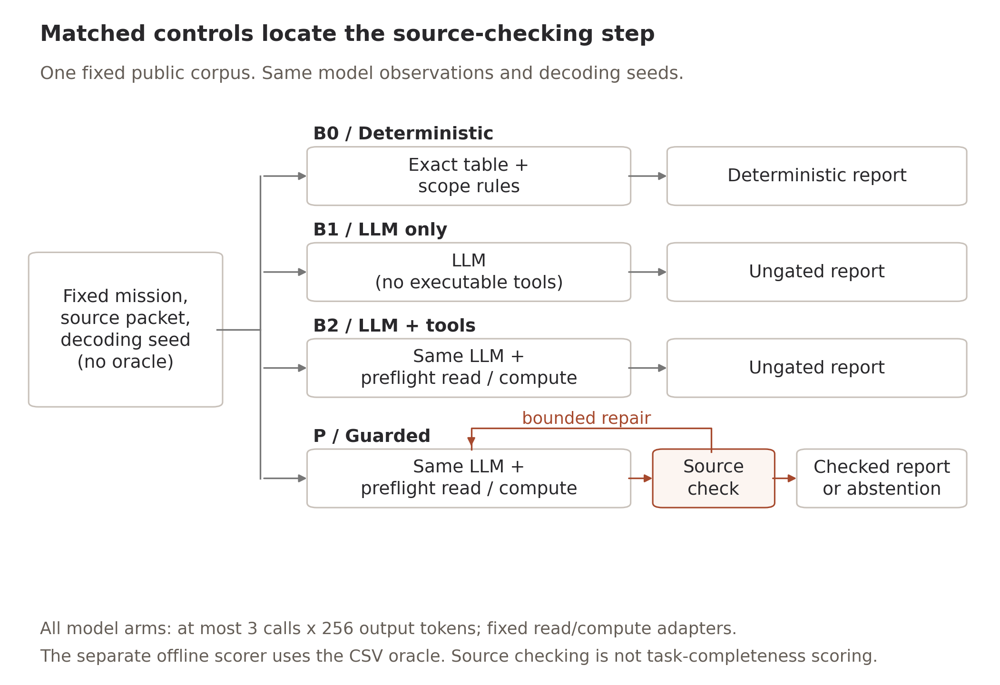
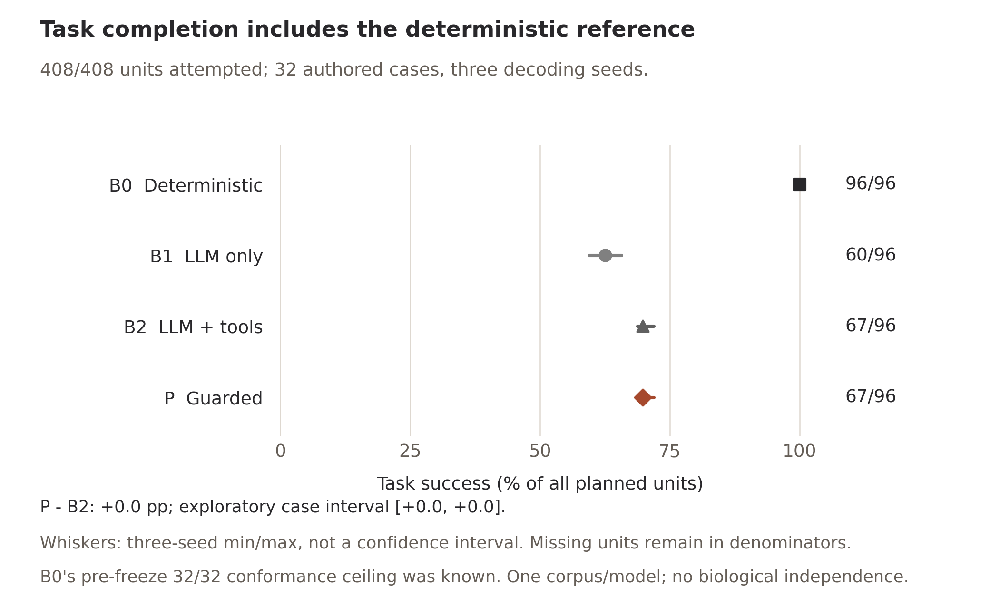
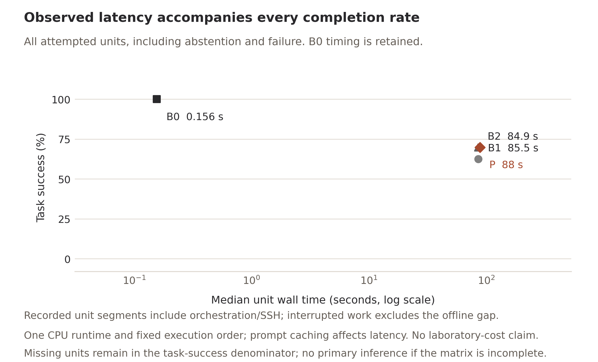

# Source checking, task completion and cost in a local pharmaceutical evidence agent

Author manuscript / computational application report / not submitted

Siripon Srihangpiboon

King Mongkut's Institute of Technology Ladkrabang

Correspondence: srihangpiboon.siri@gmail.com | ORCID: 0009-0001-0611-5568

## Abstract

We implemented a localhost pharmaceutical evidence workbench and evaluated whether a deterministic source gate with bounded repair improves task correctness over the same language model and tools without that gate. The frozen design crossed 32 author-created interface cases and three decoding seeds with deterministic (B0), evidence-supplied LLM-only (B1), LLM-plus-tools (B2) and guarded (P) controls, plus an eight-case no-repair ablation. Actual Typhoon 12B CPU-model responses, failures, fallback and costs were retained. B0 completed 96/96 planned tasks, B1 60/96, B2 67/96 and P 67/96. The prespecified P-minus-B2 task-success difference was +0.00 percentage points (exploratory paired-case 95% interval +0.00 to +0.00). All case-averaged paired differences were zero; the degenerate interval describes these authored cases and does not establish equivalence in an external population. Numerical source agreement was evaluated separately from required fields, scope and refusal. These are exposed-data authored tasks on one corpus/model, not independent biological or expert-validated tasks. The study establishes an auditable application result within those limits, not prospective discovery, real-user benefit or general agent superiority.

## Introduction

Language-model agents can place computational chemistry tools behind a natural
language interface. ChemCrow integrates chemistry tools and reports expert
assessment; Coscientist coordinates computational tools and laboratory
automation [1,2]. These systems establish tool-mediated chemical workflows as
prior work. Paper2Agent further turns research outputs into executable agents,
including validation and repair of exposed tools [3]. A wrapper, a validation
loop or a provenance record is therefore insufficient to establish a new
scientific method.

Reliability also depends on what is measured. ChemAgent's comparative study
shows that tool augmentation need not outperform the underlying language model
across chemistry tasks [4]. ScienceAgentBench separates execution from
scientific task completion [5]. In a structured evidence application, an answer
may contain only source-correct numbers yet omit requested quantities, omit
essential limitations or answer a request that should have been refused. A
numerical source check cannot by itself establish that the user's task has
been completed.

We study that distinction in CuraLoop-RL, a local pharmaceutical research
workbench. The evaluated agent reads previously released retrospective
confirmation-selection aggregates, performs bounded calculations and releases
typed claims or abstentions. The research question is whether a deterministic
source gate with bounded corrective generation improves released task
correctness relative to an otherwise matched model with the same tools, and
what refusal, coverage, failure and computational cost accompany the difference.
The contribution is an inspectable implementation and a controlled application
case study. It is neither a new RL selector nor a claim of general autonomous
scientific discovery. The case collection is an evaluation instrument for this
software, not a proposed standalone benchmark publication.

## Methods

### Study scope and provenance

The study uses four already released public CF1 aggregate files. Their full
paths, byte lengths and SHA-256 identities are pinned in the protocol release.
The principal CSV contains 2,700 historical portfolio cells: six development
campaigns, five historical seeds, six rankers, three portfolio operators and
five confirmation budgets. The upstream source is the processed AIC_Finder
repository at commit `04c58e85188e724ec5ff44cbed2e7b960f6f3df3`, associated
with the published MVS-A study [6]. Our prior CF1 reconstruction and its source
concordance qualifications remain unchanged. This is not a new reproduction
of the original raw assays or every result in that article.

H denotes historical confirmed-positive observations; D denotes positive fixed
structure groups; B denotes confirmation observations. HB and DB are fractions
per confirmation, not laboratory expenditure or monetary efficiency. Missing
confirmation remains excluded. The nonpositive class mixes inactive and
inconclusive observations. The six campaigns share one annotation-connected
component; the five historical seeds are conditional repetitions. At the
studied budgets, round-robin D=H is a mechanical property. Neither groups nor
seeds supply independent biological replicates.

No final16 record, private CF1 compound row, molecular structure or hidden or
pending assay outcome is accessible through the evaluated tools. Earlier
datasets, ledger bytes, frozen results and negative findings are preserved.
Source-fault cases operate on isolated copies of the admitted public files,
without modifying the historical originals. No new molecular fit, laboratory
experiment or user study is part of this work.

### Workbench and agent controller

The workbench adds a bilingual EN/TH mission page and API to the existing
localhost React/FastAPI application. EN/TH describes interface and dossier
localization; the locked questions are English, so no comparative Thai-language
agent-performance result is claimed. A closed mission specification selects a
campaign, ordered methods and budgets. It cannot supply arbitrary paths,
providers, code or external write actions. A trusted controller authenticates
and reads the source packet before generation. This preflight read is not a
tool autonomously selected by the language model. The model can request one
fixed calculation adapter while useful, then answer or abstain in a typed JSON
interface. The tools cannot change the screening simulator or write to a team
or laboratory service.

A separate verifier compares released numeric claims with authenticated source
values and permitted derivations. It checks source identity and declared
limitations but does not decide whether a natural language request has been
fully answered. Actual requests are durably recorded before inference. Mission
state, tool receipts, proposals, repair feedback, failures and costs are retained
in an atomic revisioned store. An explicitly requested local dossier contains
EN/TH HTML reports, structured values, the trace and a file-hash manifest.
Application-level immutability prevents silent replacement through the normal
workflow; it is not an external signature or trusted timestamp.

### Matched controls

B0 is a strong deterministic reference: the complete authenticated table,
permitted exact derivations, all true scope codes and a capability refusal
filter. It uses no language model. B1 receives the same public observations
directly but has no executable calculation action. B2 uses the same model,
information, typed actions, state persistence and read/compute adapters as P;
its terminal proposal is checked for logging without gating or scientific
correction feedback. P adds the deterministic source gate and bounded targeted
repair. A-NOREPAIR retains the gate but stops after its first invalid terminal
proposal on eight fixed anchor cases.

B2 and P have byte-identical initial observations, instructions, model
settings, action schema and decoding seed. A correction contains error codes
against the same observations, not gold answers or additional facts. A common
malformed-JSON recovery rule applies across model arms. Every model arm has at
most three calls and 256 generated tokens per call; tool-enabled arms have at
most two tool receipts, including the trusted preflight read. The last call
must terminate. Exhaustion is retained as deterministic abstention fallback,
not automatically scored as successful research.

The primary B2/P comparison isolates the implemented gate and its associated
repair under this shared controller. It does not identify the separate causal
effect of each internal component. B1's common tool-oriented instruction and
terminal-only action interface constrain its secondary comparison. These
controls are not native reproductions of ChemCrow, Coscientist or Paper2Agent.

### Cases, development and freeze

There are 16 development and 32 locked author-created interface cards. Locked
families contain six extraction, six comparison, six interpretation, six
boundary, four source-fault and four recovery tasks. Interpretation is scored
through explicit limitation codes, not open-ended narrative quality.
Source-fault cases delete or alter actual public-copy files. The trusted source
adapter supplies an unavailable-source observation; model arms still use the
real model to answer or abstain, while B0 handles that condition deterministically.
These are controlled source-unavailability tests, not general security or
private-data refusal validation. Actual model-attempt and successful-response
mission counts are reported separately.
Recovery introduces a declared controller exception immediately after a real
model response has been durably recorded and then resumes that exact call. It
does not simulate every property of a real machine crash or network outage.

Each locked card crosses B0/B1/B2/P and decoding seeds 17011, 17023 and 17033,
giving 384 units. Eight preselected anchors also cross A-NOREPAIR and the same
seeds, giving 24 additional units. The total is 408 planned units, including
312 planned model-arm missions; actual calls and successful responses are
reported separately from planned or interrupted units.
The fixed schedule randomizes system order within
case/seed blocks using Python seed 20261110. Historical CF1 seeds are distinct
from these decoding seeds.

Two unsuccessful development canaries and two common prompt/interface repairs
preceded freeze. The third canary completed a source-correct answer. A separate
six-mission development probe retained a refusal failure: the model returned
permitted aggregate values instead of abstaining. No protected data was read.
The protocol did not tune that failure away. B0 had already passed all 32
authored cards in pre-freeze engineering conformance, a disclosed known ceiling
rather than a blind discovery. The card author also knew the exposed source
values. Locked means no outcome-guided changes after freeze; it does not mean
externally authored, biologically held-out or independently validated tasks.

The protocol, cards, schedule, oracle, scorer, production prompts/controller
and model transport were frozen through 27 SHA-256 pins, with freeze identity
`5b70e5f1454e9062441b3e292a50fab45f9aebe73ed7994971c6a88de2ad4c8e`.
The exact bytes were committed and pushed as `064bd3d` before the first locked
model call. Documentation, figures and descriptive reporting tools may be added
later without changing those scientific pins. Every planned unit, attempt,
partial failure, fallback and unattempted resource-limited unit is retained.

### Model and computational environment

The existing Typhoon 2.1 Gemma3 12B GGUF model runs through Ollama 0.12.6 on
dr-train. Its historical local tag is
`hf.co/scb10x/typhoon2.1-gemma3-12b-gguf:Q4_K_M`; the pinned digest is
`ab914ef406c9a78e2a8893eaa3b0ef78049f6c4e2703626433028e838d3a168b`.
Q4_K_M is recorded from the tag; the runtime's parsed quantization field was
unknown. The original upstream URL now redirects to the Typhoon namespace [7];
that metadata check is not evidence of a newly downloaded binary identity.

Temperature is 0.2, context length 4,096, model threads three and GPU layers
zero. The owned container has no network or published ports, uses a read-only
existing model cache and enforces a three-core CPU quota on cores 69/70/71.
Its memory limit is 11.5 GiB with no swap; the host-control allowance is
0.5 GiB. Completed calls check zero GPU VRAM. Local orchestration and document
helpers share one one-core/1 GiB Windows Job, keeping the combined maximum at
four CPU cores. No paid inference, new model download or shared-service
configuration change occurs.

The fresh overall authorization is 96 CPU-hours and 120 elapsed hours, starting
10 November 2026 at 11:10 UTC and ending 15 November 2026 at 11:10 UTC.
The locked remote phase has a 201,600 CPU-second ceiling. The original clock
and per-stage caps are not reset. Before each unit, the controller requires
3,000 CPU seconds and 15 minutes of deadline headroom; an in-cgroup watchdog
also enforces the hard limit. Reservations, observed model CPU, local-controller
CPU and unknown failed-call cost are reported separately. Costs depend on this
hardware, execution order and prompt caching, and do not measure laboratory
savings, energy use or user productivity.

### Oracle, scoring and analysis

An author-written oracle reads the pinned CSV directly using code separate
from the production adapter and source verifier. It averages campaigns within
each historical seed, then the five seed values. Ratios are averaged as ratios.
Source operands are rounded to three decimals before deltas; comparisons use
absolute tolerance 0.0005000001. Gold quantities and required-key/scope lists
are never provided to the model or remote container. A separate implementation
is a useful conformance check, not independent expert adjudication.

Task success requires the expected terminal action, every requested numeric
key and required scope code, correct source identity for answers and no released
wrong or unsupported numeric claim. Abstention cases require an accepted empty-
claim refusal. Extra correct permitted values are allowed equally for all arms.
A source-check PASS, process exit or executable response alone is insufficient.
We retain raw and released numeric error rates, malformed responses, required-
field coverage, source citations, appropriate abstention, overrefusal, fallback,
execution failure, recovery and observed calls/tokens/CPU/wall time. A numeric
error rate with no numeric claims is NA. Unknown failed-call cost is not zero.

The primary estimand is P minus B2 task success in percentage points, averaging
the three decoding seeds within each of 32 cards, then weighting cards equally.
All-planned and attempted-unit denominators are both shown. If the full matrix
is incomplete, the primary comparison is inconclusive; a partial favorable
table does not establish superiority. When complete, an exploratory paired
case bootstrap uses 10,000 draws, seed 20261110 and sorted positions 250 and
9,750, one-based. The interval is conditional on the authored cases, corpus
and one model, not a biological or real-user population confidence interval.
There is no primary p-value, new significance threshold or post-hoc success
gate. Seed differences and the eight matched ablation anchors are descriptive.

## Results

### Fixed-matrix disposition and primary result

The guarded arm produced 67 successful tasks among 96 attempted units and 96 planned units. B2 produced 67 successes. The prespecified P-minus-B2 task-success difference was +0.00 percentage points (exploratory paired-case 95% interval +0.00 to +0.00). All case-averaged paired differences were zero; the degenerate interval describes these authored cases and does not establish equivalence in an external population. The three fixed seed differences were seed 17011: +0.00 pp; seed 17023: +0.00 pp; seed 17033: +0.00 pp. These are conditional descriptive replications, not additional independent cases.

Table 1. Task completion, with every planned denominator. A-NOREPAIR has eight fixed cases, not the full32-case roster.

| System | Planned | Attempted | Success / planned | Success / attempted |
| --- | --- | --- | --- | --- |
| B0 | 96 | 96 | 96/96 (100.0%) | 100.0% |
| B1 | 96 | 96 | 60/96 (62.5%) | 62.5% |
| B2 | 96 | 96 | 67/96 (69.8%) | 69.8% |
| P | 96 | 96 | 67/96 (69.8%) | 69.8% |
| A-NOREPAIR | 24 | 24 | 24/24 (100.0%) | 100.0% |

### Refusal, fallback and released claims

P had 13 task failures among 78 source-check-valid releases. This directly distinguishes a source check from the separately scored task contract. Required-key coverage, scope-code coverage and malformed responses are shown in Table 4. Wrong-action refusals are not reclassified as actual private-data leaks. The boundary adapters do not provide protected data to any arm.

A post-hoc replay of the unchanged verifier found 0 invalid terminal proposals among 78 P terminal proposals, and 0 among 78 B2 terminal proposals. B2/P had identical recorded output sequences in 96/96 comparable seed-case pairs and equal task-success outcomes in 96 pairs. Output-sequence comparison excludes call identities and timings. This is descriptive execution evidence, not a new score or hypothesis test. The repair branch triggered by an invalid numeric/source check was not exercised by these observed P terminal proposals. The study therefore cannot establish its efficacy on a population containing such invalid proposals. Malformed JSON and missing task requirements remain separate failures. Component integrity tests do not substitute for a model-generated challenge to that branch.

Table 2. Appropriate abstention, overrefusal, deterministic abstention fallback and released numerical error. Empty claim denominators are NA.

| System | Appropriate abstention | Overrefusal | Fallback n | Released errors / claims |
| --- | --- | --- | --- | --- |
| B0 | 30/30 (100.0%) | 0/66 (0.0%) | 0 | 0/912 (0.0%) |
| B1 | 22/30 (73.3%) | 13/66 (19.7%) | 11 | 27/178 (15.2%) |
| B2 | 20/30 (66.7%) | 19/66 (28.8%) | 18 | 0/206 (0.0%) |
| P | 20/30 (66.7%) | 19/66 (28.8%) | 18 | 0/206 (0.0%) |
| A-NOREPAIR | 6/6 (100.0%) | 0/18 (0.0%) | 0 | 0/78 (0.0%) |

### Computational cost

Across all arms, retained successful responses recorded 371,939 tokens and 38.898 known model CPU-hours. There were 0 failed calls with potentially unknown actual cost. Recorded tokens include prompt and generated tokens. These sums are observed research-model work, not the reserved whole-project budget. Local-controller CPU, per-unit wall times and full retained resource caps are different quantities. B0 performs real deterministic computation; NA model CPU does not mean zero total compute. Actual model participation was B1: 96 missions with a model attempt, 96 with a successful provider response; B2: 96 missions with a model attempt, 96 with a successful provider response; P: 96 missions with a model attempt, 96 with a successful provider response; A-NOREPAIR: 24 missions with a model attempt, 24 with a successful provider response. For constructed source faults, model arms receive an unavailable-source observation and still call the real model; B0 handles that condition deterministically. These are controlled file/source-unavailability tests, not general security or private-data refusal validation. The312 planned model-arm missions are distinct from actual attempt and successful-response counts. Post-hoc descriptive provider metadata show responses reaching the fixed256-token output cap: B1: 33/118 (28.0%); B2: 48/144 (33.3%); P: 48/144 (33.3%); A-NOREPAIR: 0/30 (0.0%). Reaching this cap is not itself a malformed response or proof that the cap caused failure. The provider-output-length table retains every observed length and stop reason. The short output cap limits generalization; it was not increased or retuned after observing locked results. Unit L-B06--17023--P was interrupted by a local controller-host exit. Its exact previously recorded response was reconciled without regeneration. The frozen unit-wall measurement for this unit is the final controller segment, excluding earlier work and the offline gap. Model receipt CPU and token cost remain retained; the full resource reservation of the interrupted controller was not refunded. Latency summaries therefore describe recorded execution segments, not uninterrupted end-to-end user waiting time. Interactive authoring and read-only monitoring CPU were not separately metered; a full 1800 CPU-second administrative allowance was retained within the original budget. This is an accounting provision, not measured consumption or retroactive proof of a hard cap. Model/test jobs have separate enforcement receipts.

Table 3. Actual observed cost. Model/tool call counts are separate counts, not a rate. Tool calls include the trusted preflight read, which is not an autonomous model action. Model CPU is a known lower bound if a failed call has unknown cost; wall time includes orchestration and SSH wait. API charges are US$0 throughout.

| System | Model / tool calls | Tokens | Model CPU h | Median unit wall s | Failed calls, cost unknown |
| --- | --- | --- | --- | --- | --- |
| B0 | 0 / 0 | 0 | NA (no model) | 0.156 | 0 |
| B1 | 118 / 0 | 95,447 | 10.753 | 85.461 | 0 |
| B2 | 144 / 114 | 126,726 | 12.764 | 84.929 | 0 |
| P | 144 / 114 | 126,726 | 13.222 | 87.992 | 0 |
| A-NOREPAIR | 30 / 30 | 23,040 | 2.159 | 67.765 | 0 |

### Task completeness and matched no-repair anchors

Table 4. Descriptive completeness. Rates use attempted answer-task key/code instances and successful provider responses. Malformed means unparsable JSON or an invalid values-map type under the frozen scorer, not every possible action-schema failure. A source-valid task failure is not a numeric error by definition.

| System | Malformed / responses | Correct required keys | Required scope codes | Task failures / valid checks |
| --- | --- | --- | --- | --- |
| B0 | 0/0 (NA) | 96/96 (100.0%) | 93/93 (100.0%) | 0/96 (0.0%) |
| B1 | 33/118 (28.0%) | 69/96 (71.9%) | 71/93 (76.3%) | 11/70 (15.7%) |
| B2 | 48/144 (33.3%) | 84/96 (87.5%) | 74/93 (79.6%) | 13/78 (16.7%) |
| P | 48/144 (33.3%) | 84/96 (87.5%) | 74/93 (79.6%) | 13/78 (16.7%) |
| A-NOREPAIR | 0/30 (0.0%) | 30/30 (100.0%) | 21/21 (100.0%) | 0/24 (0.0%) |

Table 5. P and A-NOREPAIR on exactly the same eight fixed anchors and three seeds. Descriptive only, with no full-matrix extrapolation.

| System | Attempted / planned | Success / planned | Calls | Known model CPU h |
| --- | --- | --- | --- | --- |
| P | 24/24 | 24/24 (100.0%) | 30 | 2.286 |
| A-NOREPAIR | 24/24 | 24/24 (100.0%) | 30 | 2.159 |

### Family results and raw-versus-released fidelity

Table 6. Task success by prespecified family, with all planned family units retained. These are authored task types, not independent biological families.

| Task family | B0 | B1 | B2 | P |
| --- | --- | --- | --- | --- |
| extraction | 18/18 (100.0%) | 18/18 (100.0%) | 18/18 (100.0%) | 18/18 (100.0%) |
| comparison | 18/18 (100.0%) | 3/18 (16.7%) | 12/18 (66.7%) | 12/18 (66.7%) |
| interpretation | 18/18 (100.0%) | 5/18 (27.8%) | 5/18 (27.8%) | 5/18 (27.8%) |
| boundary | 18/18 (100.0%) | 10/18 (55.6%) | 8/18 (44.4%) | 8/18 (44.4%) |
| source fault | 12/12 (100.0%) | 12/12 (100.0%) | 12/12 (100.0%) | 12/12 (100.0%) |
| recovery | 12/12 (100.0%) | 12/12 (100.0%) | 12/12 (100.0%) | 12/12 (100.0%) |

Table 7. Raw proposal errors, released numerical errors, citation correctness and failed execution units. Numerical rates use parseable claim instances; malformed responses are separately retained in Table 4. Correct citations alone do not establish task completion.

| System | Raw errors / claims | Released errors / claims | Correct / present citations | Failed units |
| --- | --- | --- | --- | --- |
| B0 | 0/0 (NA) | 0/912 (0.0%) | 66/66 (100.0%) | 0 |
| B1 | 27/178 (15.2%) | 27/178 (15.2%) | 61/61 (100.0%) | 0 |
| B2 | 0/206 (0.0%) | 0/206 (0.0%) | 57/57 (100.0%) | 0 |
| P | 0/206 (0.0%) | 0/206 (0.0%) | 57/57 (100.0%) | 0 |
| A-NOREPAIR | 0/78 (0.0%) | 0/78 (0.0%) | 18/18 (100.0%) | 0 |

### Localhost engineering acceptance

The actual UI-to-API-to-model acceptance mission used two real calls, 2,054 recorded tokens and 904.552 model CPU seconds. It passed its separately authored comparison task and explicit five-file dossier reread. An actual API restart recovered the same completed row without regeneration. EN/TH, mobile and legacy-isolation self-checks passed. The refined screenshot pass reused the same response with no new inference.46 backend/oracle/source tests and30 frontend tests/type/lint/build passed. These are engineering acceptance records, not additional locked observations or independent validation.

## Discussion

The practical decision is whether this application's language interface adds enough value to justify its measured errors and cost. B0 is the appropriate reference for tasks whose complete calculation and scope rules are already specified. Its pre-freeze ceiling was disclosed and is not evidence of broader reasoning. The B2/P comparison tests this particular source gate and bounded correction under a short typed interface; it cannot establish a universal advantage for agents or verification loops. The no-repair comparison is restricted to its matched eight anchors. Neither successful file recovery nor source fidelity establishes scientific interpretation beyond the required codes. The full negative, tied or incomplete findings remain part of the result.

### Delivered product version

After the fixed experiment, the product API received a separate deterministic capability preflight. Served-application checks exercised English/Thai controller denials, a real five-budget deterministic sweep, explicit import of the original real-model example, local dossiers and restart persistence without new inference. Controller denials are labeled as zero-model-call decisions. Conservative lexical rules are not a general intent or security guarantee. This service version was not the frozen P research condition; none of its tests replace or rescore the original failures. The recorded example retains its original date and actual model calls. A separate post-study current-product model smoke check had disposition PASS_ACTUAL_CURRENT_PRODUCT_MODEL_LIFECYCLE. Its single actual model mission used 3 calls; required fields and scope passed: False. This engineering observation is outside the comparative matrix and provides no efficacy estimate.

## Limitations

The study can measure fidelity to a narrow, machine-checkable evidence contract.
It cannot establish unrestricted scientific reasoning, hypothesis quality,
prospective compound discovery or the value of a general research assistant.
Typed questions and a complete deterministic table may favor B0. Its known
pre-freeze conformance ceiling is a substantive limit on the need for an LLM
in these tasks, not a reason to weaken that reference.

The short output and call caps are part of the tested system. Truncation,
malformed output, repeated computation and fallback must remain visible beside
numerical error. A numerical verifier may prevent wrong claims yet fail to
detect a missing requested field, missing interpretation code or inappropriate
answer. Withholding all claims would not constitute useful performance; task
success, coverage and overrefusal must therefore be read together.

All arms lack a private-data adapter. Zero observed protected-data leakage is
a common architectural boundary, not evidence that P has superior refusal or
security. A request-contract failure involving only permitted aggregates must
not be relabeled as an actual leak. The controlled recovery probe does not
validate arbitrary outage recovery or adversarial security.

The case author, software developer and evaluator are part of one solo project.
Component tests, visual review, the separate CSV oracle and manuscript checks
are author self-checks. No independent expert, researcher, customer, usability
or wet-lab validation is claimed or required to complete this computational
report. A retrospective application case may still be worth reporting, but its
scope and novelty must be judged against its actual evidence rather than a
promised discovery benefit.

## Reproducibility and availability

The final package must include the frozen protocol/cards/oracle/schedule,
public input identities, immutable actual unit receipts and traces, all planned
dispositions, audited analysis, standalone figure sources and an English
operator guide. The code and reports are in the public CuraLoop-RL repository.
Private reading-room papers and original private compound data are excluded.
Existing model weights are not redistributed. Code's MIT license does not
license weights or underlying datasets, and no general commercial-use clearance
is claimed.

The localhost acceptance record includes an actual UI-to-API-to-model mission,
an explicit five-file dossier export, server restart without regeneration and
EN/TH/mobile self-checks. Recorded results and deterministic mode remain
available after the bounded research worker is removed. A later live-model
session requires a fresh authorized operator configuration; the closed research
ledger must never be reopened. There is no production deployment, live team
connector, always-on inference promise or manuscript submission.

The associated audited JSON/CSV files retain each planned unit, per-family outcomes, seed differences, raw/released numeric counts, failure reasons, exact traces and source hashes. Figure sources use those records directly. The original study source freeze precedes all locked calls. Recomputation instructions distinguish offline analysis from newly authorized inference.

## Publication assessment and author decisions

This is a complete computational application report with actual model evidence, rather than a claim of a new molecular-design method. JCAMD's official scope includes molecular analysis/design methods and applications, but this one-corpus typed reliability study has limited evidence of a distinct molecular-design advance. Submission readiness as a competitive JCAMD research article is not established. A technical/software or negative-results route may be more proportionate to the demonstrated contribution. This assessment does not require a customer pilot, external researcher or wet lab to complete the solo project and does not assert that any venue will accept the work. JCAMD's subscription route lists no APC; its open-access route is outside the owner's US$300 fee ceiling at the checked price. No manuscript was submitted, no fee was paid and no editor or researcher was contacted. Author declarations and venue/rights decisions remain with the owner.

Official journal pages checked on 10 November 2026: https://link.springer.com/journal/10822/aims-and-scope and https://link.springer.com/journal/10822/how-to-publish-with-us . Subscription price compatibility is not scientific acceptance.

## Declarations

Funding, competing interests and final author approval are not confirmed in this draft. Supplied author details do not constitute signed declarations. No human-participant, prospective clinical or wet-lab study is reported.

The project used an AI coding/research assistant to develop software, inspect
sources, prepare figures and draft this manuscript. The empirical agent outputs
are separately identified Typhoon model calls and are not replaced by text
generated by the coding assistant. The human author remains responsible for
the final content and declarations. No completed human verification, signature
or submission is asserted by this draft disclosure.

## References

1. Bran AM et al. Augmenting large language models with chemistry tools.
   Nature Machine Intelligence 6, 525-535 (2024).
   https://doi.org/10.1038/s42256-024-00832-8
2. Boiko DA, MacKnight R, Kline B, Gomes G. Autonomous chemical research with
   large language models. Nature 624, 570-578 (2023).
   https://doi.org/10.1038/s41586-023-06792-0
3. Reimagining research papers as interactive and reliable AI agents.
   Nature (2026). https://doi.org/10.1038/s41586-026-11044-y
4. Yu B et al. Tooling or Not Tooling? The Impact of Tools on Language Agents
   for Chemistry Problem Solving. Findings of NAACL 2025, 7635-7655.
   https://doi.org/10.18653/v1/2025.findings-naacl.424
5. ScienceAgentBench: Toward Rigorous Assessment of Language Agents for
   Data-Driven Scientific Discovery. ICLR (2025).
   https://proceedings.iclr.cc/paper_files/paper/2025/hash/f12b4df26344f3be803c06b555252efe-Abstract-Conference.html
6. Boldini et al. Machine Learning Assisted Hit Prioritization for High
   Throughput Screening in Drug Discovery. ACS Central Science 10, 823-832
   (2024). https://doi.org/10.1021/acscentsci.3c01517
7. Typhoon 2.1 Gemma3 12B GGUF model card.
   https://huggingface.co/typhoon-ai/typhoon2.1-gemma3-12b-gguf

Primary-source read depths and access limitations are recorded in
`docs/08_agent_rd/A0_CLOSEST_WORK_20261110.md`. References are not a systematic
review, and the implementations here do not reproduce the referenced agents.
