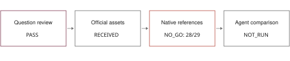

# Pre-inference Qualification of SciCode for a Budget-Matched Local Scientific-Agent Study

**An admission report. Comparative agent evaluation was not run.**

Siripon Srihangpiboon

King Mongkut's Institute of Technology Ladkrabang

Correspondence: srihangpiboon.siri@gmail.com

ORCID supplied by the author: 0009-0001-0611-5568

13 November 2026 | CuraLoop-RL | LR-SC1

## Abstract

We prepared a bounded study of automatically generated scientific validation
against generic generated tests for local coding agents. Before inference, we
qualified the official SciCode assets and a fixed six-problem validation panel.
The first technical attempt passed 26 of 29 native subproblem checks. A single
source-supported repair restored an omitted native comparator package, raising
the count to 28 of 29. One reference program, subproblem 70.8, still failed its
unchanged native assertion. Static comparison against the official assembly
helper confirmed an identical abstract syntax tree for that program. The
reference, numeric-target and environment discrepancy remains unresolved.
The admission gate therefore stopped the study. No agent inference or comparative
evaluation occurred, and the primary effect is not estimable. This report
documents a reproducibility boundary in one pinned configuration, not evidence
against a scientific-agent method or proof that the benchmark is generally wrong.

## Intended research question

Under identical public information and total generation/execution caps, does a
typed scientific-check representation improve correctly delivered native
subproblem outputs beyond a competent generic test-generating agent?
The intended contribution was incremental empirical evidence, not the invention
of executable scientific checks, contracts or runtime guards. Gate 0 allowed
bounded admission after a targeted prior-art review. It did not establish
algorithmic novelty or publication readiness.

<!-- page -->

## 1. Sources and admission procedure

SciCode provides existing scientific programming tasks and native numerical
tests [1, 2]. We used the official split of 15 validation and 65 test main
problems. Before model outcomes, six validation IDs were selected by sorting
SHA256 hashes of the fixed prefix LR-SC1-fixed-development-v1: followed by the
official main-problem ID. The selected order was 70, 44, 49, 7, 19 and 10.

The code revision was e3158ea011d4235245a547460d3688d7ccbf9900. The dataset
revision was 4510f6a6aa27c43fad7b43da2c59602a86e88480. The official numeric
asset contained 1,049,345,865 bytes and had SHA256
48b0272a88b17dbd29777c217e1b4fb2b019b92e11cc2add847409db9541b890.
The repository license and dataset card declare Apache-2.0. The numeric asset
was obtained from the official repository's linked download; no separate license
notice was retrieved for that file. Raw assets remain private and are not bundled
into the public manuscript repository.

The evaluator ran on dr-train in a task-owned Python 3.10 container, with a
one-CPU quota, 4 GiB memory, no swap allowance beyond that memory, a read-only
container root and no network during qualification. Installed versions were
NumPy 1.26.4, SciPy 1.11.4, SymPy 1.12, h5py 3.10.0 and Matplotlib 3.8.4.
A watchdog termination check passed before qualification.

Reference functions and native test predicates were unchanged. A minimal adapter
omitted only the optional Hub-loader import; all fixture-parser function bodies
were AST-identical to upstream. Test-case strings and numeric tolerances were
preserved. Reference execution was restricted to the six selected validation
problems. Test-split access checked fixture-group existence only, without reading
their numerical target values or executing test reference programs.

Agent-safe views stripped reference solutions, ground-truth code and native test
cases. No model consumed these views because admission did not pass.

<!-- page -->

## 2. Observed qualification results

Figure 1. Actual execution stopped at native evaluator readiness. The agent
comparison and model inference were not run. This is an execution-status diagram,
not a measured agent-performance result.

| Validation main ID | Initial checks | Repaired checks |
| --- | ---: | ---: |
| 70 | 6/8 | 7/8 |
| 44 | 3/3 | 3/3 |
| 49 | 4/4 | 4/4 |
| 7 | 1/1 | 1/1 |
| 19 | 2/2 | 2/2 |
| 10 | 10/11 | 11/11 |
| Total | 26/29 | 28/29 |

Table 1. Passed native reference checks within each fixed validation main problem.
Both attempts use the same 29 subproblems; they are not 58 independent observations.
These are engineering conformance checks, not model success rates.

The initial failures were 70.6, 70.8 and 10.7. Two failures were our adapter's
omission: native tests imported scicode.compare, which was not copied into the
initial minimal support package. The one permitted technical repair copied that
exact upstream package. It did not change references, assertions, targets or
tolerances. After repair, 70.6 and 10.7 passed. The remaining failure was 70.8,
with AssertionError. Five of the six main reference problems passed all checks.

Static reconstruction using the upstream gold-response and prompt-assembly
helpers yielded the same program AST as the failed 70.8 admission program.
Both AST digests were
4de68310c2cc2caa23b58bdfd447c0d152ca762bcb67f40783b1a526581d5afc.
This narrows the adapter explanation; it does not establish the cause of the
remaining reference-target-environment mismatch. No additional environment
search, reference edit or test rerun followed the allowed repair.

Fixture groups existed for all 65 test main problems. That establishes asset
coverage, not native numerical validity or 65 qualified evaluation tasks.
Separately, inspected upstream integration skips 13.6, 62.1 and 76.3 while
retaining the full substep count in a denominator. We recorded this behavior
without silently changing the proposed endpoint.

<!-- page -->

## 3. What the intended comparison would have measured

The approved design specified LLM-only generation, tool-using self-debugging,
generic generated tests, typed scientific checks and a semantic-check ablation.
The primary contrast was scientific checks minus generic generated tests.
A Qwen2.5-Coder-14B Q4_K_M study and a limited existing-Typhoon replication were
planned, with at most 520 main-problem episodes. None were executed.

The generic-test baseline was to follow AgentCoder's separated programmer,
test-designer and executor pattern [3], adapted to equal caps. Scientific and
metamorphic tests would also be allowed in that comparator. Rules to Tools
already studies prepared scientific checks in matched SciCode repair [4]; our
proposed additional question concerned automatic construction and its errors
and costs inside each trajectory. No superiority over that unreproduced system
was planned or established.

| Evidence item | Status |
| --- | --- |
| Fixed validation reference qualification | 28/29 subproblems; gate failed |
| Test fixture-group metadata coverage | 65/65 main problems; no numerical qualification |
| Agent episodes / model calls | 0 / 0 |
| Primary contrast and confidence interval | NOT_ESTIMABLE |
| Comparative model or plugin efficacy | NOT_ESTABLISHED |

Table 2. Evidence status after the admission stop. Not estimable is not a zero
effect. No missing outcome is replaced by a mock result, a prior product test
or a native-reference success.

## 4. Interpretation and limitations

The decision is a failed readiness gate, not a negative agent experiment.
The selected validation panel is small, and one environment and one allowed
technical repair cannot diagnose the full benchmark. Compatibility, numerical
libraries, reference code or target generation may explain the remaining
discrepancy; these alternatives were not experimentally separated.

All work was conducted by the developer. Neither an independent expert review
nor user, clinical or pharmaceutical discovery validation occurred. The existing
CuraLoop-RL molecular workbench and prior results remain separate evidence.
Their software checks cannot establish a SciCode treatment effect. Public-task
training contamination and single-seed limitations would also constrain any
future resumed agent study.

<!-- page -->

## 5. Reproducibility, resources and submission assessment

Public evidence includes both native qualification receipts, per-step CSV,
source hashes, fixed validation selection, the static assembly-concordance check
and the failed-gate decision. Task-owned environment, code, data and logs are
returned privately with full file hashes before remote cleanup. The final owner
report records return/cleanup and delivery status. Frozen historical ledgers,
final16, private CF1 rows and original hidden outcomes remain protected.

The resource ceiling was 128 CPU-hours and 96 allocated GPU-hours over 14 days,
with no paid API or GPU rental. GPU allocation and agent-model calls were both
zero; the new Qwen model was not downloaded. The final resource receipt separates
conservative retained CPU reservations from measured local/process usage.
Unmeasured remote/control CPU is not reported as zero. No agent effect interval,
power result, method cost comparison or model benchmark score can be reported.

Offline reconstruction of the audit counts reads the two public qualification
JSON files and groups subproblem statuses by main-problem ID. The supplied report
builder verifies 26/29 and 28/29 before rendering. It performs no inference or SSH.
Full numerical reruns would require a newly authorized account and a resolved
readiness decision; the closed task runners must not be replayed.

**Empirical Software Engineering readiness: NO_GO.** The journal's stated scope
includes empirical software-engineering evidence and reproducibility [5]. The
current work does not yet contain the comparative agent evidence needed for
the proposed contribution. This admission report is an internal technical
manuscript, not a submission-ready methods paper. The publisher offers a
subscription route without APC [6]; that fee option does not cure the evidence
gap. No manuscript was submitted.

Any next research action requires an explicit owner decision. A bounded
benchmark-qualification review could investigate the existing 70.8 discrepancy
and denominator behavior without agent tuning. That is a proposed follow-up,
not authorization to alter this report, run a third attempt or choose easier
validation cases.

## References

[1] Tian et al. SciCode: A Research Coding Benchmark Curated by Scientists.
https://arxiv.org/abs/2407.13168

[2] SciCode official evaluation instructions. Pinned revision listed in section 1.
https://github.com/scicode-bench/SciCode

[3] Huang et al. AgentCoder: Multi-Agent Code Generation with Effective Testing
and Self-optimisation. https://arxiv.org/abs/2312.13010

[4] Ning et al. Rules to Tools: Executable Checks for LLM Agents in Scientific
Computing. https://arxiv.org/abs/2610.00313

[5] Empirical Software Engineering, journal scope. Accessed 13 November 2026.
https://link.springer.com/journal/10664

[6] Empirical Software Engineering, publishing options. Accessed 13 November 2026.
https://link.springer.com/journal/10664/how-to-publish-with-us
