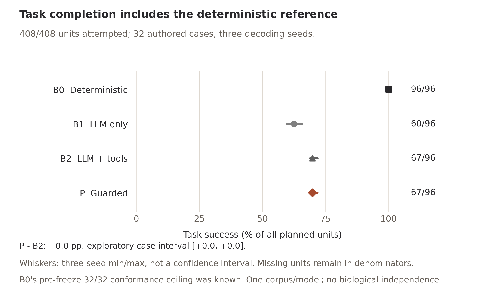
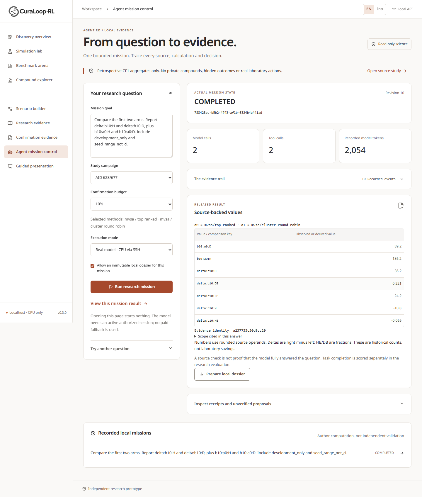
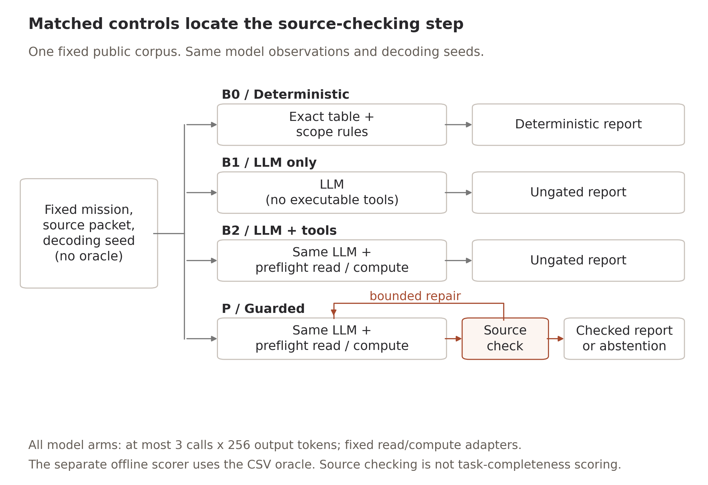

# AgentRD actual evidence

The frozen comparison is complete: **408/408 units**, including 312 real-model
missions and 436 provider responses. This folder separates that study from
engineering acceptance and development observations. None is independent
expert validation, a user study, clinical evidence or commercial clearance.
Final16/private CF1 rows/hidden outcomes remain closed.

## Final results and deliverables, 11 November 2026

| Condition | Task success | Actual model calls |
| --- | ---: | ---: |
| Deterministic B0 | 96/96 | 0 |
| LLM-only B1 | 60/96 | 118 |
| LLM + tools B2 | 67/96 | 144 |
| Guarded agent P | 67/96 | 144 |
| A-NOREPAIR, eight anchors only | 24/24 | 30 |

Primary P minus B2: **0.00 percentage points**, conditional exploratory interval
**[0.00, 0.00]**. All 96 paired output sequences matched. The observed invalid
terminal-proposal count was 0/78 for each of B2/P, so the gate's numerical/source
repair branch was not naturally exercised. No external-population equivalence
or general gate benefit follows. P also failed 13/78 source-check-valid tasks.

- [Full owner report](../../08_agent_rd/FINAL_OWNER_REPORT_20261111.md),
  [acceptance matrix](../../08_agent_rd/DELIVERY_ACCEPTANCE_MATRIX_V1.md),
  [reproduction instructions](../../08_agent_rd/REPRODUCIBILITY_V1.md).
- [Final 11-page English manuscript PDF](../../07_publication/CuraLoop-AgentRD-Computational-Report-EN-v2.pdf),
  [editable manuscript](../../07_publication/CURALOOP_AGENTRD_COMPUTATIONAL_REPORT_EN_V2.md),
  [all-page author review](manuscript-visual-review-v2.json).
- [Final eight-page English operator guide](../../manual/CuraLoop-AgentRD-Guide-EN-v2.pdf),
  [all-page author review](manual-visual-review-v2.json).
- [Prespecified analysis](analysis-v1/analysis.json),
  [full 408-unit disposition](locked-progress-v1.json),
  [actual traces and frozen scores](locked-results-v1/),
  [read-only scorer/analysis replay](reproducibility-replay-v1.json).
- [Descriptive supplement](descriptive-v1/descriptive.json),
  [all planned units](descriptive-v1/all-planned-units.csv),
  [output lengths/stop reasons](descriptive-v1/provider-output-lengths.csv),
  [post-hoc mechanism audit](mechanism-audit-v1.json).
- [57 backend checks, 32 frontend checks and actual served acceptance](product-scope-checks-v1.json),
  [current product browser evidence](product-policy-browser-v1.json),
  [explicit product/research distinction](product-policy-acceptance.json).
- [Current-service actual model lifecycle](product-current-model-acceptance-v1.json)
  passed technically, but its task **failed: ABSTAINED after three actual calls**.
  [Exact failed task record](product-current-model-mission-v1.json).
- [Complete 477-file return/reread](complete-remote-return-v1.json),
  [exact owned cleanup](owned-remote-cleanup-v1.json),
  [fresh owned absence](fresh-remote-absence-v1.json),
  [exact executed worker sources](executed-runtime-source-v1/).

The final technical/account receipts are `final-audit-v1.json`,
`account-closure-v1.json` and `settled-account-identity-v1.json`; main delivery is
recorded separately after the actual push. Retained reservations are not
measured consumption. [Administrative cost limitation](interactive-control-accounting-v1.json)
discloses control CPU that was not separately metered.

[Editable completion SVG](result-figures-v2/02-task-completion.svg) ·
[Actual descriptive latency plot](result-figures-v2/03-cost-completion.png) ·
[Editable latency SVG](result-figures-v2/03-cost-completion.svg) ·
[Color/grayscale and final-insertion review](result-figures-visual-review-v2.json) ·
[Fresh-output figure reproduction](offline-figure-reproduction-v2.json).

The first manuscript/plot edition and its failed visual reviews remain intact:
[paper review v1](manuscript-visual-review-v1.json),
[figure review v1](result-figures-visual-review-v1.json),
[exact original authoring sources](first-edition-authoring-source-v1.json).
The revised edition fixes layout and label association without changing data.

## Historical development and initial product acceptance

- [Fresh release](release-admission-v1.json) preserves fourteen prior ledger
  identities and66 scientific pins without rewriting their historical status.
- [Isolated runtime admission](remote-runtime-admission-v1.json): existing
  Typhoon12B, CPU-only, no model download/paid API/shared-service change.
- [Tiny format admission](real-model-format-admission-v1.json) is a technical
  diagnostic, not a pharmaceutical task result.
- [Canary1](development-real-mission-v1.json) and
  [canary2](development-real-mission-v2.json) did not complete their task.
  [Canary3](development-real-mission-v3.json) completed one real model call.
  Their two pre-freeze interface revisions and all costs remain recorded.
- [Six real development probes](development-coverage-v1.json): five task
  passes, one refusal-task failure. Source-correct permitted numbers were
  returned instead of refusing a final16 request; no final16 data was accessed.
- [46 backend/oracle/source checks](component-checks-v4.json) and
  [30 frontend checks plus type/lint/build](frontend-checks-v3.json) passed.
  Earlier failed checks remain beside their corrected versions.
- [Actual browser -> API -> real model -> dossier](browser-acceptance-v1.json)
  passed the authored comparison question, source hashes, explicit export,
  actual API restart, EN/TH and mobile checks. Two actual model calls,
  2,054 recorded tokens; this is one development acceptance example.
- [UI refinement](browser-refinement-v2.json) reused that exact saved real
  mission with **zero new inference**. It tested collapsed event disclosure,
  restored mission filters, a mobile result jump and bilingual event labels.

[Result detail](screens-v2/03-agent-result-detail-en.png) ·
[Thai interface](screens-v2/04-agent-recorded-result-th.png) ·
[Thai recorded events](screens-v2/05-agent-translated-trail-th.png) ·
[Mobile result](screens-v2/06-agent-mobile-result-th.png)

[Seven-page English guide](../../manual/CuraLoop-AgentRD-Guide-EN-v1.pdf) ·
[Rendered-page self-review](manual-visual-review-v1.json) ·
[Exact original real mission](example-mission-v1.json) ·
[Actual EN dossier](example-dossier-v1/report-en.html) ·
[Actual TH dossier](example-dossier-v1/report-th.html)

## Locked study

[Protocol/source freeze](protocol-freeze-v1.json) precedes locked model calls.
It pins the authored cards, separate CSV oracle/scorer, schedule, engine/prompts,
analysis and model runtime.32 cases, three decoding seeds, B0/B1/B2/P and eight
fixed no-repair anchors produce408 planned units, including312 real-model
missions. These are exposed-data authored cases, not biological held-out tasks.
Pre-freeze B0 conformance already passed all32; that known ceiling is disclosed.

[CPU feasibility](cpu-feasibility-v1.json) is a development-based heuristic,
not a completion guarantee. The same hard CPU/deadline limits and every planned
unit disposition apply. A process PASS is not a scientific or task PASS.
The final disposition/analysis above records all actual units. No favorable
subset, seed, replacement trial or unrun model effect was selected.

[Full protocol](../../08_agent_rd/COMPUTATIONAL_PROTOCOL_V1.md) ·
[Execution history and closeout](../../08_agent_rd/ACTIVE_EXECUTION_20261110.md) ·
[Source/reuse](../../08_agent_rd/A0_SOURCE_AND_REUSE_20261110.md) ·
[Targeted related work](../../08_agent_rd/A0_CLOSEST_WORK_20261110.md)

## Source-derived control diagram

[Editable SVG](figures-v2/01-control-flow.svg) ·
[Color/grayscale author review](control-flow-visual-review-v2.json) ·
[Visual specification](visual-spec-v1.json)

This is a diagram of the frozen implementation, not an experimental result.
The first layout is retained in `figures-v1`; the revised layout separates the
repair label from the neighboring node. Diagram/guide dependencies are isolated
from the model/evaluator environment. Quantitative figures above use the actual
completed matrix. Offline deterministic missions and explicit recorded-example
replay remain available after research-worker cleanup; live inference requires
fresh owner authorization and transport setup.
