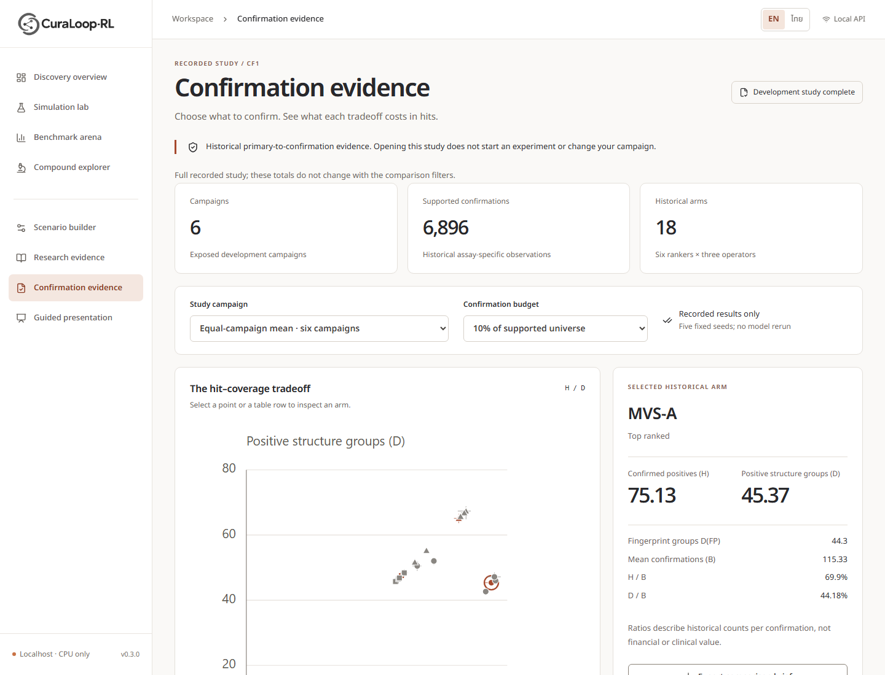
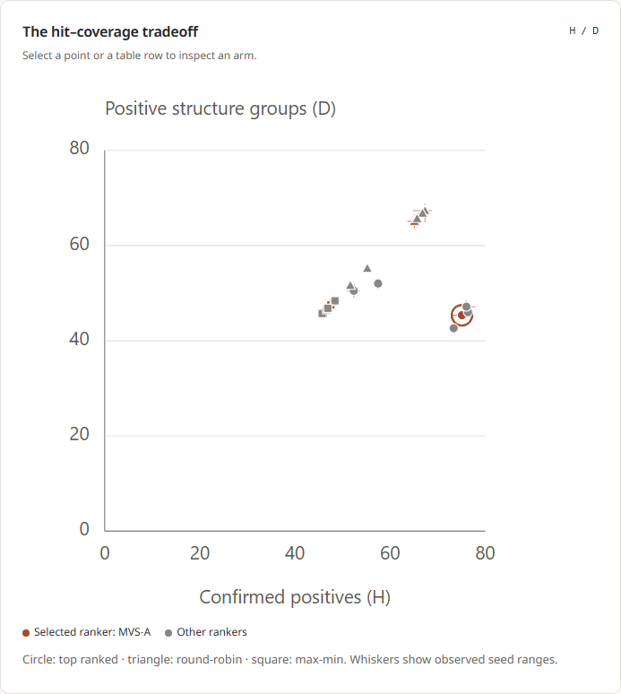

# LR-CF2P evidence

Actual execution, 10 November 2026. Research: **NO_GO_THIS_MECHANISM** after two
bounded formulations and 12 constructed cases. Product: **PASS_INTERNAL_INTEGRATION**.
These are separate conclusions. No new molecular fit or private/final outcome
access occurred. [Owner checkpoint](../../06_execution/LR_CF2P_OWNER_CHECKPOINT_20261110.md).

## Current acceptance records

| Evidence | What it establishes |
| --- | --- |
| [Admission](admission-v1.json) and [release](../../../research/manifests/lr_cf2p_release_20261110_v1.json) | Fresh authority/input identities; 13 old accounts and 66 merged scientific pins |
| [Constructed cases v2](constructed-falsification-v2.json) | Twelve exact probability/coverage counterexamples; constructed evidence only |
| [Closest-work review](../../02_literature/CF2_CLOSEST_WORK_20261110.md) and [reading receipt](reading-receipt-v1.json) | Source locations, inspected depth and access limits; not author algorithm reproductions |
| [Build v5](frontend-build-v5.json) | Lint/typecheck/production build of final frontend |
| [Browser v5](browser-check-v5.json) | 70 actual EN/TH views; 18 arms and five displayed metrics match API, direct study/no mutation, explicit scenario route, download, failure/retry, pending preservation, mobile/keyboard checks |
| [Native C v2](native-c-workspace-v2.json) | Actual local stdio initialize/list/inspect/export and invalid-argument transport |
| [Verification summary](verification-v1.json) | Final 22 Python/API tests, 26 frontend tests and scoped Ruff results, linked to their executed source/resource identities |
| [Visual review](visual-review-v1.json) | Parent self-review of final chart/mobile/grayscale and all six rendered PDF pages; title overflow repaired, no independent reviewer claimed |
| [Fresh remote absence](remote-absence-v1.json) | Read-only check; no remote CF2P task/upload/return/deletion was needed |
| [Closure audit](closure-audit-v1.json) and [budget](budget-closeout-v1.json) | Preservation, complete receipts, local owned process exit, unchanged inputs and closed accounting |

Earlier versions and failures remain as diagnostic history. Browser v1 rejected
the random preview port under the existing origin policy; that policy was not
weakened. Browser v3 detected Thai chart-label overflow; v4 repaired it. Final
v5 also checks explicit Scenario builder access after a campaign-free visit.
The first PDF rendering had one clipped heading; generation v2 repairs it.
`manual-generation-v1.json` records that superseded first attempt and its hash.
Current output is [manual generation v2](manual-generation-v2.json) plus final
visual review, not the earlier pending status.

## Actual screen gallery

Final served-build captures below are v5. The English PDF uses the v4 captures
of the same Confirmation component; its content/layout source is unchanged.
The v5 build additionally fixes navigation to the explicit Scenario builder
when no campaign exists. Both versions' evidence is retained.

[All arms](screens-v5/04-all-arms-en.png) ·
[Thai desktop](screens-v5/05-confirmation-desktop-th.png) ·
[Thai mobile](screens-v5/06-confirmation-mobile-th.png) ·
[Thai mobile chart](screens-v5/06b-tradeoff-mobile-th.png) ·
[Actual SVG](tradeoff-ui-default-v5.svg) ·
[Controlled unavailable-state test](screens-v5/07-unavailable-state-en.png) ·
[Overview entry](screens-v5/08-overview-cf1-entry-en.png) ·
[C Workspace English](screens-v5/09-c-workspace-en.png) ·
[C Workspace Thai](screens-v5/09-c-workspace-th.png).

The unavailable capture is an injected HTTP503 acceptance case, not a reported
production outage. Overview uses a disposable synthetic pending campaign for
this privacy check, not a new HIV or CF1 molecular study. C Workspace captures
show actual locally exported files. No live team destination was configured.

## Reproduce the bounded engineering checks

Use the installed development/web environment with `PYTHONPATH=src;.` on Windows.
`tests/test_confirmation_study.py` exercises all 2,700 cells/35 numerical views,
strict source validation, privacy, API and immutable exports. The six targeted
existing API regressions are listed in `verification-v1.json`. Frontend:
`npm --prefix frontend test -- --maxWorkers=1` and the existing build scripts.
Native tools and operator steps are in the [integration guide](../../05_product/CF1_INTEGRATION_GUIDE_20261110.md).

Execution helpers under `tools/cf2p_*` are records for this **closed** budget and
task namespace. Do not rerun their admission/booking commands or overwrite their
receipts; a new run needs a fresh owner-approved namespace and account. Private
job logs, reading PDFs and disposable SQLite stores remain under `.local`.

[English PDF addendum](../../manual/CuraLoop-RL-Confirmation-Evidence-Guide-EN-v4.pdf) ·
[Research decision](../../03_research/CF2_DESIGN_DECISION_20261110.md) ·
[Updated full phase report](../../06_execution/PROJECT_PHASE_STATUS_20261110.md).
