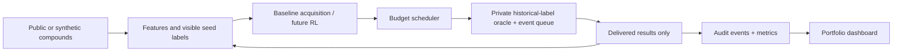

# CuraLoop-RL | Pharmaceutical Screening Decision Lab

> **Independent personal portfolio | Research & demonstration only | Not an official GPO project**

A product-first, research-backed plan to create a reproducible interactive workbench for **budget-aware compound screening** using a **retrospective virtual laboratory simulator**, standard active-learning strategies and a future adaptive RL meta-policy. The long-term architecture is **digital-twin-ready**; no real laboratory integration or operational Digital Twin is claimed.

## What does the user experience?

1. Choose a **SYNTHETIC_ONLY** demo library (default) or an appropriately licensed historical assay dataset (future).
2. Set budget, assay batch size, result delay, seed and policy.
3. Run a selection campaign. Each policy sees only previous **delivered** labels; hidden labels are revealed through the simulator at due time.
4. Compare confirmed hits, budget consumed, simulated elapsed time and molecular diversity under matched conditions.
5. Export a source-labelled run manifest and event-level audit trail.

## Portfolio value proposition

For a non-ML pharmaceutical audience: *"If we can assay only a small subset of candidate compounds, which ones should we select and how should we adapt as results arrive?"* The app demonstrates this **decision-making process**. It does **not** assert discovery of a drug, biological efficacy beyond the source assay or financial savings in real production.

## Current handoff status

| Component | Evidence-backed status |
|---|---|
| Product vision, user story, architecture, QA specification | DOCUMENTED IN THIS ZIP |
| Working Streamlit dashboard / repo | **TO BE CREATED by GPT Work** |
| Real RL training or benchmark result | **NOT RUN** |
| Live, connected, validated Digital Twin | **NOT AVAILABLE** |
| Original publisher/article PDF files | **NOT INCLUDED** |
| 25-paper bibliography | CATALOGUED, subset independently checked, remaining unverified |
| Internal organizational data or authorization | NOT PROVIDED / MUST NOT BE ASSUMED |

## Architecture

**Strict rule:** policies never access the private truth store. An initial labelled seed set is selected by a reproducible procedure and its assay-budget treatment is documented and equal across policies.

## Recommended build stack (CPU/Windows)

Python 3.11, `pytest`, `numpy`, `pandas`, `scikit-learn`, `Streamlit`. RDKit is recommended for real chemistry datasets; pure-synthetic first milestone may use a documented 2D numerical fixture to avoid RDKit installation blockers. SQLite or JSONL for local event audit. No API key or GPU needed. Gymnasium / Stable-Baselines3 are optional, later milestones.

## Next actions

Read `START_HERE.md` and run the GPT Work master prompt with this ZIP. For the detailed definition of done, see `PLAN.md`, `audit/AUDIT_REPORT.md`, `docs/PRODUCT_REQUIREMENTS.md`, and `docs/ACCEPTANCE_TEST_MATRIX.md`.

## Related work, credit and data rights

The combination of RL and screening is not itself novel. Compare GLARE (NeurIPS 2025), SimDMTA (JCIM 2026), and cost-aware multifidelity Bayesian optimization (ACS Central Science 2025) before making research novelty claims. Bibliography and source links: `papers/PRIORITIZED_READING_WITH_VERIFICATION.md`. Papers and datasets retain third-party rights even when source code is MIT-licensed. Never put unreviewed paper PDFs or raw datasets in a public Git repo.
