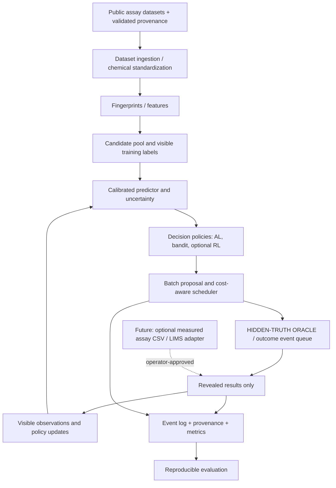

# Architecture: from replay simulator to a defensible digital twin

## Correct terminology

A **digital model** is a computational representation without live physical updates. A **retrospective replay simulator** reveals historical assay labels when queried and can test decisions, but is not synchronized with a running laboratory. A **digital shadow** accepts real updates into the model but does not close a real decision/experiment feedback loop. An actual **decision-support digital twin of a screening workflow** requires: a specified real workflow counterpart, timely data assimilation, predictive capacity, evaluation of model fidelity and uncertainty, recommendations that feed real decisions, and new observations closing the loop. These are maturity levels, not marketing synonyms.

National Academies definition: https://www.ncbi.nlm.nih.gov/books/NBK605502/
Drug-development twin requirements: https://pmc.ncbi.nlm.nih.gov/articles/PMC9351294/

## Architectural context

## Hard boundary: policy cannot read hidden labels

- `TruthStore`: in a separate module/process or private enclosure, retains full labeled benchmark records. Not passed as a pandas dataframe to agent code.
- `Oracle.query(compound_ids, assay_type, request_time)`: validates unqueried candidate IDs; reserves cost; creates immutable event IDs; schedules outcomes; cannot return truth before due time.
- `Environment.observe()`: only gives available candidate descriptors, published labels already revealed, budget/time, eligible actions, and pending status.
- `Environment.step(action)`: validates action shape; creates requests; advances clock or completes a batch; emits newly available result events.
- `Policy.choose(observation)`: consumes only exported observations; no file-system access to truth; enforce via process or dependency inversion in tests.
- `EventStore`: append-only records of proposal, accepted/rejected action, reserved cost, queued status, delivered result, policy/model versions and snapshot identifiers.

A strict module split is not sufficient if the agent has arbitrary file access; for honest audit, test the policy with a restricted interface or isolated process in the benchmark runner.

## Minimum data objects

- `Candidate`: `compound_id`, `canonical_smiles`, `fingerprint`, `scaffold_id`, `source_dataset`, `source_record_id`.
- `AssayTruth` (oracle only): `compound_id`, `assay_id`, `label`, `label_type`, `provenance`, `observed_at` when available.
- `ExperimentRequest`: `request_id`, `batch_id`, `compound_id`, `assay_id`, `scheduled_at`, `due_at`, `cost_units`, `simulation_scenario_id`.
- `ExperimentResult`: `request_id`, `delivered_at`, `observed_value`, `is_synthetic`, `source_type`, `quality_flags`.
- `PolicyObservation`: `available_ids`, `known_records`, `pending_ids`, `remaining_budget`, `current_step`, `predictor_summary`, `scenario_public_params`.
- `PolicyAction`: `strategy`, `batch_size`, `selected_compound_ids`, `stop`.
- `Event`: immutable, versioned ledger item with `schema_version`, `event_id`, `run_id`, `timestamp`, `type`, and payload.
- `RunManifest`: git SHA, dataset release/hash, data-use terms, preprocessing config, split seed, initial seed IDs, model and policy versions, cost scenario, environment ID.

## Example agents

1. `RandomPolicy` - selection without informative scores.
2. `GreedyPolicy` - maximize calibrated predicted active probability.
3. `UncertaintyPolicy` - choose most uncertain probabilities, with tie-break rules.
4. `DiversityPolicy` - max-min distance / diversity selection by molecular fingerprints.
5. `CostAwarePolicy` - chosen supported acquisition function per simulated cost unit.
6. `BanditMetaPolicy` - selects or mixes allowed strategy recommendations based on environment state.
7. `RLMetaPolicy` - optional policy trained with sequential returns and permitted target/task partition.

## Twin fidelity architecture: staged

**Stage A / M1:** replay oracle, deterministic cost/delay/noise simulator. `replay_simulator` only.

**Stage B / M4:** replay simulator with checked calibration of delay/noise against *real provenance-bearing data where available*; otherwise label assumptions `synthetic_scenarios`.

**Stage C / M6:** `assay_feedback_adapter` accepts real partner assay files after schema validation, access and consent check, and operator authorization; model updates and audit snapshots. This may justify `digital shadow`.

**Stage D / future:** documented partner workflow, feedback-based real decisions, monitored prediction calibration, uncertainty reporting and prospective validation. Only then evaluate the term `digital twin`.

## Technologies

Python 3.11+, pytest, pydantic or dataclasses, RDKit, numpy/pandas, scikit-learn, scipy, matplotlib, CLI via Typer or argparse. Gymnasium and stable-baselines3 optional after M2. Parquet optional for cached features. SQLite for local event logs; no database service required. A lightweight FastAPI UI only after stable core metrics and tests.

## Security and science boundaries

Do not automatically execute real-world experiments, synthesize compounds or propose patient treatment. Hold the simulated experiment history separate from any future real assay records. Redact secrets, use local paths and explicit authorizations for uploads and connected systems. The sim-to-real gap must be measured, not asserted away.

## Portfolio UI layer (added in Personal Portfolio Edition)

The simulator stays as the single testable Python core. A thin Streamlit UI (`app/streamlit_app.py`) calls a public `RunService` and renders only `PolicyObservation`, delivered `ExperimentResult`, `EventStore` and derived metrics. The UI must **never import private `TruthStore`** or display unrevealed labels. `app` components implement four views: Overview, Scenario, Screening Run, Compare & Export. For a GPO-audience demonstration, every plotted value states its synthetic/historical source. Prefer local/offline use and do not add organization-specific SSO, LIMS access or deployment.
