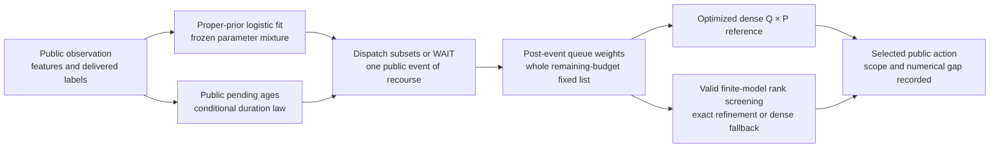

# Conditional event-time search: constructed prototype

**Implemented and tested on constructed cases. Real-data Goal4 NOT_RUN.**
This module is separate from the application UI/CLI and its historical policies.
It does not train an RL controller or establish novel theory, calibration,
molecular discovery benefit or journal readiness.



| Module | Responsibility |
| --- | --- |
| [belief.py](belief.py) | Public feature anchors; delivered-label-only Laplace logistic finite mixtures; nested M32/64/128draws and explicit prior fallback |
| [queue.py](queue.py) | Exact finite-support survival-conditioned event patterns and list-position completion probabilities |
| [mixture.py](mixture.py) | Joint virtual labels, normalized parameter weights, finite-model TV/chi-square intervals and optimized deterministic partial ranking |
| [recourse.py](recourse.py) | Direct accepted reward once, post-event continuation, partial dispatch/WAIT, shortlist-relative action values and proxy labels |
| [controls.py](controls.py) | Completion-first CPE adaptation and full-horizon MC16greedy rollout with retained samples/MC uncertainty |
| [policy.py](policy.py) | Public-Observation adapter for14research arms, owned acceptance history, common feasibility and no private Task/due/hash/file input |

The [method contract](../../docs/03_research/METHOD_REDESIGN_PLAN_A_V1.md)
defines assumptions, prior/optimizer/numerics, comparators and limitations.
The [tested source/environment identities](../../docs/evidence/plan-a-20261105-v1/constructed-all-v1-identity.json)
and [119-test output](../../docs/evidence/plan-a-20261105-v1/constructed-all-v1-tests.txt)
identify the executed checkpoint. The
[dependency snapshot](../requirements_plan_a_constructed_v1.txt) records the
existing environment; a fresh installation or Linux numeric run was not tested.

Constructed checks can be run from the repository root with the existing test
environment, for example:

```powershell
rtk proxy .venv/Scripts/python.exe -m pytest tests/research/test_queue_v3.py tests/research/test_mixture_v3.py tests/research/test_recourse_v3.py tests/research/test_recourse_oracle_v3.py tests/research/test_belief_v3.py tests/research/test_controls_v3.py tests/research/test_public_policy_v3.py -q
```

The versioned evidence runner adds one-CPU/memory/time guards and source hashes
within the original authorized PlanA window:

```powershell
rtk proxy .venv/Scripts/python.exe -m tools.run_plan_a_constructed_checks_v1 --attempt v2
```

Each attempt must use a new number. It does not ingest real assays. Do not edit
frozen evidence or extend the expired window without a new bounded contract.
Run one campaign at a time per worker when comparing computation; count
`setup_seconds` once plus all decision `policy_seconds`. Initialize a session
from the engine's initial public Observation, submit its returned proposal,
and record acceptance only after a successful engine submit. The private
evaluator/source-role gate and real-study runner remain later work.

The first actual feature cohort failed4/2/12quotas at2/2/7groups. The
[owner revision decision](../../docs/06_execution/GOAL3_COHORT_REVISION_OPTIONS_20261105.md)
is pending. Final labels and real-data experiment execution are outside this
constructed demonstration.
